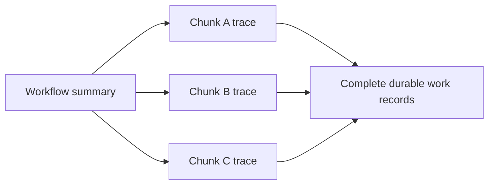

# How to Redesign Huge Traces Without Dropping Required Work Records

Author: [nawazdhandala](https://www.github.com/nawazdhandala)

Tags: OpenTelemetry, Performance

Description: Split giant workflows into meaningful linked traces while retaining complete business records and bounded diagnostic detail.

A trace with tens of thousands of spans can overwhelm a browser even when the backend stores it successfully. Sampling the trace does not solve the shape problem: keeping the selected trace still requires rendering its enormous graph. If every unit of work must remain recorded, separate the business record from the diagnostic trace representation.

Start by asking what each span explains. A span around a meaningful remote call or phase can be useful. A span for every row in a million-row import may be a poor navigation structure even if no data is discarded.

## Measure trace shape before changing it

Export a simplified span list with `name` and `parent_id` fields. Count operations to identify the repeated pattern responsible for graph size.

```python
import json
from collections import Counter
from pathlib import Path
spans = json.loads(Path("spans.json").read_text())
counts = Counter(s["name"] for s in spans)
for name, count in counts.most_common(10):
    print(count, name)
print("total spans:", len(spans))
```

Also measure serialized bytes, event counts, maximum nesting depth, and attributes per span. A trace with modest span count can still be huge because every span repeats an input document or stack trace.



## Introduce bounded execution units

For an import, use one trace per chunk with a stable workflow ID and chunk index. Each chunk can retain all of its meaningful spans, while the workflow summary records totals and links to related traces. Choose a chunk boundary that already exists operationally, such as a transaction, checkpoint, or queue message.

The Java API can create a new root linked to the orchestration span:

```java
Span chunk = tracer.spanBuilder("import.chunk")
    .setNoParent()
    .addLink(workflowContext)
    .setAttribute("app.workflow.id", workflowId)
    .setAttribute("app.chunk.index", chunkIndex)
    .startSpan();
try (Scope scope = chunk.makeCurrent()) {
    processChunk();
} finally {
    chunk.end();
}
```

This is an application fragment requiring a configured tracer, a `SpanContext`, and your chunk operation. Starting a new root intentionally changes trace identity. Do not expect every backend to render links as a single parent-child waterfall; verify its navigation and search support.

## Preserve completeness in the right store

If every item needs an auditable outcome, write a durable item-result record. This illustrative schema retains the correlation needed to move from the record to its chunk trace.

```json
{
  "workflow_id": "import-42",
  "chunk_index": 7,
  "item_id": "item-391",
  "outcome": "committed",
  "trace_id": "4bf92f3577b34da6a3ce929d0e0e4736",
  "attempt": 1
}
```

Traces can still contain aggregate counts, duration, retry reason, and selected diagnostic events for that chunk. If individual spans are contractually required, keep them all but partition them into bounded traces instead of pretending a single giant trace is the only complete representation.

## Validate accounting and usability together

Compare item totals before and after the redesign. The sum of committed, rejected, and retried outcomes should reconcile with the workflow's input and attempt model. Ensure the same item is not counted twice when retries create a new chunk trace.

Then measure backend retrieval size and browser rendering time on a representative large workflow. Record actual results from your environment; there is no universal safe span-count threshold across UIs and browsers.

Avoid replacing all spans with events without measuring the result. Large event arrays still increase payload size and may have their own SDK limits. Also inspect span, event, attribute, and link limits so the SDK does not silently truncate required diagnostic fields.

The goal is a navigable hierarchy with explicit correlation and complete work accounting. Preserve the granularity users need, but make each trace correspond to a bounded operation that a human can inspect during an incident.

## References

The [community question](https://www.reddit.com/r/OpenTelemetry/comments/1qiv29z/grafana_ui_jaeger_becomes_unresponsive_with_huge/) motivated this investigation. The implementation references are [official reference 1](https://opentelemetry.io/docs/languages/java/api/), [official reference 2](https://opentelemetry.io/docs/concepts/signals/traces/).
