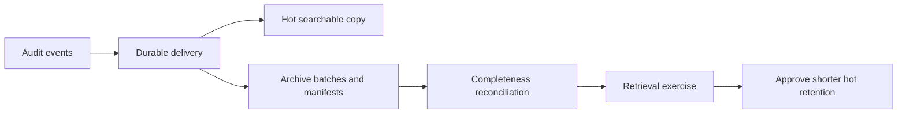

# How to Reduce Observability Spend While Preserving Audit Logs

Author: [nawazdhandala](https://www.github.com/nawazdhandala)

Tags: Observability, AWS, Python

Description: Separate searchable operational logs from durable audit evidence, verify archive completeness, and test retrieval before reducing hot retention.

Reducing searchable log retention is much safer when audit evidence has an independently verified archive. The design starts with two different needs: fast incident searches and complete historical records. They can share an ingestion source, but their retention, access, and recovery requirements should be explicit.

The examples use Python 3 and an illustrative object-storage archive. They do not prescribe a legal retention period. Your organization's approved policy determines which records must be retained, for how long, and who may retrieve them. The technical task is to make that policy testable without keeping every debug message in the most expensive search tier.

## Define which records are audit evidence

Use a dedicated event type or source with a stable schema. Do not infer audit status from log severity: a successful permission change may be informational and still be important evidence. Preserve event time, action, actor reference, object reference, result, and a unique event ID. Apply the organization's data-minimization rules before the event leaves the application.

```json
{"event_id":"evt-1042","event_time":"2026-11-15T10:00:00Z","event_type":"permission_change","actor_ref":"staff-17","object_ref":"project-42","result":"allowed"}
```

Keep credentials, tokens, and unnecessary payloads out of both hot and archive paths. Encryption and restricted access matter, but they do not compensate for collecting avoidable secrets. Make schema changes explicit so historical records remain readable after the application changes.

## Archive with evidence of completeness

Create bounded batches and a manifest containing event count, time range, schema version, object key, and content checksum. A checksum detects changed bytes; it does not prove that every expected event arrived. Compare source or delivery counts with archived counts separately and investigate gaps before deleting the hot copy.

```python
import hashlib, json
records = [{"event_id":"evt-1042"}, {"event_id":"evt-1043"}]
payload = b"".join((json.dumps(r,sort_keys=True)+"\n").encode() for r in records)
manifest = {"object_key":"audit/2026/11/15/batch-1.jsonl",
            "count":len(records), "sha256":hashlib.sha256(payload).hexdigest()}
assert manifest["count"] == 2
assert hashlib.sha256(payload).hexdigest() == manifest["sha256"]
print(json.dumps(manifest, indent=2))
```

In production, store manifests durably and protect their provenance. An attacker able to replace both data and its checksum defeats a plain integrity check. Object versioning and retention controls can strengthen the design, but configuration and access policy determine the actual protection.



## Make storage policy reviewable

The following is an internal policy record, not an AWS API request. Keeping it separate from provider configuration avoids implying that a single lifecycle switch implements the whole requirement.

```yaml
# Internal policy example; adapt to your approved requirements.
record_class: audit
hot_search_days: 30
archive_days: 365
archive_owner: security-platform
retrieval_target_hours: 8
integrity_check: sha256-manifest
completeness_check: source-count-reconciliation
```

If using S3 Object Lock, understand version-specific retention and the difference between governance and compliance modes before enabling them. These settings can constrain future deletion. Lifecycle transitions also have size, duration, request, and retrieval considerations. Verify the exact storage class and account settings instead of assuming that every archived object can be fetched immediately.

## Test the retrieval path before claiming savings

Choose an old batch, locate it using only the documented lookup fields, retrieve it with the intended access role, verify the checksum, and answer a sample audit question. Record elapsed time and missing dependencies. A backup that only its creator can find is not an operationally ready archive.

Then reduce hot retention for one low-risk source and compare the actual bill, retrieval volume, and incident workflow. Keep failures visible: delivery rejection, reconciliation mismatch, archive lag, and failed retrieval exercises should have owners. The savings calculation must include archive requests and retrieval work, not just the removed search-tier storage. This produces a durable separation between fast troubleshooting and retained evidence while preserving a tested way to answer historical questions.

## References

The [community question](https://www.reddit.com/r/devops/comments/1og42rk/how_do_smaller_teams_manage_observability_costs/) motivated this walkthrough. Implementation references:

- [Official reference 1](https://docs.aws.amazon.com/AmazonS3/latest/userguide/object-lock.html)
- [Official reference 2](https://docs.aws.amazon.com/AmazonS3/latest/userguide/lifecycle-transition-general-considerations.html)
