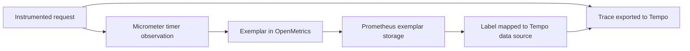

# How to Repair Spring Boot Metric-to-Trace Links with Prometheus and Tempo

Author: [nawazdhandala](https://www.github.com/nawazdhandala)

Tags: Spring Boot, Prometheus, Grafana

Description: Verify Micrometer tracing integration, histogram publication, OpenMetrics scraping, exemplar storage, and the Tempo link configuration.

A Spring Boot application can export traces to Tempo and metrics to Prometheus while still producing no clickable exemplar links. The connection is created when a metric observation captures the active trace context. It is not inferred later by matching timestamps or service names.

Start by identifying the Prometheus client generation. Micrometer supports the current Prometheus Java client through `micrometer-registry-prometheus` and the legacy client through `micrometer-registry-prometheus-simpleclient`. Their exemplar integration APIs differ. Use Spring Boot's dependency management rather than mixing arbitrary Micrometer and client versions.

## Confirm the application has the required bridge

The application needs Actuator, a Prometheus registry, and a supported Micrometer Tracing bridge with trace export. In a Boot application, let the framework configure the registry and tracing integration. Manually constructing a second registry can bypass the exemplar context wiring used by Actuator.

Inspect the dependency tree for competing client generations:

```bash
./mvnw dependency:tree \
  -Dincludes=io.micrometer:*,io.prometheus:*,io.opentelemetry:*
```

Check the versions and the registry actually serving `/actuator/prometheus`. A successful dependency resolution does not prove the correct registry instance is used at runtime.

## Publish a histogram and expose the endpoint

A minimal properties fragment for a controlled staging test is:

```properties
management.endpoints.web.exposure.include=health,prometheus
management.metrics.distribution.percentiles-histogram.http.server.requests=true
management.tracing.sampling.probability=1.0
```

The full sampling setting is for a brief, low-volume diagnostic test. Restore the production policy after verifying correlation. Secure the management endpoint according to your deployment; exposure does not require making it public.

Send real requests through an instrumented endpoint, then inspect OpenMetrics output:

```bash
curl --fail --silent \
  -H 'Accept: application/openmetrics-text; version=1.0.0' \
  http://localhost:8080/actuator/prometheus > actuator.openmetrics
rg 'http_server_requests|trace_id|span_id' actuator.openmetrics
```

Metric names can vary with instrumentation conventions and registry versions, so inspect the endpoint before hard-coding a dashboard query. Exemplars are sparse; generate several observations and check promptly rather than expecting one on every bucket.



## Check Prometheus before Grafana

Query the exemplar API around the test request:

```bash
curl --fail --silent --get http://localhost:9090/api/v1/query_exemplars \
  --data-urlencode 'query=http_server_requests_seconds_bucket' \
  --data-urlencode 'start=2026-11-15T12:00:00Z' \
  --data-urlencode 'end=2026-11-15T12:05:00Z'
```

If exemplars appear at Actuator but not in Prometheus, inspect scrape protocol negotiation and the deployed server's exemplar-storage configuration. If they are already absent at Actuator, inspect the tracing bridge, registry customization, and whether the measurement happened with active sampled context.

## Configure the final trace lookup

In Grafana's Prometheus data source, map the exemplar label actually returned by the API to the Tempo data source. A mismatch between `trace_id` and a differently named label can leave a perfectly stored exemplar without a usable link.

Open the referenced trace ID directly in Tempo. If it is missing, inspect trace export, tail sampling, tenant headers, and retention. An SDK sampled flag does not guarantee Tempo retained the trace. Preferential tail sampling can remove a trace even though an exemplar captured its ID earlier.

Finally, test a custom timer recorded outside a request and one recorded inside a span. The difference demonstrates whether context capture is functioning. Keep metric labels bounded; adding a trace ID as a normal metric tag is not an exemplar substitute and creates a new time series per trace.

## References

The [community question](https://stackoverflow.com/questions/79607523/micrometer-registry-prometheus-not-showing-exemplars) motivated this investigation. The implementation references are [official reference 1](https://docs.micrometer.io/micrometer/reference/implementations/prometheus.html), [official reference 2](https://docs.spring.io/spring-boot/reference/actuator/metrics.html), [official reference 3](https://prometheus.io/docs/prometheus/latest/querying/api/).
