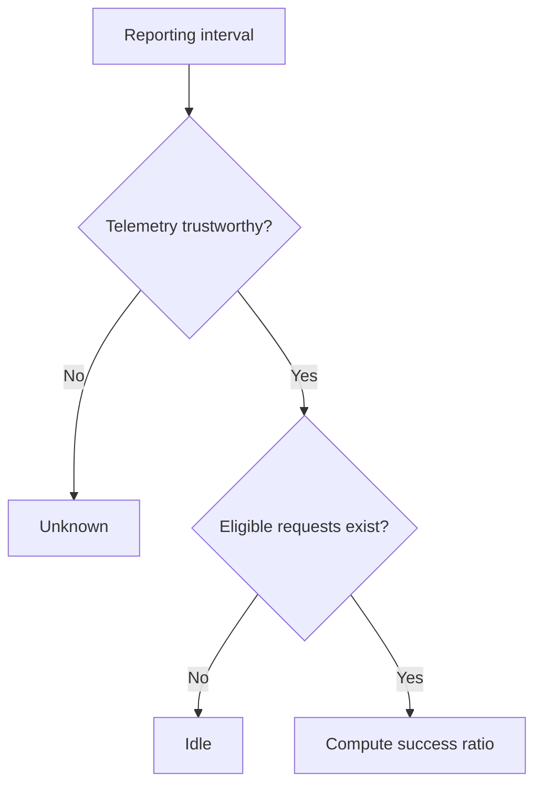

# How to Represent No Traffic in an SLO Without Calling It an Outage

Author: [nawazdhandala](https://www.github.com/nawazdhandala)

Tags: SLO, Prometheus, Monitoring

Description: Model healthy, failing, idle, and unknown states separately so zero-request periods do not distort request-based SLOs or conceal telemetry loss.

A request-based SLO has no observed success ratio when no eligible requests occur. That state is neither a failed request nor proof that the service would succeed if called. Preserve it as no traffic, and distinguish it from missing telemetry. This keeps a quiet endpoint from generating false outages while preventing monitoring failures from looking healthy.

The examples use custom application counters with Prometheus 3.x and a Python 3 classification fixture. The policy excludes idle periods from request-based accounting because there are no events to count. A time-based availability SLO or synthetic-probe SLO can legitimately use a different denominator, but it must say so explicitly.

## Define four states

Use healthy and failing only when eligible observations exist. Use idle when telemetry is available but the request count is zero. Use unknown when required telemetry is missing or stale. These states should be visible in the dashboard legend and in exported reports.

```python
def classify(total,failed,telemetry_present):
    if not telemetry_present:
        return "unknown"
    if total == 0:
        return "idle"
    return "healthy" if failed == 0 else "failing"
assert classify(0,0,True) == "idle"
assert classify(0,0,False) == "unknown"
assert classify(10,1,True) == "failing"
print([classify(*x) for x in [(0,0,True),(0,0,False),(10,0,True),(10,1,True)]])
```

This is a reporting state model, not a production availability detector. A successful scrape alone cannot prove application instrumentation is correct. Use additional freshness checks if the exporter can keep serving old values or if metrics are collected through a delayed pipeline.

## Calculate the ratio only for positive traffic

The following query filters out services with no eligible requests during the interval. It does not invent a 100% value for them. The custom failed counter must count a subset of the same eligible population.

```promql
(
  1 - sum by (service) (increase(service_failed_requests_total[1h]))
      / sum by (service) (increase(service_eligible_requests_total[1h]))
)
and on (service)
(sum by (service) (increase(service_eligible_requests_total[1h])) > 0)
```

Do not divide by `clamp_min(total, 1)` merely to remove a display error. That changes the mathematical definition and can hide a small denominator. Likewise, a global `or vector(0)` may erase service labels and misrepresent missing data as a real observation.



## Monitor the monitoring path separately

Detect a complete loss of expected samples with an absence rule. The example operates at job level; it cannot identify an individual target removed from discovery without an expected-target inventory.

```promql
absent_over_time(up{job="checkout"}[10m])
```

Also alert on failed scrapes where the target still exists. A request counter that disappears while `up` remains one needs its own metric-presence check. Separate these notifications from user-impact alerts so the responder understands whether the service is failing or its state cannot be established.

## Choose what availability means during idle periods

If the product promises that an endpoint is usable at any time, add a synthetic journey and define a separate probe-based objective. The synthetic traffic is evidence about the tested path, location, credentials, and frequency. It is not a substitute for the real-user request SLI, and its events should not silently inflate the real-user denominator.

For scheduled services, document active hours and expected batch windows. For low-volume endpoints, show request counts next to percentages and consider per-event review. A single failure out of two requests is meaningful but statistically different from five thousand failures out of ten thousand.

Test the dashboard with no traffic, exporter loss, target removal, and a genuine failed request. Confirm that reports preserve unknown intervals rather than dropping them without explanation. An honest SLO report tells the reader both how the observed requests behaved and where the evidence was insufficient to make a claim.

A practical dashboard can show the ratio in one panel and a small state table beside it. Include service, eligible count, last telemetry timestamp, and state. This prevents a graph renderer from silently connecting points across an unknown interval and implying continuous health. When exporting monthly reports, retain the same state vocabulary rather than replacing blanks with zero or one. If the audience needs a single headline number, accompany it with the measured population and unknown-coverage fraction so the simplification remains auditable.

## References

The [community question](https://www.reddit.com/r/sre/comments/109w8ru/) motivated this walkthrough. Implementation references:

- [Official reference 1](https://sre.google/workbook/implementing-slos/)
- [Official reference 2](https://prometheus.io/docs/prometheus/latest/querying/functions/)
- [Official reference 3](https://prometheus.io/docs/prometheus/latest/querying/operators/)
