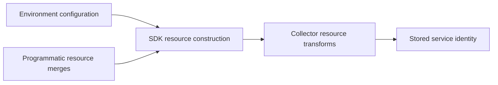

# How to Resolve Conflicting OpenTelemetry Service Name Settings

Author: [nawazdhandala](https://www.github.com/nawazdhandala)

Tags: OpenTelemetry, Observability

Description: Trace service-name precedence from SDK environment variables through programmatic resources and Collector transformations.

A service name can be assigned in several places: SDK environment variables, framework configuration, programmatic resources, resource detectors, and Collector processors. When they disagree, the name displayed by the backend depends on which value reaches the exported resource, not which configuration file looks most authoritative.

For SDKs implementing the standard environment configuration, `OTEL_SERVICE_NAME` takes precedence over `service.name` inside `OTEL_RESOURCE_ATTRIBUTES`. That rule does not imply that every language SDK automatically reads environment variables or that later programmatic merges cannot override the result.

## Remove the first ambiguity

This shell example deliberately creates a conflict:

```bash
export OTEL_SERVICE_NAME=checkout-api
export OTEL_RESOURCE_ATTRIBUTES=service.name=legacy-checkout,service.version=2026.11.15
```

Under the standard environment precedence rule, the service name is `checkout-api`. Prefer one source of truth instead:

```bash
export OTEL_SERVICE_NAME=checkout-api
export OTEL_RESOURCE_ATTRIBUTES=service.version=2026.11.15,deployment.environment.name=staging
```

Changing the environment of a deployment definition does not alter an already running process. Verify the new Pod or process started with the intended values. Avoid dumping all environment variables because exporter headers and credentials may share the same configuration surface.



## Inspect the emitted resource before the backend

Use a staging Collector with a debug exporter or an SDK console exporter for a single synthetic span. Inspect the resource section, not a span attribute that happens to have the same key.

A minimal Collector 0.120.0 diagnostic pipeline is:

```yaml
receivers:
  otlp:
    protocols:
      http:
        endpoint: 127.0.0.1:4318
exporters:
  debug:
    verbosity: detailed
service:
  pipelines:
    traces:
      receivers: [otlp]
      exporters: [debug]
```

Run this only with controlled test data because detailed debug output can expose span attributes. If the name is already wrong at this boundary, inspect the SDK's autoconfiguration path and resource merge order. If it is correct here but wrong downstream, inspect gateway transforms and backend resource mapping.

## Make precedence testable in the application

The following small Python fixture documents the environment-only rule; it is a model, not a replacement for an SDK test.

```python
resource_attributes = {"service.name": "legacy-checkout", "service.version": "1.0"}
service_name = "checkout-api"
effective = dict(resource_attributes)
if service_name:
    effective["service.name"] = service_name
assert effective["service.name"] == "checkout-api"
print(effective)
```

For the actual application, create a startup test that exports one span and asserts its resource name. Include a conflicting setting intentionally so an SDK or framework upgrade cannot silently change your assumed precedence.

## Check multiple providers and signals

Applications sometimes create a manually configured tracer provider while metrics use framework autoconfiguration. That can produce one service name for traces and another for metrics. The same issue appears when a Java agent and an application-owned SDK both initialize telemetry.

Inventory the provider owners and use one shared resource definition where the framework supports it. Confirm traces, logs, and metrics separately. A successful trace lookup does not prove the other signals use the same resource.

Finally, distinguish renaming from migration. Old telemetry remains under the old service name, dashboards may filter on it, and alert queries may need a transition period. Keep `service.name` stable across replicas and use version or instance attributes for changing process details. Appending a Pod name to solve a conflict creates a new service identity per replica and makes cross-instance analysis harder.

## References

The [community question](https://stackoverflow.com/questions/78737503/difference-between-otel-service-name-and-otel-resource-attributes-service-name-c) motivated this investigation. The implementation references are [official reference 1](https://opentelemetry.io/docs/specs/otel/configuration/sdk-environment-variables/), [official reference 2](https://opentelemetry.io/docs/languages/java/configuration/).
