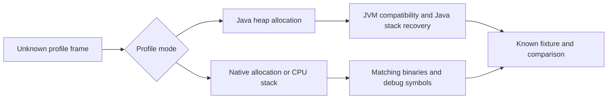

# How to Resolve Unknown Java Allocation Frames in Kubernetes Profiles

Author: [nawazdhandala](https://www.github.com/nawazdhandala)

Tags: Java, Profiling, Kubernetes

Description: Separate Java allocation classes from native frames, then verify profiler mode, JVM compatibility, symbols, and container attach access.

An unknown or `malloc`-related frame in a Java profile does not always mean the profiler lost the Java allocation site. First identify the profiling mode. Java heap allocation profiling, native allocation profiling, and CPU profiling through allocator code answer different questions and use different stack and symbol mechanisms.

Record the async-profiler version, JVM vendor and version, container image, architecture, and command used. Do not compare an old `profiler.sh` invocation with current `asprof` documentation without checking the release's supported syntax.

## Capture a known Java allocation workload

For an async-profiler release using `asprof`, take a bounded allocation profile:

```bash
asprof -e alloc -d 30 -f /tmp/allocations.html 1234
```

The PID must be visible in the namespace where the tool operates. Java allocation profiling estimates allocation pressure using its sampling mechanism; it is not a heap-retention census. The top class frame identifies allocated object type, while the stack below it explains the allocation path.

Compare with a CPU profile from the same workload phase:

```bash
asprof -e cpu -d 30 -f /tmp/cpu.html 1234
```

A native allocator stack in the CPU profile means execution sampled there. It does not, by itself, quantify retained native memory or prove that the Java allocation profiler failed.



## Verify attach and namespace boundaries

Use JVM tools from a compatible environment to inspect the target:

```bash
jcmd 1234 VM.version
jcmd 1234 VM.flags
```

The attach mechanism requires appropriate user and group identity and access to the target's attach socket. Container `/tmp` and PID namespaces can differ from the host shell. A profiler library path must be accessible to the target JVM, not just to the diagnostic container.

Inspect the profiler's diagnostic output for attach failures, unavailable events, and stack recovery limitations. Do not discard those messages while retaining only the generated HTML file; an output file can still contain a degraded profile.

## Resolve native symbols with matching artifacts

For native and JVM internal frames, preserve the exact shared libraries and debug symbols matching the running image. A package with the same major Java version but a different build can produce incorrect symbolization. Build IDs help confirm that the symbols and binary correspond.

```bash
readelf -n /path/to/libjvm.so
readelf -n /path/to/native-library.so
```

Paths are placeholders for libraries from the target image. Do not install arbitrary debug packages into production just to make a graph prettier; collect matching artifacts through the image build or diagnostic environment.

Java method names, native function symbols, source line information, and reliable stack unwinding are separate capabilities. Debug symbols can improve native names but cannot fix every unwinding failure or unsupported JVM combination.

## Test one change at a time

Create a small application path with a recognizable allocation, capture it with the same JVM and profiler image, and verify that its class and call site appear. Then add the native library or container restriction suspected in the production case.

If a frame remains unknown, quantify how much of the profile it represents and whether the surrounding stack is still useful. A small unknown tail may not affect the conclusion, while a dominant unknown region prevents attribution and should remain an explicit limitation.

Finally, distinguish allocation rate from memory growth. A hot allocation site can produce short-lived objects that are promptly collected. To investigate a leak, compare retained heap or native memory over time with suitable tools. Fixing symbol resolution makes the evidence readable; choosing the correct profiling mode makes it relevant.

## References

The [community question](https://stackoverflow.com/questions/70860682/asyncprofiler-malloc-undefined-category) motivated this investigation. The implementation references are [official reference 1](https://raw.githubusercontent.com/async-profiler/async-profiler/master/docs/ProfilingModes.md), [official reference 2](https://raw.githubusercontent.com/async-profiler/async-profiler/master/docs/Troubleshooting.md).
