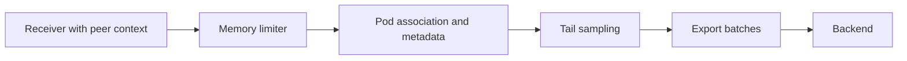

# How to Restore Kubernetes Attributes After Reordering Processors

Author: [nawazdhandala](https://www.github.com/nawazdhandala)

Tags: OpenTelemetry, Kubernetes

Description: Recover missing pod metadata by enriching before batching and sampling, then verify pod association and Kubernetes API access.

Kubernetes attributes can disappear after an apparently harmless processor reorder. The Kubernetes attributes processor may associate telemetry with a Pod using the incoming connection's IP address. Batching and tail sampling can detach records from that request context. Once the connection information is gone, moving the same enrichment rule later cannot recover it.

This guide uses Collector Contrib 0.120.0. It focuses on resource enrichment, not application span attributes. A resource represents the process or workload that produced telemetry; placing `k8s.pod.name` on one span does not repair every signal emitted by that process.

## Restore the ordering contract

Put the memory limiter first, then context-dependent enrichment, then filtering or sampling, and finally export batching. The following pipeline fragment assumes all named components are defined elsewhere.

```yaml
service:
  pipelines:
    traces:
      receivers: [otlp]
      processors: [memory_limiter, k8sattributes, tail_sampling, batch]
      exporters: [otlp/backend]
```

The limiter should remain early so pressure can be returned toward the receiver. The important ordering constraint here is that `k8sattributes` precedes components that reassemble or buffer records independently of their original connection.



Define the association rules in priority order. Prefer a stable resource identifier when it is supplied by trusted instrumentation, with connection IP as a fallback.

```yaml
processors:
  k8sattributes:
    auth_type: serviceAccount
    extract:
      metadata:
        - k8s.namespace.name
        - k8s.pod.name
        - k8s.pod.uid
        - k8s.node.name
    pod_association:
      - sources:
          - from: resource_attribute
            name: k8s.pod.uid
      - sources:
          - from: connection
```

Pod UID avoids confusion when a Pod name is reused. It must describe the source workload, not the gateway. Do not blindly copy the Collector's own environment variables into every incoming resource.

## Check what the gateway can actually know

A proxy, service mesh, or upstream Collector can make the connection peer the proxy rather than the originating Pod. Reordering cannot fix that topology. Enrich at the node agent or propagate a trustworthy source resource attribute before forwarding to the gateway.

Use the downward API in the application Pod to expose its UID, then configure the SDK to attach that value as a resource attribute. This fragment is for the application container's environment.

```yaml
env:
  - name: POD_UID
    valueFrom:
      fieldRef:
        fieldPath: metadata.uid
  - name: OTEL_RESOURCE_ATTRIBUTES
    value: k8s.pod.uid=$(POD_UID)
```

Kubernetes expands references to previously defined environment variables in this form. If an entrypoint constructs its own environment, inspect the effective value rather than assuming the manifest reached the SDK.

Check the Collector service account's access independently of record matching:

```bash
kubectl auth can-i list pods --all-namespaces \
  --as=system:serviceaccount:observability:otel-collector
kubectl auth can-i watch pods --all-namespaces \
  --as=system:serviceaccount:observability:otel-collector
```

Namespace-scoped deployments need permissions and discovery filters that agree with the workloads they serve. Additional metadata, such as deployment ownership, can require access beyond Pods.

## Verify before removing diagnostic output

Send a small fixture from one known application Pod. Inspect resource attributes immediately after enrichment using a temporary debug destination in an isolated environment. Confirm the UID, namespace, and node against Kubernetes, then check the same record at the final backend.

If the fixture is enriched but production records are not, compare their resource attributes and network paths. If neither is enriched, inspect RBAC, cache synchronization, and association rules. If enrichment exists upstream but vanishes downstream, inspect resource transforms and exporters that map or discard attributes.

Avoid leaving verbose debug export enabled across customer traffic. The useful regression test is a small known resource that survives the full processor chain with the correct workload identity, not a large sample of sensitive application payloads.

## References

The [community question](https://stackoverflow.com/questions/77893695/whats-the-recommended-processor-ordering-for-opentelemetry-collector-configurat) motivated this investigation. The implementation references are [official reference 1](https://raw.githubusercontent.com/open-telemetry/opentelemetry-collector-contrib/v0.120.0/processor/k8sattributesprocessor/README.md), [official reference 2](https://raw.githubusercontent.com/open-telemetry/opentelemetry-collector-contrib/v0.120.0/processor/tailsamplingprocessor/README.md).
