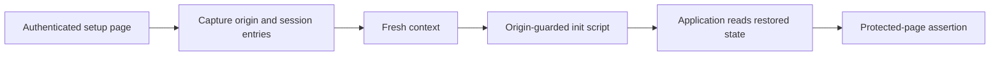

# How to Restore Session Storage for Playwright Synthetic Checks

Author: [nawazdhandala](https://www.github.com/nawazdhandala)

Tags: Playwright, TypeScript, Monitoring

Description: Capture origin-scoped session storage and seed it before application scripts run when ordinary Playwright storage state cannot restore login.

Playwright storage state is not a complete snapshot of every browser storage mechanism. Applications that keep login state in `sessionStorage` need an explicit capture and restore step. Restore it before application scripts read authentication state, and restrict the restoration to the exact origin that owns the data.

Use a supported Playwright release and a dedicated synthetic account. The snippets assume a successful login has already been established on the `page` object in an authentication setup test. They are an application-specific workaround, not a reason to change production authentication persistence solely for testing.

## Capture session storage and ordinary state

Save the origin with the session entries so a test cannot accidentally inject credentials into another site. Capture cookies and supported persistent storage separately because many applications use more than one mechanism. The following is a fragment inside your setup test, after an authenticated UI assertion.

```typescript
// Fragment inside an authenticated setup test with a page fixture.
import { mkdir, writeFile } from 'node:fs/promises';
await mkdir('playwright/.auth', { recursive: true });
const session = await page.evaluate(() => ({
  origin: location.origin,
  entries: Object.fromEntries(Object.keys(sessionStorage).map(
    key => [key, sessionStorage.getItem(key) ?? '']
  )),
}));
await writeFile('playwright/.auth/session.json', JSON.stringify(session), { mode: 0o600 });
await page.context().storageState({ path: 'playwright/.auth/state.json', indexedDB: true });
```

The `indexedDB` option requires Playwright 1.51 or newer. Omit it only if your authentication does not need IndexedDB. Protect both files and exclude the authentication directory from source control and public artifacts. File permissions are one layer; CI artifact access and retention are equally important.

## Seed a fresh context before navigation

Register an init script before creating the destination page. It runs before the application's scripts. The exact-origin guard prevents restoration on identity-provider pages or unrelated iframes. A per-tab marker avoids repeatedly overwriting refreshed session values on later navigations.

```typescript
// tests/restored-session.spec.ts
import { test, expect } from '@playwright/test';
import { readFile } from 'node:fs/promises';

test('restored session reaches account', async ({ browser }) => {
  const saved = JSON.parse(await readFile('playwright/.auth/session.json', 'utf8'));
  const context = await browser.newContext({ storageState: 'playwright/.auth/state.json' });
  try {
    await context.addInitScript(({ origin, entries }) => {
      if (location.origin !== origin || sessionStorage.getItem('__synthetic_restored')) return;
      for (const [key, value] of Object.entries(entries)) {
        sessionStorage.setItem(key, String(value));
      }
      sessionStorage.setItem('__synthetic_restored', '1');
    }, saved);
    const page = await context.newPage();
    await page.goto(saved.origin + '/account');
    await expect(page.getByTestId('authenticated-account')).toBeVisible();
  } finally {
    await context.close();
  }
});
```

Use a marker name that cannot collide with the application. Validate the captured JSON shape and allowed origin in your real fixture before executing the test. The sample trusts a locally generated setup artifact; do not load arbitrary downloaded session files.



## Inspect storage without exposing values

When debugging, list keys and origin rather than printing tokens. This fragment can run inside a Playwright test after navigation. It helps distinguish wrong-origin restoration from an expired or rejected session.

```typescript
const storageSummary = await page.evaluate(() => ({
  origin: location.origin,
  sessionKeys: Object.keys(sessionStorage),
  localKeys: Object.keys(localStorage),
}));
console.log(storageSummary);
```

## Understand the limits of reuse

Session storage is scoped to an origin and tab session. It survives reloads within that tab but is not automatically shared with a newly created independent context. Copying it does not restore JavaScript memory, service-worker state, or server-side session validity. Tokens can expire or be revoked even when every key was restored correctly.

If the application still redirects to login, verify origin, initialization order, required cookies, persistence mode, and token lifetime. Do not add arbitrary waits before fixing the storage boundary. Keep a fresh-login check alongside this restored-session check, because reuse intentionally skips authentication. A successful restoration proves the captured session works for the protected journey at that time, not that users can currently sign in from scratch.

Do not use the restoration marker as proof of authentication. It only indicates that the init script copied entries; the server can reject the resulting session. Keep the protected-page assertion authoritative and report a failed restoration separately from a successful login. If the application intentionally clears session storage on logout, create a dedicated logout test without this restoration fixture, because seeding state on new pages can conflict with the behavior under test. Keep the fixture narrowly scoped to journeys that explicitly intend to reuse an authenticated session.

## References

The [community question](https://stackoverflow.com/questions/79998740/playwright-session-state-not-loading) motivated this walkthrough. Implementation references:

- [Official reference 1](https://playwright.dev/docs/auth)
- [Official reference 2](https://playwright.dev/docs/api/class-browsercontext)
