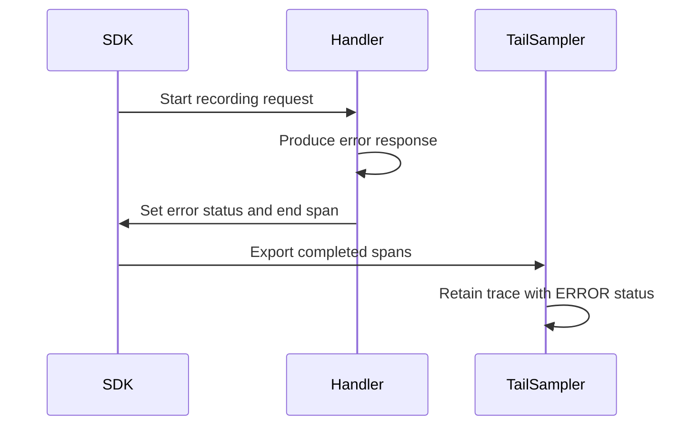

# How to Retain Java Error Traces When HTTP Status Arrives Late

Author: [nawazdhandala](https://www.github.com/nawazdhandala)

Tags: OpenTelemetry, Java

Description: Record Java failures correctly and use tail sampling when the sampling decision depends on the final request outcome.

A sampler invoked when a span starts cannot know the HTTP response status that will be produced later. Reading an attribute after the response and setting it on the span does not retroactively change the SDK's original sampling decision. This is a timing constraint, not a missing status-code configuration option.

To retain traces based on eventual errors, send the relevant spans to a tail sampler and make the retention decision there. That requires sufficient recording upstream. A Collector cannot recover spans that the application SDK never exported.

## Record the failure on the span

For manual Java instrumentation, record the exception and set the span status. Recording an exception event alone is not equivalent to setting `ERROR`. The following method fragment assumes a configured `Tracer` and application operation.

```java
Span span = tracer.spanBuilder("reserve-stock").startSpan();
try (Scope scope = span.makeCurrent()) {
    reserveStock();
} catch (RuntimeException error) {
    span.recordException(error);
    span.setStatus(StatusCode.ERROR, "reservation failed");
    throw error;
} finally {
    span.end();
}
```

The types come from `io.opentelemetry.api.trace` and `io.opentelemetry.context.Scope`. Let supported HTTP instrumentation assign protocol attributes and status according to its semantic conventions. Do not mark every client-side 4xx response or expected domain rejection as a server defect without considering the operation's semantics.

## Ensure the Collector receives the evidence

For a controlled Java service whose traces will be sampled downstream, this autoconfiguration setting records and samples locally regardless of parent sampling decisions:

```bash
export OTEL_TRACES_SAMPLER=always_on
export OTEL_EXPORTER_OTLP_ENDPOINT=http://localhost:4318
export OTEL_EXPORTER_OTLP_PROTOCOL=http/protobuf
```

Use this only after sizing the ingestion path. Across multiple services, a coherent sampling policy is necessary to avoid partial traces. `parentbased_always_on` has different behavior: it respects an unsampled parent, so it cannot guarantee that every local error reaches the Collector.



Use this Collector Contrib 0.120.0 processor fragment:

```yaml
processors:
  tail_sampling:
    decision_wait: 20s
    num_traces: 30000
    policies:
      - name: keep-errors
        type: status_code
        status_code:
          status_codes: [ERROR]
      - name: healthy-baseline
        type: probabilistic
        probabilistic:
          sampling_percentage: 2
```

The baseline sample helps compare error paths with healthy behavior. It is not an unbiased error-rate estimator after error traces are preferentially retained. Use application metrics for the denominator.

## Test the late-outcome case directly

Send three staging requests: a successful request, an immediate failure, and a failure occurring near the end of a slow operation. Confirm the final status on the exported span and that the failure arrives before the tail-sampling decision. Then test a failure whose span arrives after the window to understand the limitation.

All spans belonging to a trace must reach the same sampler. A short decision window can miss a late error; increasing it consumes more retained memory. Queue failures, process restarts, and upstream head sampling remain possible loss boundaries even with an error policy.

If complete retention of every failed business transaction is mandatory, tracing alone is not the durable record. Write a separate reliable outcome event or transaction record. Tail sampling is useful diagnostic selection, but its guarantees are bounded by the recording and delivery system that feeds it.

## References

The [community question](https://www.reddit.com/r/OpenTelemetry/comments/1exikj0) motivated this investigation. The implementation references are [official reference 1](https://opentelemetry.io/docs/languages/java/api/), [official reference 2](https://opentelemetry.io/docs/concepts/sampling/), [official reference 3](https://raw.githubusercontent.com/open-telemetry/opentelemetry-collector-contrib/v0.120.0/processor/tailsamplingprocessor/README.md).
