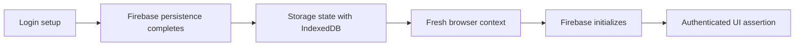

# How to Reuse Firebase Login State in Playwright Browser Contexts

Author: [nawazdhandala](https://www.github.com/nawazdhandala)

Tags: Playwright, Firebase, TypeScript

Description: Capture Firebase authentication including IndexedDB with Playwright 1.51 or newer, restore it into a fresh context, and verify the authenticated UI.

Saving cookies alone may not preserve a Firebase login because the web SDK can persist authentication in browser storage, including IndexedDB. With Playwright 1.51 or newer, capture IndexedDB explicitly when saving storage state, then restore that state into a new browser context. Verify the application has finished authentication before writing the file.

Use a dedicated test account and the same application origin and Firebase project in setup and tests. This walkthrough assumes the application's login UI already selects an appropriate persistent Firebase authentication mode. An in-memory persistence mode intentionally disappears with the page and cannot be made durable by copying a few cookies.

## Capture state after authenticated UI appears

The setup test performs a real login through the application and waits for a stable authenticated marker. Adapt selectors and routes to your application. Do not save state immediately after clicking the button, because the SDK may not have completed its asynchronous persistence work.

```typescript
// tests/auth.setup.ts
import { test as setup, expect } from '@playwright/test';
import { mkdir } from 'node:fs/promises';

setup('save Firebase authentication', async ({ page }) => {
  const email = process.env.SYNTHETIC_EMAIL;
  const password = process.env.SYNTHETIC_PASSWORD;
  if (!email || !password) throw new Error('Missing synthetic credentials');
  await page.goto('/login');
  await page.getByLabel('Email', { exact: true }).fill(email);
  await page.getByLabel('Password', { exact: true }).fill(password);
  await page.getByRole('button', { name: 'Sign in', exact: true }).click();
  await expect(page.getByTestId('authenticated-account')).toBeVisible();
  await mkdir('playwright/.auth', { recursive: true });
  await page.context().storageState({
    path: 'playwright/.auth/firebase.json',
    indexedDB: true,
  });
});
```

The `indexedDB` option is version-sensitive; check the installed Playwright version rather than assuming an older lockfile supports it. Keep the authentication file out of source control and public CI artifacts. It can contain credentials sufficient to impersonate the synthetic account.

## Restore through a dependent project

Make the authenticated project depend on setup, and exclude setup files from ordinary test matching. A new context created for each test receives the saved cookies, local storage, and captured IndexedDB state.

```typescript
// playwright.config.ts
import { defineConfig } from '@playwright/test';
export default defineConfig({
  use: { baseURL: process.env.SYNTHETIC_BASE_URL },
  projects: [
    { name: 'setup', testMatch: /.*\.setup\.ts/ },
    {
      name: 'authenticated',
      testIgnore: /.*\.setup\.ts/,
      dependencies: ['setup'],
      use: { storageState: 'playwright/.auth/firebase.json' },
    },
  ],
});
```

The saved state does not clone the running SDK's JavaScript memory. Firebase still initializes in the new page and restores its persisted session. Tests should wait for the authenticated state rather than assuming it exists synchronously at the first script statement.



## Verify restoration independently

The following test deliberately navigates directly to the protected destination. If restoration fails, it should show a login redirect or fail the authenticated assertion rather than silently logging in again.

```typescript
// tests/account.spec.ts
import { test, expect } from '@playwright/test';
test('restored session reaches account', async ({ page }) => {
  await page.goto('/account');
  await expect(page.getByTestId('authenticated-account')).toBeVisible();
  await expect(page).not.toHaveURL(/\/login(?:\?|$)/);
});
```

## Diagnose persistence mismatches

Check exact origin, protocol, port, Firebase project, and persistence mode. A state file captured on localhost does not automatically authenticate another host. Session-storage persistence needs a separate restoration strategy, while in-memory persistence requires a new authentication flow. Token expiry or revocation also requires refreshing the setup state.

Use separate accounts when parallel tests mutate server-side state. Sharing one stored session does not isolate database records, carts, or profile settings. Keep a separate fresh-login synthetic check because this restored-session test intentionally bypasses the login journey. Together they distinguish broken sign-in from broken authenticated application behavior without claiming that a copied state file is a permanent session.

Make the setup failure visible as a distinct test outcome. If setup cannot authenticate, dependent tests should not quietly run with an old state file left over from a previous job. Use a clean workspace or remove expired state through the test harness before setup, and inspect project dependency results in CI. For scheduled monitoring, regenerate state on an intentional cadence and after credential changes. Track which setup run produced the state used by each journey so a failure can be traced to an expired token, a changed origin, or a newly broken protected page.

## References

The [community question](https://stackoverflow.com/questions/77325496/playwright-re-use-state-re-use-authentication-with-firebase) motivated this walkthrough. Implementation references:

- [Official reference 1](https://playwright.dev/docs/auth)
- [Official reference 2](https://playwright.dev/docs/api/class-browsercontext#browser-context-storage-state)
- [Official reference 3](https://firebase.google.com/docs/auth/web/auth-state-persistence)
