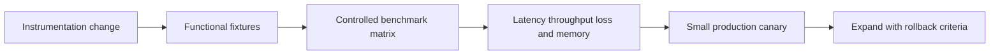

# How to Review eBPF Observability Changes for Performance Regressions

Author: [nawazdhandala](https://www.github.com/nawazdhandala)

Tags: eBPF, Performance, Kubernetes

Description: Use a staged benchmark matrix, stage-specific loss counters, and application latency guardrails when reviewing eBPF instrumentation changes.

An eBPF observability change can reduce application performance without making the agent's CPU graph look dramatic. Extra work may occur in the instrumented kernel path, stack collection, map updates, userspace decoding, or export. A review should measure the whole path and preserve the application's latency and throughput objectives.

Start with a precise description of the change: new hook, larger event, additional stack, more map keys, or a different aggregation strategy. Each affects a different part of the cost model and needs a representative workload.

## Define the benchmark matrix before running it

Use baseline, disabled-new-feature, and enabled-new-feature runs on the same kernel, hardware, image, and workload. Include idle, steady, burst, and degraded-destination conditions.

```json
{
  "variants": ["baseline", "candidate-disabled", "candidate-enabled"],
  "workloads": ["idle", "steady", "burst", "slow-export"],
  "measurements": ["request_p99", "throughput", "agent_cpu", "kernel_loss", "queue_loss", "memory"]
}
```

The disabled candidate detects unrelated changes in the new build. Repeat runs and alternate their order to reduce warm-cache and environmental bias. Record the offered workload and completed operations separately.



## Validate semantics before optimizing

Use program-type-appropriate tests for filtering, event fields, and map updates. The kernel's BPF program-run facility supports specific program types and contexts; it is not a universal substitute for exercising a tracing program on real workload events.

Preserve an expected event fixture with known counts and identifiers. Confirm the new feature does not silently sample, truncate, or duplicate records unless that behavior is part of the reviewed design. A performance improvement caused by accidentally observing fewer events is not a successful optimization.

For userspace cost, capture a bounded profile:

```bash
perf record -F 99 -g -p 1234 -o candidate-consumer.data -- sleep 30
perf report -i candidate-consumer.data --stdio
```

Use the actual consumer process and matching symbols. Compare kernel event-production counters, reservation failures or perf-buffer losses, userspace queue drops, and final delivery totals for the same interval.

## Report absolute cost and relative change

A small calculation can make benchmark reporting consistent:

```python
baseline = {"p99_ms": 20.0, "rps": 10000.0}
candidate = {"p99_ms": 20.8, "rps": 9900.0}
for key in baseline:
    relative = 100 * (candidate[key] / baseline[key] - 1)
    print(key, "absolute", candidate[key] - baseline[key], "percent", round(relative, 2))
```

These values are illustrative. Actual reports should include repeated-run variability, sample duration, and the workload's stable operating range. A tiny difference within normal run-to-run variation is weaker evidence than a consistent shift across repetitions.

Normalize agent cost by event rate and payload size. A version processing twice as many events can use more CPU while being more efficient per event. Conversely, lower CPU with higher event loss may indicate failure rather than improvement.

## Review resource bounds and failure behavior

Inspect map cardinality limits, eviction policy, buffer capacity, stack depth, payload size, and queue bounds. Test a slow or unavailable destination. The application should not inherit uncontrolled memory growth or blocking from the observability pipeline.

Consider hot-hook frequency and per-CPU imbalance. A small amount of work on a frequently executed syscall path can matter more than expensive work on a rare event. Kernel-side aggregation can reduce transport but may increase map contention or change the granularity of evidence.

## Canary the exact production configuration

Deploy to a small representative node subset with explicit rollback criteria for application latency, error rate, CPU pressure, memory, and event loss. Compare similar workloads and node types, accounting for traffic differences. Do not infer safety from an idle canary.

Keep a way to disable the new feature without removing the entire monitoring system. After rollout, preserve the benchmark inputs and configuration so future changes can be compared consistently. A strong review explains the functional effect, the measured resource cost, the data-loss boundaries, and the conditions under which the result remains valid.

## References

The [community question](https://www.reddit.com/r/kubernetes/comments/1ll3bwq/) motivated this investigation. The implementation references are [official reference 1](https://docs.kernel.org/bpf/bpf_prog_run.html), [official reference 2](https://docs.kernel.org/bpf/ringbuf.html), [official reference 3](https://raw.githubusercontent.com/libbpf/libbpf/master/src/libbpf.h), [official reference 4](https://raw.githubusercontent.com/torvalds/linux/master/tools/perf/Documentation/perf-record.adoc).
