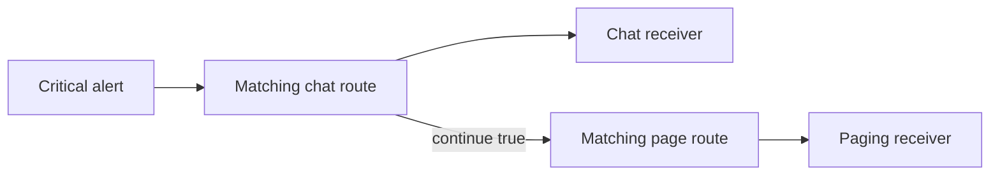

# How to Route Critical Alerts to Both Chat and Paging

Author: [nawazdhandala](https://www.github.com/nawazdhandala)

Tags: Alertmanager, Monitoring, SRE

Description: Use Alertmanager receiver fan-out or explicit sibling continuation, then test that both chat and paging receive critical alert transitions.

A critical alert often needs a page for the responder and a chat message for the wider team. Alertmanager supports this, but a common configuration mistake is to create two matching sibling routes and assume both run. By default, traversal stops after the first matching sibling. Choose either one receiver containing both integrations or explicit continuation between sibling routes.

The examples use local webhook sinks so route behavior can be tested without notifying people. Substitute the integration-specific configuration for your chat and paging systems after the route is verified. Use the `amtool` binary from the same Alertmanager release as the server.

## Prefer one receiver when policy is shared

If the destinations share grouping and reminder behavior, one receiver with multiple integration entries is straightforward. The example uses two webhooks as stand-ins for separate chat and paging adapters. Each adapter must implement its own delivery and deduplication behavior.

```yaml
route:
  receiver: review
  group_by: [environment, service, alertname]
  routes:
    - matchers: ['severity="critical"']
      receiver: critical-fanout
receivers:
  - name: review
  - name: critical-fanout
    webhook_configs:
      - url: http://notification-sink:8080/chat
        send_resolved: true
      - url: http://notification-sink:8080/page
        send_resolved: true
```

A receiver name is a configuration object, not a comma-separated list of receiver names. Two integration entries inside one object are legitimate. If using actual Slack and PagerDuty configuration blocks, follow their current schemas and load secrets from supported secret-file settings rather than embedding them in the repository.

## Use continuation when policies differ

Separate routes are useful when chat and paging have different timers or grouping. Set `continue: true` on the earlier matching sibling, because that is the route that would otherwise stop traversal. The fragment below replaces the root route's child list; define both referenced receivers elsewhere.

```yaml
# route.routes fragment
routes:
  - matchers: ['severity="critical"']
    receiver: critical-chat
    repeat_interval: 4h
    continue: true
  - matchers: ['severity="critical"']
    receiver: critical-page
    repeat_interval: 1h
```

Ordering matters. A broader earlier route can intercept an alert before either of these branches is reached. Inspect the complete tree, including inherited matchers and timers, rather than reviewing the two lines in isolation. Avoid combining both fan-out designs accidentally, which can create duplicate chat messages.



## Test the exact labels

Route tests are read-only and do not prove that a remote integration accepts messages. They prove which receiver names the configuration selects. Follow them with delivery tests against the local sinks.

```bash
amtool check-config alertmanager.yml
amtool config routes test --config.file=alertmanager.yml \
  alertname=CheckoutUnavailable severity=critical environment=prod service=checkout
```

For the first design, expect the single `critical-fanout` receiver, whose configuration has two destinations. For the second, expect both receiver names. Also test warning severity, missing service, and an unrelated team to ensure broad matches do not page the wrong responders.

## Verify failure and resolution paths

Hold a test alert firing, confirm one initial delivery at each sink, and then resolve it. Check that the paging adapter resolves the same incident identity that it opened. A chat message and a paging event may have different delivery latency; store both timestamps rather than assuming atomic delivery.

Next make one sink fail temporarily. Confirm that retries are visible and that the other destination still behaves as expected under your integration. Review inhibition, silences, and active-time rules, which can intentionally prevent delivery even when routing matches. Finally, monitor notification failures independently of the destination being tested. A routing configuration is complete only when both destinations receive the intended transitions and failures can be diagnosed without relying on the missing notification itself.

## References

The [community question](https://stackoverflow.com/questions/62672730/prometheus-alertmanager-send-notifications-to-multiple-slack-channel) motivated this walkthrough. Implementation references:

- [Official reference 1](https://prometheus.io/docs/alerting/latest/configuration/)
- [Official reference 2](https://github.com/prometheus/alertmanager/blob/main/README.md)
