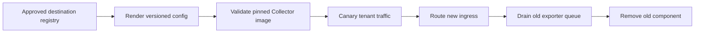

# How to Safely Change Customer OTLP Destinations in Collector Config

Author: [nawazdhandala](https://www.github.com/nawazdhandala)

Tags: OpenTelemetry, Observability

Description: Plan destination migrations with configuration validation, canary routing, queue draining, and an explicit cutover boundary.

Adding a customer's OTLP destination is a configuration rollout with data-delivery consequences. A syntactically valid endpoint may still reject credentials, lack a signal type, or have different retention behavior. Replacing a destination also raises a harder question: where should records already queued for the old destination go?

Treat the Collector configuration as a compiled artifact generated from a small destination registry. Validate endpoint ownership, credentials, signal support, and tenant mapping before generating exporter names. Avoid accepting arbitrary Collector YAML from customers.

## Represent the intended change explicitly

The following JSON is an application-owned registry example, not a Collector API. A generation number makes rollout and rollback decisions auditable.

```json
{
  "tenant": "alpha",
  "generation": 12,
  "signals": ["logs", "traces"],
  "old_destination": "alpha-v11",
  "new_destination": "alpha-v12",
  "cutover": "new-ingress-after-deployment"
}
```

Decide whether historical queued records must reach the original destination, the replacement, or both. The simplest predictable migration keeps the old exporter instance alive until its queue drains, then retires it. Reassigning the old component identifier to a new endpoint can make the backlog's destination ambiguous, especially with persistent queues.



## Validate using the deployment binary

For Collector Contrib 0.120.0, use the exact container tag that will run the configuration. Mount a candidate file into a disposable container. Validation confirms component configuration; it does not establish network reachability or successful authentication.

```bash
docker run --rm \
  -v "$PWD/candidate.yaml:/etc/otelcol-contrib/config.yaml:ro" \
  otel/opentelemetry-collector-contrib:0.120.0 \
  validate --config=/etc/otelcol-contrib/config.yaml
```

Secrets referenced through environment variables must exist during validation, with non-production values suitable for the check. Also enforce a policy that destination hosts are approved. Otherwise a customer-controlled URL can turn the telemetry gateway into a network access path.

Keep versioned exporter identifiers during the overlap:

```yaml
exporters:
  otlp/alpha-v11:
    endpoint: old-collector.example.net:4317
    timeout: 5s
  otlp/alpha-v12:
    endpoint: new-collector.example.net:4317
    timeout: 5s
```

A route fragment switches new records to the new pipeline. Define that pipeline with `otlp/alpha-v12` and retain the previous worker until its old backlog has completed.

```yaml
connectors:
  routing/tenant:
    default_pipelines: [logs/quarantine]
    table:
      - context: resource
        condition: attributes["tenant.id"] == "alpha"
        pipelines: [logs/alpha-v12]
```

## Make the canary prove delivery

Use a unique migration marker and several sequence-numbered records. Verify them in the destination, including resource identity, timestamps, trace identifiers, and tenant isolation. An HTTP success response at an intermediate proxy is weaker evidence than finding the records in the intended account.

If you temporarily dual-export, document the duplication window. Retries and overlapping routes may create duplicate records; ensure downstream billing, alerts, and deduplication tolerate that behavior. Do not infer exactly-once delivery from two successful exporter responses.

Collector configuration reload behavior depends on the deployment mechanism and distribution. A file changing on disk does not universally mean a running process reloads it. Use an explicit rollout procedure and observe which configuration generation each Pod runs.

For rollback, restore the prior ingress route while leaving both queues intact. Check whether data accepted by the new destination must be retained there or replayed under a separate migration job. Finally, remove obsolete secrets and exporter components only after delivery checks and the backlog policy are satisfied. This separates routing correctness from backlog handling and makes the cutover reviewable before traffic moves.

## References

The [community question](https://stackoverflow.com/questions/79884341/multi-tenant-log-routing-with-opentelemetry) motivated this investigation. The implementation references are [official reference 1](https://opentelemetry.io/docs/collector/configuration/), [official reference 2](https://raw.githubusercontent.com/open-telemetry/opentelemetry-collector-contrib/v0.120.0/connector/routingconnector/README.md), [official reference 3](https://raw.githubusercontent.com/open-telemetry/opentelemetry-collector/v0.120.0/exporter/exporterhelper/README.md).
