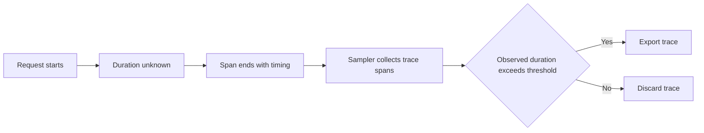

# How to Sample Slow Requests After Their Spans End

Author: [nawazdhandala](https://www.github.com/nawazdhandala)

Tags: OpenTelemetry, Performance

Description: Use tail sampling for completed latency, distinguish trace duration from one span, and test the decision boundary.

A request's final duration is available only after it completes. A head sampler makes its decision earlier, so it cannot select slow requests by measuring their eventual elapsed time. Ending a span and then asking the normal sampler to reconsider it is not how the OpenTelemetry SDK sampling lifecycle works.

Use tail sampling when the retention criterion depends on completed timing. Record the candidate population upstream, route each trace consistently, and keep enough state to wait for meaningful evidence. The examples below use Collector Contrib 0.120.0.

## Decide which duration you mean

The tail processor's latency policy evaluates the time between the earliest span start and latest span end it has observed for a trace. That is not necessarily the duration of the HTTP server span. Background work, linked asynchronous operations, missing spans, and clock skew can change the interpretation.

```yaml
processors:
  tail_sampling:
    decision_wait: 15s
    num_traces: 25000
    policies:
      - name: slow-traces
        type: latency
        latency:
          threshold_ms: 1500
```

This retains traces whose observed duration meets the policy threshold. Put the processor into the traces pipeline after context-dependent enrichment and before batching. A configuration definition without pipeline wiring has no effect.

```yaml
service:
  pipelines:
    traces:
      receivers: [otlp]
      processors: [memory_limiter, tail_sampling, batch]
      exporters: [otlp/backend]
```

Define the referenced receiver, limiter, batch processor, and exporter in the complete configuration. If Kubernetes enrichment is needed, place it before sampling.



## Verify the timing calculation with a fixture

This standalone fixture demonstrates the observed trace range in milliseconds. It deliberately includes a child extending beyond the server span, so the distinction is visible.

```python
spans = [
    {"name": "HTTP server", "start_ms": 0, "end_ms": 1200},
    {"name": "background task", "start_ms": 1000, "end_ms": 1900},
]
trace_duration = max(s["end_ms"] for s in spans) - min(s["start_ms"] for s in spans)
server_duration = spans[0]["end_ms"] - spans[0]["start_ms"]
assert trace_duration == 1900
assert server_duration == 1200
print({"trace_ms": trace_duration, "server_ms": server_duration})
```

If your policy is specifically about server response latency, instrument an explicit bounded attribute or use an OTTL policy supported by the pinned processor release to select the server span's timing. Test that policy against your real semantic conventions rather than assuming every span called `HTTP` represents the incoming request.

## Account for arrival time as well as execution time

The decision window begins when the sampler receives the first span, not when the application starts the request. A completed child can arrive before a long-running root. If the sampler decides before the root arrives, its observed duration and error information may be incomplete.

Choose a window using the distribution of first-to-last arrival delays, including SDK batch delays and exporter retries. A larger window increases the number of traces held in memory. It does not provide unlimited retention for jobs that run for hours.

Test traces just below and above the threshold, traces with delayed child export, and a trace where the final span arrives after the window. Compare the resulting trace structure, not only the number of retained traces. Keep an independent latency histogram for aggregate service objectives because the retained trace population is intentionally biased toward slow requests.

Finally, verify the upstream SDK is not discarding the exact requests you want to inspect. Tail sampling can select only among spans delivered to it. A 1% head sample followed by a slow-trace policy captures slow traces within that 1%, not every slow request.

## References

The [community question](https://stackoverflow.com/questions/72186762/allow-open-telemetry-sampling-decision-at-the-end-of-the-span) motivated this investigation. The implementation references are [official reference 1](https://opentelemetry.io/docs/concepts/sampling/), [official reference 2](https://raw.githubusercontent.com/open-telemetry/opentelemetry-collector-contrib/v0.120.0/processor/tailsamplingprocessor/README.md), [official reference 3](https://opentelemetry.io/docs/languages/java/api/).
