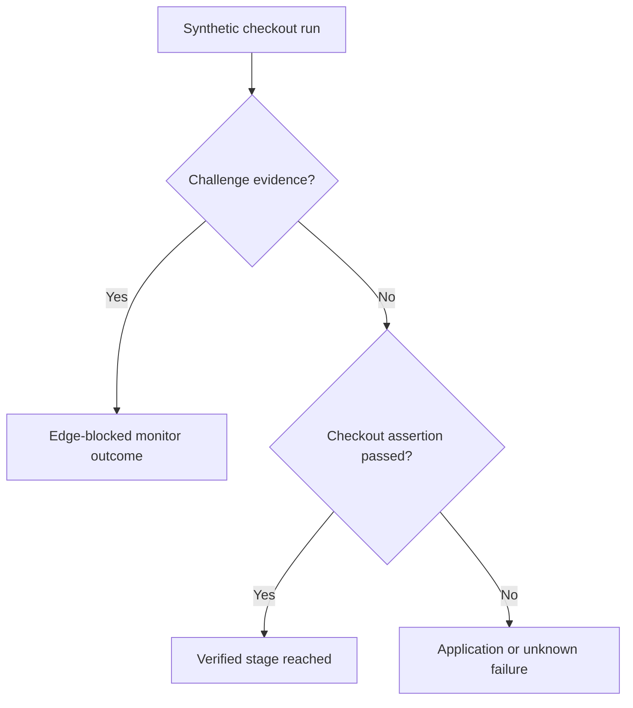

# How to Separate Checkout Failures from Bot-Protection Errors

Author: [nawazdhandala](https://www.github.com/nawazdhandala)

Tags: Playwright, Monitoring, SRE

Description: Classify synthetic checkout outcomes using edge evidence and application progress, and keep blocked probes distinct from verified customer checkout failures.

A synthetic checkout can fail because checkout is broken or because the monitoring browser is challenged before it reaches checkout. Both deserve investigation, but they are different observations. Preserve the stage reached, response status, challenge evidence, and final application assertion instead of reducing every failed run to payment outage.

Use an authorized test store or a dedicated non-purchasing journey. For Shopify, official test-order mechanisms require deliberate configuration; enabling payment test mode on a live store affects real customers. Do not switch a production payment provider into test mode merely to run a scheduled monitor. A live smoke check can stop before submitting an order.

## Record the furthest verified stage

Define stages such as storefront loaded, cart opened, checkout rendered, and payment test completed. An edge challenge before cart creation provides no direct evidence about payment processing. A checkout page returning HTTP 200 also does not prove the required form or payment method is usable.

```json
{"run_id":"syn-17","stage":"checkout-navigation","http_status":403,"challenge_marker":true,"checkout_form_visible":false,"classification":"edge-challenge","order_submitted":false}
```

The challenge marker must be based on provider-documented behavior or an approved page signature from your own environment. A generic 403 alone is not proof of bot protection; it can also mean application authorization failure. Keep uncertain cases as unclassified until evidence resolves them.

## Classify outcomes without bypassing protection

The fixture demonstrates conservative classification. It treats a visible challenge as an edge outcome, a reached form as journey progress, and ambiguous status failures as unknown. It does not attempt to solve challenges or evade the provider's controls.

```python
def classify(status,challenge,checkout_visible):
    if challenge:
        return "edge-challenge"
    if checkout_visible and status is not None and 200 <= status < 400:
        return "checkout-reached"
    if status is not None and status >= 500:
        return "server-error"
    return "unclassified-failure"
assert classify(403,True,False) == "edge-challenge"
assert classify(403,False,False) == "unclassified-failure"
print(classify(200,False,True))
```

## Capture response status and a semantic assertion

This fragment belongs in a Playwright Test journey against your own storefront. Replace the accessible heading with the actual approved checkout marker. The code stops before any payment submission and records the main navigation status.

```typescript
import { test, expect } from '@playwright/test';
test('checkout is reachable without submitting an order', async ({ page }, testInfo) => {
  const target = process.env.SYNTHETIC_CHECKOUT_URL;
  if (!target) throw new Error('Missing authorized checkout URL');
  const response = await page.goto(target);
  await testInfo.attach('navigation-status', {
    body: JSON.stringify({ status: response?.status() ?? null }),
    contentType: 'application/json',
  });
  await expect(page.getByRole('heading', { name: 'Checkout', exact: true })).toBeVisible();
});
```

A direct checkout URL may require a valid cart or session. Build those prerequisites through the supported storefront flow, and record them as separate stages. Do not reuse a stale checkout token indefinitely; that can turn session expiry into a false platform outage.



## Compare with independent customer evidence

Correlate blocked probes with real-user checkout errors, support reports, and another approved monitoring location. A monitor-only challenge may require an approved provider integration or monitoring policy adjustment. A challenge affecting real customers is itself user impact and must not be dismissed as synthetic noise.

Keep separate counters for edge-blocked runs, runner failures, and verified application failures. Treat blocked runs as missing coverage for the checkout stage rather than successful checkout. Test the classifier with known challenge pages and genuine application errors, and review it after storefront or protection changes. The final page should explain what the monitor proved, where it stopped, and which team can investigate the observed boundary.

Keep a coverage denominator for each stage. If ten runs are challenged before checkout and two reach checkout successfully, reporting twelve successful payment checks would be false, while reporting ten confirmed payment failures would also overstate the evidence. Report two verified checkout observations and ten blocked observations. The distinction is especially useful when a provider changes its protection policy: the monitor may lose coverage abruptly even though the application has not changed. Assign an owner and deadline to restore that coverage through the provider-supported path.

## References

The [community question](https://www.reddit.com/r/devops/comments/1r8jmez/sreish_monitoring_for_a_blackbox_paas_shopify/) motivated this walkthrough. Implementation references:

- [Official reference 1](https://playwright.dev/docs/network)
- [Official reference 2](https://help.shopify.com/en/manual/checkout-settings/test-orders)
