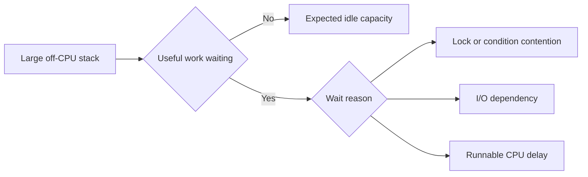

# How to Separate Idle Waiting from Contention in Off-CPU Flame Graphs

Author: [nawazdhandala](https://www.github.com/nawazdhandala)

Tags: Profiling, Linux

Description: Interpret off-CPU widths using thread roles, request activity, and wait reasons so idle workers are not mistaken for bottlenecks.

An off-CPU flame graph often gives idle worker threads the largest boxes. That is mathematically correct: a worker waiting for work can spend almost the entire capture off CPU. It does not mean the idle wait caused a slow request.

Interpret waiting in context. The important question is whether useful work was ready and delayed, or whether the thread had nothing to do. Stack width alone cannot answer that question.

## Capture a scoped interval with workload context

Use BCC's process filter and a bounded duration:

```bash
sudo /usr/share/bcc/tools/offcputime -p 1234 -f 30 > offcpu.folded
```

Keep the request rate, latency, queue depth, and thread count for the same interval. If the service was mostly idle, large waits in event polling or worker conditions are expected. A production capture during a traffic lull should not be compared directly with a saturated staging run.



## Account for accumulated thread time

This arithmetic fixture illustrates why off-CPU totals exceed wall time:

```python
threads = 40
capture_seconds = 30
idle_fraction = 0.95
accumulated_wait = threads * capture_seconds * idle_fraction
print("aggregate idle thread-seconds:", accumulated_wait)
assert accumulated_wait == 1140
```

Forty mostly idle threads can accumulate 1,140 seconds of waiting during a 30-second capture. That number is not a 1,140-second request and should not be plotted as one service latency.

Thread names and stack ancestry can identify event loops, background timers, connection pools, and active request workers. Preserve this grouping when rendering the graph. Removing thread identity too early can merge harmless waits with the critical request path.

## Compare waiting with queue and pressure signals

Inspect CPU pressure and application queues:

```bash
cat /proc/pressure/cpu
cat /sys/fs/cgroup/cpu.pressure
```

Use the target cgroup and appropriate permissions. High runnable pressure with queued requests supports CPU contention. A growing application queue with workers blocked on the same mutex supports a different hypothesis. A quiet queue and many polling threads usually indicates spare capacity.

For a process-level thread snapshot, inspect roles and states:

```bash
ps -L -p 1234 -o pid,tid,stat,comm,wchan:32
```

`wchan` is a hint and can be unavailable or obscured by permissions. It does not provide the full causal chain or tell you who owns a lock.

## Follow the owner, not just the waiter

A futex stack can represent lock contention, a condition variable waiting for work, or runtime coordination. Identify the application operation and lock ownership before proposing a fix. The thread holding the lock may be executing slowly, blocked on I/O while holding it, or never releasing it because of a defect.

Compare healthy and slow captures under similar load. Look for changes in request-serving threads and queue age rather than total waiting across all background threads. A broad off-CPU profile can be dominated by periodic timers that are irrelevant to the incident.

For asynchronous applications, an event loop's polling wait is often healthy. The logical request may be waiting for a remote response while the loop is free to serve other requests. Use tracing or task-aware runtime diagnostics to connect the logical wait to the OS evidence.

## Validate the interpretation with an intervention

Reduce lock hold time, improve the identified dependency, or adjust CPU placement in a controlled test. Confirm request latency and queue depth improve. If only the graph's proportions change because more work is now performed elsewhere, the proposed explanation remains unproven.

Label the graph's unit explicitly, usually accumulated microseconds or thread-time, and record whether the tool includes runnable delay in its off-CPU interval. Different tools and filters can measure different populations. A correct interpretation separates expected idle capacity from waits that postpone useful work.

## References

The [community question](https://stackoverflow.com/questions/60190228/best-event-counter-to-use-for-measuring-wall-clock-time-using-perf-tools) motivated this investigation. The implementation references are [official reference 1](https://raw.githubusercontent.com/iovisor/bcc/master/tools/offcputime_example.txt), [official reference 2](https://docs.kernel.org/accounting/psi.html).
