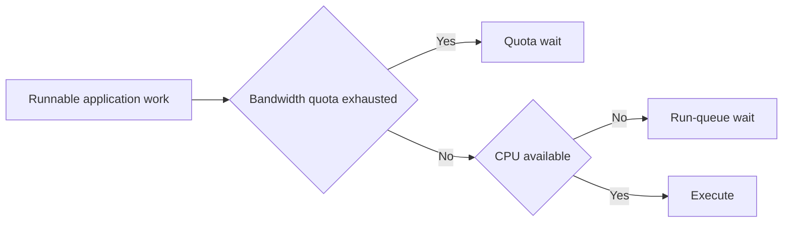

# How to Separate Kubernetes CPU Quota Throttling from CPU Contention

Author: [nawazdhandala](https://www.github.com/nawazdhandala)

Tags: Kubernetes, Linux

Description: Use cgroup bandwidth counters, CPU pressure, and scheduler wait evidence to distinguish limits from competition for node CPU.

CPU quota throttling and CPU contention both delay runnable work, but they are different mechanisms. A quota stops a cgroup after it consumes its allowed bandwidth. Contention makes runnable tasks wait because other tasks are using the available CPUs. CPU shares or weights influence that competition; they do not create the same quota-throttling counter.

A container can experience both simultaneously. Diagnose each independently before deciding whether to change limits, requests, concurrency, or placement.

## Read quota evidence first

On Linux cgroup v2, inspect the target cgroup's bandwidth limit and counters:

```bash
cat /sys/fs/cgroup/cpu.max
cat /sys/fs/cgroup/cpu.stat
cat /sys/fs/cgroup/cpu.weight
```

`nr_throttled` and `throttled_usec` indicate bandwidth enforcement. `cpu.weight` expresses relative allocation under contention; it is not a guaranteed CPU percentage. The effective behavior also depends on siblings, ancestor limits, cpusets, and scheduler configuration.

Compare the cAdvisor throttling rate with usage:

```promql
rate(container_cpu_cfs_throttled_seconds_total{namespace="checkout",container="api"}[5m])
```

A high value supports quota involvement, but the duration can aggregate scheduling behavior across execution contexts. Do not interpret it naively as a percentage of one wall-clock second without understanding the metric's accounting.



## Observe contention separately

Read CPU pressure at the relevant cgroup and node scope:

```bash
cat /sys/fs/cgroup/cpu.pressure
cat /proc/pressure/cpu
```

Pressure stall information reports time tasks are delayed for CPU. It is broader evidence of waiting and should be interpreted alongside quota counters; it is not a direct meter of CPU shares alone.

If scheduler accounting metrics are enabled in your cAdvisor build, inspect run-queue time:

```promql
rate(container_cpu_schedstat_runqueue_seconds_total{namespace="checkout",container="api"}[5m])
```

These metrics are not guaranteed to be exposed by every kubelet configuration. Missing metrics mean unavailable instrumentation, not zero contention. For deeper analysis, use a bounded scheduler trace or runtime profiling under an approved diagnostic workflow.

## Choose an experiment that separates the causes

To test quota effects, compare the same workload with a higher quota on an otherwise similar node. To test contention, compare placement on a less busy node while keeping the quota unchanged. Change one factor at a time and record request latency, throughput, runnable work, and node pressure.

Increasing CPU requests can improve scheduling placement and relative allocation when the node is busy, but it does not increase an unchanged CPU limit. Removing a limit can eliminate that cgroup's quota boundary while leaving contention and ancestor restrictions intact.

For latency-sensitive workloads, inspect CPU manager policy, cpuset placement, and interference from neighboring workloads. A node-wide utilization average can hide a hot CPU or an imbalanced affinity assignment.

## Avoid a false diagnosis from averages

A service waiting on a database can show low CPU without either quota pressure or runnable contention. A thread pool waiting for a lock can also appear idle at the OS level. Correlate application queueing and off-CPU evidence before attributing every delay to Kubernetes resource controls.

Document the conclusion in mechanism-specific terms: quota exhausted in a known fraction of periods, runnable tasks waiting under node contention, or application threads blocked elsewhere. That language leads to a targeted change and prevents teams from repeatedly raising CPU limits when the actual bottleneck is placement, concurrency, or a dependency.

## References

The [community question](https://stackoverflow.com/questions/70561395/how-to-measure-throttling-due-to-cpu-shares-in-kubernetes) motivated this investigation. The implementation references are [official reference 1](https://kubernetes.io/docs/concepts/configuration/manage-resources-containers/), [official reference 2](https://docs.kernel.org/admin-guide/cgroup-v2.html), [official reference 3](https://raw.githubusercontent.com/google/cadvisor/master/docs/storage/prometheus.md).
