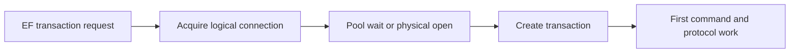

# How to Separate Npgsql Pool Waits from EF Core Transaction Startup

Author: [nawazdhandala](https://www.github.com/nawazdhandala)

Tags: .NET, EF Core, PostgreSQL

Description: Measure connection acquisition, transaction creation, and the first command separately, then correlate Npgsql pool usage and physical-open traces.

A slow `BeginTransactionAsync` does not necessarily mean PostgreSQL spent that time beginning a transaction. EF Core may need to open a connection first, which can involve waiting for a pooled connector or creating a physical connection. Measure those boundaries separately before tuning transactions or increasing the pool size.

This walkthrough targets .NET 10, EF Core 10, and Npgsql 10 with matching provider packages. The code is a diagnostic method fragment inside an application with a configured `DbContext` named `db` and cancellation token `ct`. Run it only in a controlled diagnostic path; it is not a reason to hold connections open across normal request processing.

## Measure connection acquisition explicitly

Open the connection before beginning the transaction, then time transaction creation and the first command independently. Close the connection in `finally`, and dispose the transaction even when a command fails. Never run parallel operations on the same `DbContext`.

```csharp
using System.Diagnostics;
using Microsoft.EntityFrameworkCore;

var timer = Stopwatch.StartNew();
await db.Database.OpenConnectionAsync(ct);
var openMs = timer.Elapsed.TotalMilliseconds;
try
{
    timer.Restart();
    await using var transaction = await db.Database.BeginTransactionAsync(ct);
    var beginMs = timer.Elapsed.TotalMilliseconds;
    timer.Restart();
    await db.Database.ExecuteSqlRawAsync("SELECT 1", ct);
    var firstCommandMs = timer.Elapsed.TotalMilliseconds;
    await transaction.RollbackAsync(ct);
    Console.WriteLine($"open_ms={openMs:F1} begin_ms={beginMs:F1} first_command_ms={firstCommandMs:F1}");
}
finally
{
    await db.Database.CloseConnectionAsync();
}
```

The open duration still combines pool acquisition and possible physical connection work. It is a useful boundary, not a pure pool-wait measurement. The first command matters because driver transaction setup can be deferred or combined with later protocol work; a fast begin call alone does not establish that the database round trip was fast.

## Correlate pool state at the same time

Npgsql 10 renamed metrics to align with OpenTelemetry conventions. Inspect the installed version before copying dashboard names from older articles. Use `dotnet-counters` to observe the `Npgsql` meter for the application process.

```bash
# Replace 12345 with the application process ID.
dotnet-counters monitor --counters Npgsql --process-id 12345
```

For Npgsql 10, inspect `db.client.connection.count` with `state=used` and `state=idle`, and `db.client.connection.max`. A used count near the maximum with no idle connectors supports pool contention. It does not prove why connections are held: long queries, open transactions, leaks, and excessive concurrency can all produce that state.



## Give the pool a stable diagnostic name

Name the data source so metrics identify the intended pool without exposing a raw connection string. Register and reuse the data source with an appropriate application lifetime rather than rebuilding it per request.

```csharp
using Npgsql;
var builder = new NpgsqlDataSourceBuilder(connectionString)
{
    Name = "CheckoutDatabase"
};
await using var dataSource = builder.Build();
```

This fragment assumes `connectionString` comes from your secret configuration. Configure EF Core to use the intended shared data source through its supported provider setup. Multiple independently created data sources can create multiple pools, making a single aggregate chart misleading.

## Interpret the combined evidence

Slow open calls with pool saturation and few physical-open spans point toward waiting for a free connector. Slow open calls with physical connection spans point toward DNS, network, TLS, authentication, or server admission. A fast open followed by a slow first command points further down the execution path. Correlate with PostgreSQL activity and application request traces rather than choosing one metric in isolation.

Do not increase pool size until the server connection budget and concurrent workload justify it. More connections can worsen database saturation. Also account for EF execution strategies: manually controlled transactions need the documented retry pattern when retries are enabled. The useful result is a timing breakdown tied to pool and server evidence, with a specific next investigation instead of a generic conclusion that transaction startup is slow.

## References

The [community question](https://stackoverflow.com/questions/80013695/how-to-distinguish-npgsql-connection-pool-wait-time-from-ef-core-begintransactio) motivated this walkthrough. Implementation references:

- [Official reference 1](https://www.npgsql.org/doc/diagnostics/metrics.html)
- [Official reference 2](https://www.npgsql.org/doc/diagnostics/tracing.html)
- [Official reference 3](https://learn.microsoft.com/en-us/ef/core/saving/transactions)
- [Official reference 4](https://www.npgsql.org/doc/basic-usage.html)
