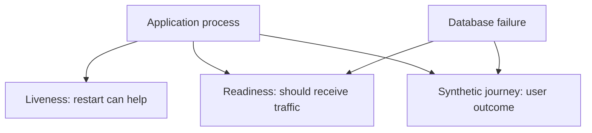

# How to Separate Process Health from Database Journey Checks

Author: [nawazdhandala](https://www.github.com/nawazdhandala)

Tags: Kubernetes, Monitoring, SRE

Description: Design liveness, readiness, and synthetic checks with different failure consequences so a shared database outage does not trigger useless restart storms.

A database outage should not automatically convince Kubernetes that every application process is dead. Liveness, readiness, and user-journey checks answer different questions and have different consequences. Design each around the action its failure triggers: restart, remove from service, or notify a responder.

This tutorial uses stable Kubernetes probe fields and illustrative HTTP endpoints. The application must implement the endpoint semantics; naming a route `/livez` does not make it safe. Test the behavior on the Kubernetes version and deployment strategy you actually run, especially when a shared dependency can fail for all replicas at once.

## Keep liveness focused on recoverable process failure

A liveness failure can restart the container. Use it for conditions where restarting is a reasonable recovery action, such as a deadlocked process. Avoid making it depend on a shared database whose failure a restart cannot repair. A startup probe can give initialization time before liveness takes over.

```yaml
# Container specification fragment.
ports:
  - name: http
    containerPort: 8080
startupProbe:
  httpGet: {path: /startupz, port: http}
  periodSeconds: 5
  failureThreshold: 24
livenessProbe:
  httpGet: {path: /livez, port: http}
  periodSeconds: 10
  timeoutSeconds: 2
  failureThreshold: 3
readinessProbe:
  httpGet: {path: /readyz, port: http}
  periodSeconds: 5
  timeoutSeconds: 2
  failureThreshold: 3
```

The timings are examples, not universal settings. Choose them from measured initialization and recovery behavior. A probe that is more expensive than ordinary requests can become a source of load during an outage. Keep responses small and avoid exposing internal secrets in their bodies.

## Decide readiness from serving capability

Readiness controls whether the pod should receive service traffic. A database dependency may matter if every useful request requires it, but a service that can serve cached or independent routes may remain partially useful. Explicitly decide whether removing all replicas during a shared database outage improves behavior or merely changes errors into a total routing failure.

```json
{"live":true,"ready":true,"capabilities":{"cached_catalog":true,"account_writes":false},"reason":"database unavailable; cached reads remain supported"}
```

This is an internal diagnostic response example, not a Kubernetes probe schema. Kubernetes evaluates the HTTP status, not these fields. If readiness remains true for degraded operation, the application must return appropriate errors for unsupported operations and the user-journey monitor must expose the impact.



## Test the failure matrix

Write expected outcomes before injecting failures. The fixture captures one possible policy: a dead process fails all checks, while a database outage leaves process liveness healthy but breaks the database-dependent journey. Readiness depends on the service's degraded-mode design.

```python
cases = [
 {"name":"healthy","live":True,"ready":True,"journey":True},
 {"name":"database-down-cached-service","live":True,"ready":True,"journey":False},
 {"name":"process-dead","live":False,"ready":False,"journey":False},
]
for case in cases:
    print(case["name"],"restart" if not case["live"] else "keep process",case["journey"])
assert cases[1]["live"] and not cases[1]["journey"]
```

## Observe consequences, not just endpoint responses

In staging, disconnect the database and watch restart counts, ready endpoints, client error behavior, and synthetic results. Then restore the dependency and verify recovery without manual restarts. Also test a process deadlock or equivalent controlled failure to prove liveness still performs its intended role.

A deep check that opens a new database connection on every probe can worsen connection exhaustion. Use bounded timeouts and consider a cached dependency assessment where appropriate, while keeping its freshness visible. Avoid making health endpoints a privileged administrative interface.

Finally, route user-impact alerts to the service owner and dependency symptoms to the responders who can act. A process that is alive but cannot complete a customer transaction deserves an incident signal without an automatic restart loop. The completed design explains why each check exists, what a failure causes, and which recovery behavior has actually been tested.

Ensure health checks do not require the same overloaded worker pool as the requests they are meant to diagnose unless that is an intentional signal. A saturated request queue can delay a trivial liveness response and trigger restarts that discard useful work. Measure probe latency under representative load, and choose the endpoint implementation and thresholds together. Keep the synthetic journey outside the process so it still observes ingress, routing, authentication, and dependency failures that internal probes cannot see.

## References

The [community question](https://www.reddit.com/r/sre/comments/1xu7xdn/what_do_you_actually_put_behind_health/) motivated this walkthrough. Implementation references:

- [Official reference 1](https://kubernetes.io/docs/tasks/configure-pod-container/configure-liveness-readiness-startup-probes/)
- [Official reference 2](https://prometheus.io/docs/practices/alerting/)
