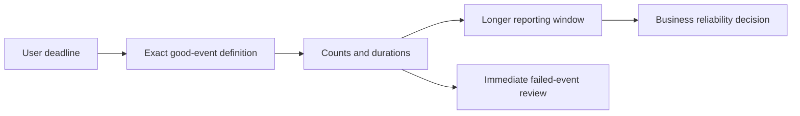

# How to Set a Latency SLO for Very Low-Traffic Endpoints

Author: [nawazdhandala](https://www.github.com/nawazdhandala)

Tags: SLO, SRE, Python

Description: Choose meaningful latency thresholds and reporting windows when only dozens of requests occur, and avoid misleading high-precision SLO targets.

With forty requests per month, one slow request changes the observed success percentage by 2.5 points. A 99.9% monthly latency target allows only 0.04 slow requests in expectation, so any single violation misses the target. That may be a deliberate business requirement, but it is not a smooth operational signal.

Start with the user journey and the cost of one slow request. An administrative export, a payment authorization, and a rare disaster-recovery endpoint have different expectations even at identical traffic volume. The examples use Python 3 and an internal SLO specification, with no assumption that a high percentage is automatically better.

## Make the event granularity visible

Calculate how much one failure changes the observed score and how many bad events the target permits at expected volume. This small fixture exposes the mismatch before you build dashboards or burn-rate alerts.

```python
requests = 40
target = 0.999
allowed_bad = requests*(1-target)
one_bad_success = (requests-1)/requests
print({"allowed_bad_events":round(allowed_bad,4),
       "success_with_one_bad":one_bad_success,
       "one_event_percentage_points":100/requests})
assert one_bad_success == 0.975
```

The result does not prove the target is wrong. It proves the decision should be explicit: are you willing to declare the period unsuccessful after one slow event? If yes, ensure each event can be investigated and that the latency threshold reflects the actual user deadline rather than an arbitrary industry number.

## Prefer a clearly defined threshold

Use an exact histogram boundary or event record to count requests meeting the deadline. Percentiles estimated from very few observations can move sharply and may be hard to interpret. Show the raw good and total counts beside the ratio.

```yaml
# Internal SLO policy, not a vendor configuration API.
service: rare-export
eligible_event: completed customer export request
latency_threshold_seconds: 10
measurement_start: accepted request
measurement_end: downloadable result available
reporting_window_days: 90
report_fields: [good_count, total_count, success_fraction, worst_duration]
```

A longer window increases sample size but also delays changes in the reported score. It does not create new evidence about the present state. Keep a shorter operational view for recent failures and explain that the longer score is a reporting choice, not a guarantee of current health.



## Replay the proposed policy on real event shapes

Use a redacted history of durations, including timeouts and cancellations according to the agreed eligibility rules. The fixture treats a timeout as a bad event and demonstrates how a small population behaves. It is not a recommendation for a particular threshold.

```python
durations = [1.2,2.1,3.0,1.8,12.0,None]
threshold = 10.0
good = sum(value is not None and value <= threshold for value in durations)
total = len(durations)
print({"good":good,"total":total,"fraction":good/total})
assert good == 4 and total == 6
```

## Design alerting for sparse evidence

A conventional burn-rate alert can fire after a single event because the denominator is tiny. Do not add a minimum-traffic gate without considering what it hides: a critical low-volume endpoint could fail every request and never reach the gate. Use a separate failed-event notification, a ticket, or a synthetic journey based on the urgency of that specific workflow.

Synthetic checks can provide more frequent availability evidence, but keep their objective separate from the real-user latency objective. A synthetic export with a tiny dataset may not represent a customer's large export. Match the important characteristics and document what the probe does not cover.

Review every violation during the initial period. Record whether the user noticed, whether intervention helped, and whether the threshold or eligibility rule was ambiguous. Avoid presenting a precise confidence claim from a handful of observations. A useful low-traffic SLO combines a meaningful deadline, transparent counts, explicit uncertainty, and a response policy that still works when only one customer is affected.

## References

The [community question](https://www.reddit.com/r/sre/comments/1rqay29/do_people_actually_set_999_target_for_latency_slo/) motivated this walkthrough. Implementation references:

- [Official reference 1](https://sre.google/workbook/implementing-slos/)
- [Official reference 2](https://sre.google/workbook/alerting-on-slos/)
- [Official reference 3](https://prometheus.io/docs/practices/histograms/)
