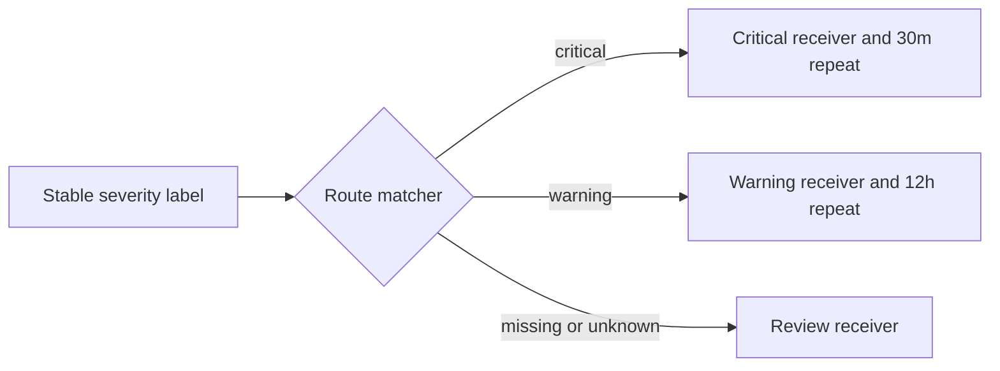

# How to Set Critical and Warning Alertmanager Reminder Schedules

Author: [nawazdhandala](https://www.github.com/nawazdhandala)

Tags: Alertmanager, Prometheus, Monitoring

Description: Configure severity-specific Alertmanager routes with explicit grouping and validate that critical and warning alerts inherit the intended timers.

Critical and warning alerts often need different reminder schedules because they imply different response urgency. Put the schedule in Alertmanager routing and keep the severity label stable in the alert rule. Avoid encoding notification cadence in alert names or changing labels dynamically as a workaround.

This example uses a current Alertmanager configuration with local webhook sinks. Replace the sinks with reviewed integrations after route testing. The intervals are illustrative: a critical event may need paging escalation that belongs in the paging system rather than repeated Alertmanager messages every few minutes.

## Define severity as a routing contract

Agree on the allowed values and what each means operationally. A warning that requires no immediate human action should not silently enter the critical route because its label is missing or misspelled. Use a visible fallback destination during rollout and audit alerts reaching it.

```yaml
route:
  receiver: unmatched-review
  group_by: [environment, service, alertname, severity]
  group_wait: 30s
  group_interval: 5m
  repeat_interval: 4h
  routes:
    - matchers: ['severity="critical"']
      receiver: critical-sink
      repeat_interval: 30m
    - matchers: ['severity="warning"']
      receiver: warning-sink
      repeat_interval: 12h
receivers:
  - name: unmatched-review
    webhook_configs:
      - url: http://notification-sink:8080/unmatched
  - name: critical-sink
    webhook_configs:
      - url: http://notification-sink:8080/critical
  - name: warning-sink
    webhook_configs:
      - url: http://notification-sink:8080/warning
```

Both repeat intervals align with the five-minute group interval. Severity is included in grouping so critical and warning members do not share a notification group under the same route context. Environment and service preserve the intended operational boundary. Add team routing above or below these branches only after deciding which settings should be inherited.

## Verify matching before delivery

Use the `amtool` version shipped with your Alertmanager release to validate the file and inspect route results. The route test is read-only and does not send pages. Its exact display formatting varies by version, but the intended receiver should be unambiguous.

```bash
amtool check-config alertmanager.yml
amtool config routes test --config.file=alertmanager.yml \
  alertname=CheckoutErrors environment=prod service=checkout severity=critical
amtool config routes test --config.file=alertmanager.yml \
  alertname=CheckoutErrors environment=prod service=checkout severity=warning
```

Test an unknown value and a missing severity too. A configuration that works only for the two happy-path labels can still lose important alerts during a rule migration. Treat the fallback destination as an operational queue with an owner, not a place where unmatched alerts disappear unnoticed.



## Keep an explicit acceptance matrix

The following fixture represents expected policy outcomes. It does not replace Alertmanager's route engine; it documents the cases that the route test and delivery test must cover. Keeping this matrix beside configuration makes future changes easier to review.

```python
expected = {"critical":("critical-sink",30),
            "warning":("warning-sink",720)}
for severity in ["critical","warning","info",""]:
    receiver, minutes = expected.get(severity,("unmatched-review",240))
    print(severity or "missing", receiver, minutes)
assert expected["critical"][1] < expected["warning"][1]
```

## Separate reminders from escalation

An unacknowledged critical incident may need escalation to another person after ten minutes. That is different from resending the same group to the same integration after thirty minutes. Confirm how your paging provider handles deduplication keys, acknowledgments, and resolved events. Alertmanager cannot infer that a human has acknowledged a page unless the integration and workflow explicitly support it.

Finally, send a stable test alert to each non-production sink and observe its initial notification, group updates, reminder, and resolution. Ensure a warning does not become a critical notification merely because both share an alert name. Review reminder frequency after real usage: too many reminders create noise, while a long interval can leave an unattended warning forgotten. The correct schedule follows a documented response expectation and a tested route, not severity naming alone.

Test a severity transition explicitly. If a rule changes from warning to critical, its label identity changes and the paging integration may see a new incident while the warning resolves. Decide whether that is the intended workflow. If continuity matters, use your incident system to associate the two alerts rather than hiding severity in an annotation that the route cannot match. Record both receiver deliveries in the acceptance test, including the warning resolution, so the transition does not leave an abandoned open incident.

## References

The [community question](https://stackoverflow.com/questions/67628163/alertmanager-different-interval-for-different-alert-rules) motivated this walkthrough. Implementation references:

- [Official reference 1](https://prometheus.io/docs/alerting/latest/configuration/)
