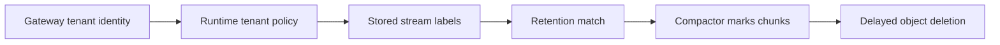

# How to Set Different Loki Retention Periods for Teams

Author: [nawazdhandala](https://www.github.com/nawazdhandala)

Tags: Loki, Grafana, Observability

Description: Configure tenant and stream retention in Loki, verify identity and label matching, and test policies without deleting production history.

A global retention setting working while a team override does nothing usually means the policy is attached to the wrong identity or does not match the stored stream. A team name in your dashboard is not automatically a Loki tenant. Start by identifying whether teams have separate tenant IDs or share a tenant and use labels.

This walkthrough targets Loki 3.x with the TSDB index and an already working object store. The snippets are configuration fragments to merge into your deployment, not a complete installation. Check the documentation for your exact release before applying them. The important unit of investigation is one tenant, one stream, and one newly ingested canary record.

## Separate tenant identity from stream identity

A trusted gateway normally provides `X-Scope-OrgID` when Loki authentication is enabled. That header selects the tenant. Stream labels such as `team` are a separate mechanism. If authentication is disabled, data uses the single tenant identity; inventing an override named after a Kubernetes namespace will not split it into multiple tenants.

```yaml
# Main Loki configuration fragment
runtime_config:
  file: /etc/loki/runtime.yaml
limits_config:
  retention_period: 720h
compactor:
  working_directory: /var/loki/compactor
  retention_enabled: true
  delete_request_store: s3
  retention_delete_delay: 2h
```

The object store named here must already be configured. Keep the working directory persistent. Confirm that the active schema uses a 24-hour index period before looking at selector behavior. A configuration file mounted into a distributor does not prove the compactor can read the same runtime file.

## Express the policy at the correct level

Use explicit tenant IDs when teams have actual tenant isolation. Give a short retention stream rule a clearly higher priority than overlapping rules, and avoid equal-priority rules that obscure intent.

```yaml
# /etc/loki/runtime.yaml
overrides:
  payments:
    retention_period: 336h
    retention_stream:
      - selector: '{environment="development"}'
        priority: 10
        period: 48h
  analytics:
    retention_period: 168h
```

For a shared tenant, instead place selectors such as `{team="payments"}` in that tenant's `retention_stream` list. A selector can match stored labels, not arbitrary fields parsed from log text. Query a representative stream and inspect its labels before deciding that the configuration has failed. The same word appearing in a JSON body is insufficient.

```bash
# Use a gateway that authenticates the request in a real deployment.
curl -fsSG 'http://localhost:3100/loki/api/v1/series' \
  -H 'X-Scope-OrgID: payments' \
  --data-urlencode 'match[]={environment="development"}'
```

## Test a policy, not a screenshot

Write down expected retention for a small matrix before rollout. For this example payments development data gets 48 hours, other payments streams get 336 hours, analytics gets 168 hours, and other tenants inherit 720 hours. This is a review fixture, not an implementation of Loki's complete precedence rules.

```python
cases = [("payments", "development", 48),
         ("payments", "production", 336),
         ("analytics", "production", 168),
         ("other", "production", 720)]
for tenant, environment, expected in cases:
    hours = 48 if (tenant, environment) == ("payments", "development") else {
        "payments": 336, "analytics": 168}.get(tenant, 720)
    assert hours == expected
    print(tenant, environment, hours)
```



## Interpret delayed results correctly

Use new canary streams after the policy change. The current documentation warns that changes are not retroactive, so an old record is a poor acceptance test. Allow for the retention cycle and deletion delay. Query disappearance and object removal are separate observations: the index can stop returning a record before the sweeper removes its chunk.

If a canary remains searchable, inspect tenant identity, loaded runtime configuration, stream labels, and compactor errors in that order. If it stops appearing but storage remains flat, investigate deletion permissions and pending markers. Avoid tightening an object-store lifecycle rule to force the result; deleting chunks ahead of Loki's index maintenance can leave broken references. Capture the policy version and canary timestamp so another engineer can repeat the same test later.

A useful policy review also tests overlap deliberately. Add a stream carrying both development and audit labels, then document which priority should win. Compare that expectation with the deployed version rather than relying on list order. Keep the runtime file update atomic and monitor reload errors; a partially written file or an invalid duration can leave operators assuming a new policy is active when it was rejected. Record the tenant header at the trusted gateway, without exposing authentication secrets, to eliminate identity ambiguity during the canary test.

## References

The [community question](https://stackoverflow.com/questions/79342867/not-getting-grafana-loki-retention-overrides-to-work) motivated this walkthrough. Implementation references:

- [Official reference 1](https://grafana.com/docs/loki/latest/operations/storage/retention/)
