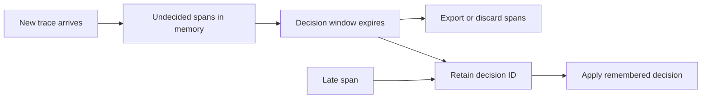

# How to Size Tail-Sampling Memory for Late-Arriving Spans

Author: [nawazdhandala](https://www.github.com/nawazdhandala)

Tags: OpenTelemetry, Performance

Description: Estimate concurrent traces, measure retained bytes, and size decision caches separately from the span buffer.

Tail-sampling memory depends on more than spans per second. The sampler retains undecided traces, each with a variable number of spans and attributes, while decision caches may retain identifiers after span data has been released. Late arrivals put pressure on both mechanisms in different ways.

Start with an explicit workload model, then validate it against process memory under representative traffic. The calculations below are planning estimates for Collector Contrib 0.120.0, not claims about a fixed byte cost per span.

## Estimate concurrently undecided traces

For a steady arrival rate, multiply new traces per second by the decision window. Apply a burst factor and account for uneven sharding. Do not use span rate as trace rate.

```python
new_traces_per_second = 1200
window_seconds = 30
burst_factor = 1.5
minimum_trace_slots = int(new_traces_per_second * window_seconds * burst_factor)
print(minimum_trace_slots)
assert minimum_trace_slots == 54000
```

A trace-count limit of 50,000 would already be smaller than this illustrative estimate. That is a capacity warning, not a memory measurement. One trace with 20,000 spans can consume more memory than thousands of short traces.



## Measure bytes with the actual workload

Run an isolated sampler under a stable fixture and compare retained memory against a baseline. Use RSS and heap measurements together, including warm-up and garbage-collection behavior. Keep exporter queues empty for the first measurement so their memory does not obscure sampling state.

The next calculation uses hypothetical measured values. Replace them with your own observations; do not copy the result into a container limit.

```python
baseline_mib = 180
loaded_mib = 900
retained_traces = 36000
bytes_per_trace_estimate = (loaded_mib - baseline_mib) * 2**20 / retained_traces
projected_slots = 54000
projected_mib = baseline_mib + projected_slots * bytes_per_trace_estimate / 2**20
print(round(bytes_per_trace_estimate), round(projected_mib))
```

Repeat with large exceptions, high fan-out traces, and delayed spans. An average measured from tiny healthy requests can severely understate the cost of the error traces your policy is designed to retain.

## Configure trace storage and decision caches separately

A possible starting fragment is:

```yaml
processors:
  tail_sampling:
    decision_wait: 30s
    num_traces: 60000
    expected_new_traces_per_sec: 1200
    decision_cache:
      sampled_cache_size: 120000
      non_sampled_cache_size: 600000
    policies:
      - name: errors
        type: status_code
        status_code:
          status_codes: [ERROR]
```

`expected_new_traces_per_sec` helps allocation planning; it is not a traffic admission limit. Cache sizes count remembered trace decisions, not full traces. A large drop cache can help keep late spans consistent with an earlier drop, but it cannot recover previously discarded spans or reconsider a newly discovered error.

Estimate cache residence using decision rate and capacity. For example, 600,000 entries at 1,000 new drop decisions per second represents roughly ten minutes before churn, under a simplified uniform model. Actual LRU behavior depends on repeated access and traffic distribution.

## Validate under combined pressure

After measuring the sampler alone, repeat with a slow backend and bounded exporter queues. Add memory for queued batches, receiver buffers, enrichment caches, the runtime, and burst allowance. Keep the memory limiter below the container's kill threshold and observe refusal behavior.

Scale with trace affinity. If every trace reaches a random replica, total memory may look healthy while each decision sees only fragments. Changes to the routing ring can also produce late spans on a different sampler, where the original cache is unavailable.

Watch the release-specific tail-sampling metrics for early eviction and late arrivals, inspecting the actual scrape for exact names. A successful sizing test shows stable memory, acceptable refusal rates, and complete retained fixture traces during peak load and recovery. A graph that merely stays below the container limit is insufficient evidence of sampling correctness.

## References

The [community question](https://stackoverflow.com/questions/77654922/otel-collector-tail-sampling) motivated this investigation. The implementation references are [official reference 1](https://raw.githubusercontent.com/open-telemetry/opentelemetry-collector-contrib/v0.120.0/processor/tailsamplingprocessor/README.md), [official reference 2](https://opentelemetry.io/docs/collector/scaling/).
