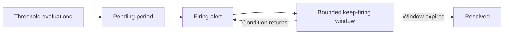

# How to Stop Flapping Alerts from Repeatedly Paging On-Call

Author: [nawazdhandala](https://www.github.com/nawazdhandala)

Tags: Prometheus, Alertmanager, SRE

Description: Trace alert identity and state transitions, then use stable labels and bounded firing persistence to reduce repeated pages safely.

An Alertmanager repeat interval limits reminders for an ongoing alert group. It is not a universal cooldown after every page. If an alert resolves and then fires again, or its labels change, the notification pipeline can treat it as new activity. Increasing the repeat interval may therefore leave the noisy behavior unchanged.

Start by exporting a short timeline from Prometheus and Alertmanager. This walkthrough assumes Prometheus 3.x and a compatible current Alertmanager. The application error-ratio metric below is a custom recording rule, not a built-in metric. Keep the remediation tied to the observed transition rather than suppressing all messages for a longer period.

## Verify alert identity

An alert's labels identify it. Put changing measurements and descriptive text in annotations. A label containing the current error percentage creates a new identity whenever the value changes, defeating continuity and potentially producing repeated notifications.

```yaml
groups:
  - name: checkout-alerts
    rules:
      - alert: CheckoutErrorRateHigh
        expr: checkout:error_ratio5m > 0.05
        for: 5m
        keep_firing_for: 10m
        labels:
          severity: critical
          service: checkout
        annotations:
          summary: Checkout error rate is high
          description: 'Current ratio: {{ $value }}'
```

Here `for` requires persistence before firing, while `keep_firing_for` keeps an already firing alert active through a bounded gap. They act at different ends of the transition. Ten minutes is an example, not a default recommendation: choose it from your observed gaps and recovery requirements. A longer value also delays the resolution signal.

## Reconstruct the state sequence

Record the complete label set, firing start, resolution, and notification timestamps. Do not rely on chat message text, which may combine several alerts. A fingerprint change with no real service change points toward labels or routing. A stable fingerprint with alternating states points toward the rule, missing telemetry, or threshold behavior.

```python
states = [(0,"firing"),(4,"resolved"),(6,"firing"),(9,"resolved"),(12,"firing")]
new_episodes = sum(state == "firing" and (i == 0 or states[i-1][1] != "firing")
                   for i, (_,state) in enumerate(states))
print("Separate firing episodes:", new_episodes)
assert new_episodes == 3
```

The fixture counts three episodes, even though they fit within a typical reminder interval. It is a state illustration, not a reimplementation of Alertmanager's notification log. Receiver retries, grouping updates, and high-availability behavior require their own evidence.



## Inspect routing after fixing the rule

Use stable group labels that match the operational incident boundary. The example groups by environment, service, and alert name, preventing unrelated environments from sharing the same notification group.

```yaml
route:
  receiver: incident-webhook
  group_by: [environment, service, alertname]
  group_wait: 30s
  group_interval: 5m
  repeat_interval: 4h
receivers:
  - name: incident-webhook
    webhook_configs:
      - url: http://notification-sink:8080/alerts
        send_resolved: true
```

This is a complete minimal routing example using a local test sink. Replace it with your reviewed receiver configuration. Disabling resolved notifications only hides resolution messages; it does not stop Prometheus from resolving the alert or make the next firing episode the same continuous event.

## Test both noise reduction and recovery

Replay a timeline containing a short failure, a sustained failure, a brief healthy gap, and a durable recovery. Verify that the initial page still arrives quickly enough and that a genuine recovery is eventually reported. Also simulate missing telemetry because a disappearing metric can look like a threshold recovery.

If the alert represents a user-impact symptom with rapidly fluctuating traffic, consider a better aggregation window or an SLO burn-rate condition. Do not use firing persistence to conceal an incorrect denominator. Keep a record of before-and-after episode counts, actual response actions, and delayed recovery notifications. The goal is fewer unnecessary interruptions while preserving the signal that requires an engineer to act.

Check whether an external incident integration applies its own grouping or reopening policy. Alertmanager may send one correctly grouped update while the destination creates a new incident because its deduplication key includes changing text. Compare the raw webhook payload with the destination record, and preserve the stable fingerprint or group identity through the adapter. This locates the responsibility at the correct boundary instead of repeatedly changing Prometheus timers to compensate for receiver behavior.

## References

The [community question](https://stackoverflow.com/questions/78192157/resolved-alerts-resets-repeat-interval-in-alertmanager) motivated this walkthrough. Implementation references:

- [Official reference 1](https://prometheus.io/docs/alerting/latest/configuration/)
- [Official reference 2](https://prometheus.io/docs/prometheus/latest/configuration/alerting_rules/)
