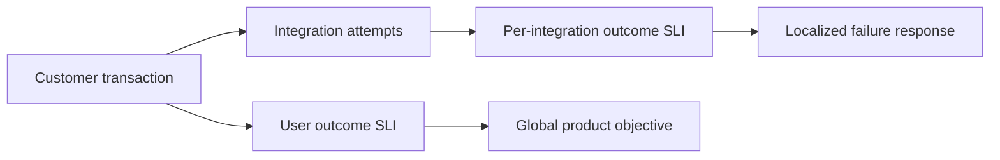

# How to Stop Global SLOs from Hiding a Failed Integration

Author: [nawazdhandala](https://www.github.com/nawazdhandala)

Tags: SLO, Prometheus, Python

Description: Keep request-weighted global reliability while adding bounded integration slices and low-volume response rules that expose localized outages.

A global availability score can remain excellent while one third-party integration fails every request. If the failing integration carries little traffic, successful requests elsewhere dominate the denominator. Keep the global score for the overall product, but add slices that reflect meaningful user journeys and ownership boundaries.

This example uses two synthetic payment integrations and custom request counters. The labels are bounded integration names, not customer IDs or arbitrary endpoint URLs. Decide which integrations deserve separate objectives based on product commitments, failure isolation, and response actions rather than creating a slice for every possible attribute.

## Demonstrate the masking effect

The fixture has a high-volume healthy integration and a low-volume integration with total failure. The global success rate is roughly 99.9%, while one customer path is unusable. Neither number is wrong; they describe different populations.

```python
integrations = {"primary":(100000,0),"regional":(100,100)}
total = sum(n for n,f in integrations.values())
failed = sum(f for n,f in integrations.values())
print("global",1-failed/total)
for name,(n,f) in integrations.items():
    print(name,1-f/n)
assert integrations["regional"][1] == integrations["regional"][0]
```

Do not replace the global metric with an unweighted average of integration percentages. That gives a tiny integration the same weight as a large one and changes the meaning again. Show both the request-weighted aggregate and the individual slices, with their request counts.

## Preserve integration labels through measurement

Record the selected integration when the request is attempted, including timeouts and connection failures. If the counter is emitted only after a successful response, the failed integration can disappear instead of looking unhealthy. The example calculates a per-integration error ratio.

```promql
sum by (integration) (rate(payment_requests_total{outcome="failed"}[15m]))
/
sum by (integration) (rate(payment_requests_total[15m]))
```

Define whether fallback attempts count as separate dependency events or one customer transaction. Both metrics can be valuable, but they answer different questions. A failed first provider followed by a successful fallback is a dependency failure and may still be a successful user transaction with increased latency.



## Create a bounded slice policy

The internal policy below identifies the expected integration set and the special response for sparse traffic. It is not a vendor configuration file. Keep the mapping near the service catalog and review it when providers are added or retired.

```yaml
service: payments
integration_slices: [primary, regional]
report_counts: true
unknown_integration_action: review
low_volume_response: inspect each failed customer transaction
synthetic_coverage:
  primary: enabled
  regional: enabled
```

An expected-integration inventory also helps detect a missing metric series. A healthy-looking dashboard containing only the remaining provider is insufficient. Monitor both unexpected disappearance and explicit failures, with a clear distinction between no traffic and no telemetry.

## Match paging to the response

For high-volume slices, a burn-rate policy can detect sustained impact. For low-volume slices, a minimum-volume gate may suppress a total outage indefinitely. Pair it with a suitable synthetic journey or a per-event response for important customer failures. Avoid paging every tiny slice identically if there is no urgent action; define ticket and escalation paths where appropriate.

During investigation, compare integration errors with user outcomes, fallback volume, latency, and geography. A provider outage that is fully absorbed by fallback may need a capacity warning before it becomes a user incident. A region-specific credential failure may require a different owner from a provider-wide outage.

Test a total failure of the low-volume integration, a telemetry disappearance, and a successful fallback scenario. The dashboard should make all three distinguishable. This preserves an honest global score while ensuring a small but important customer group cannot disappear inside a large denominator.

## References

The [community question](https://www.reddit.com/r/sre/comments/qsidvs/) motivated this walkthrough. Implementation references:

- [Official reference 1](https://sre.google/workbook/implementing-slos/)
- [Official reference 2](https://sre.google/workbook/alerting-on-slos/)
- [Official reference 3](https://prometheus.io/docs/practices/alerting/)
