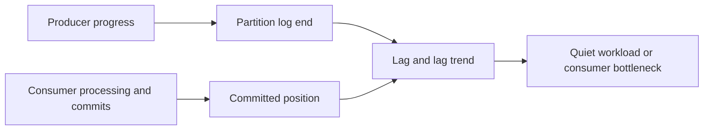

# How to Tell Falling Kafka Traffic from a Stalled Consumer

Author: [nawazdhandala](https://www.github.com/nawazdhandala)

Tags: Kafka, Monitoring, Python

Description: Compare producer progress, committed offsets, partition lag, and business processing rates before interpreting a drop in daily Kafka consumption.

Lower consumer throughput can mean fewer records were produced, a consumer stopped making progress, or the workload moved to another partition or group. A comparison with yesterday's total cannot distinguish these causes. Inspect production, consumption, and lag over the same interval, then connect offsets to business processing semantics.

The examples use Apache Kafka 4.1 command-line tools and a Python 3 offset fixture. Use the client configuration file approved for your cluster authentication. These commands describe state; they do not reset offsets or change group membership. Keep consumer group and topic names explicit because similar names can refer to different processing pipelines.

## Inspect partition-level group progress

Describe the consumer group and record current offsets, log-end offsets, lag, and assigned members. A group-level total can hide one stuck partition while other partitions continue normally.

```bash
bin/kafka-consumer-groups.sh \
  --bootstrap-server broker.example.com:9092 \
  --command-config client.properties \
  --describe --group billing-worker
```

Repeat at a bounded interval and compare the same partitions. Rebalances can temporarily change assignment and progress. Missing committed offsets require separate interpretation; do not convert an unknown offset into zero and report an enormous invented backlog.

## Compare offset movement and lag movement

The fixture models one partition over five minutes. In the first scenario, production and consumption both slow together without increasing lag. In the second, producers advance while the committed consumer position barely moves.

```python
scenarios = {
 "quiet": {"end0":1000,"end1":1050,"commit0":990,"commit1":1040},
 "stalled": {"end0":1000,"end1":1500,"commit0":990,"commit1":1000},
}
for name,s in scenarios.items():
    produced = s["end1"]-s["end0"]
    committed = s["commit1"]-s["commit0"]
    lag0,lag1 = s["end0"]-s["commit0"],s["end1"]-s["commit1"]
    print(name,{"produced_offset_delta":produced,"committed_delta":committed,"lag_change":lag1-lag0})
assert scenarios["stalled"]["end1"]-scenarios["stalled"]["commit1"] == 500
```

Offset differences are progress indicators, not always exact counts of business records. Compaction, transactional records, filtering, and commit strategy affect interpretation. A committed offset also does not necessarily prove that an external side effect completed if the application commits before processing.



## Keep business progress beside broker progress

Record successfully processed business events and failures in the consumer application. The internal observation below separates fetched, processed, and committed progress so a fast poll loop cannot hide a stuck downstream database write.

```json
{"group":"billing-worker","partition":2,"window_seconds":300,"fetched_records":500,"processed_events":10,"committed_offset_delta":10,"downstream_error_count":490}
```

Map Kafka JMX metrics to your monitoring system using the exporter configuration you actually deploy. Names in Prometheus often differ from native Kafka metric names. Verify the mapping instead of copying a plausible `kafka_*` query from another installation.

## Compare yesterday only after diagnosis

Daily totals are useful for volume anomaly detection, but compare equivalent time-of-day windows and account for weekends, holidays, and upstream schedules. Use counter increases rather than summing sampled cumulative counters. A counter reset after a restart must not look like negative business volume.

If lag grows, inspect processing latency, downstream errors, rebalance frequency, partition skew, and whether enough consumers can be assigned useful work. Adding more consumers than partitions cannot create unlimited parallelism. If production falls and lag stays low, investigate the producer or upstream source rather than restarting healthy consumers.

Test the dashboard with a quiet producer, a paused consumer, a failed downstream dependency, and a rebalance. The completed view should explain whether records stopped arriving, stopped being processed, or stopped being committed, with partition-level evidence that survives a misleading global average.

Add a processing-age signal when the product promises timely results. Offset lag is a count-like distance and cannot tell whether the oldest unprocessed business event is seconds or hours old. A low-volume partition can have a tiny lag while violating a strict deadline. Preserve event timestamps and measure the age of unfinished work at the application boundary. Use that signal alongside partition lag, with explicit handling for producer clock errors and out-of-order events, so the dashboard reflects both backlog size and customer-visible delay.

## References

The [community question](https://stackoverflow.com/questions/61357676/compare-last-day-total-consumption-for-kafka-consumer-in-grafana) motivated this walkthrough. Implementation references:

- [Official reference 1](https://kafka.apache.org/41/operations/monitoring/)
- [Official reference 2](https://kafka.apache.org/41/operations/basic-kafka-operations/)
