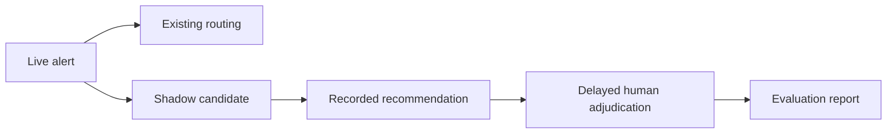

# How to Test AI Alert Prioritization in Shadow Mode

Author: [nawazdhandala](https://www.github.com/nawazdhandala)

Tags: AI, SRE, Python

Description: Evaluate AI triage against frozen incident labels while preserving existing paging, measuring missed critical events, and recording reviewable decisions.

Shadow mode means an AI system makes recommendations without changing who is paged, which alerts are suppressed, or how incidents escalate. Existing routing remains authoritative while you collect evidence about the candidate's decisions. This is a practical way to discover whether prioritization helps before giving it operational authority.

The examples use Python 3 and a vendor-neutral decision schema. They do not call a model API. You can use the same evaluation format for a language model, a classifier, or a rules-based baseline. Keep the baseline in the experiment: a complex system should earn its place by improving outcomes that matter.

## Freeze the decision boundary

Capture only the information available at the time of each alert. Later incident conclusions must not leak into the candidate input. Include alert labels, relevant recent telemetry summaries, known ownership, and timestamps. Store the prompt or policy version, candidate version, and input snapshot identifier with every decision.

```json
{"alert_id":"a-17","input_snapshot":"snap-17","candidate_version":"triage-3","recommended_priority":"critical","reason":"checkout failures exceed the reviewed threshold","evidence_ids":["metric-17"],"abstain":false}
```

Treat abstention as an expected outcome. Missing context should produce an explicit request for human review, not a confident low-priority classification. Keep logs and retrieved text as untrusted evidence: instructions contained inside them should not change the evaluator's policy or enable tool actions.

## Evaluate missed critical incidents first

Measure performance at the incident level as well as the alert level. Ten correlated alerts from one outage should not dominate the score. The fixture computes critical-event recall and precision from a tiny synthetic dataset. A real evaluation needs enough diverse incidents to support a useful confidence statement.

```python
truth = {"i1":True,"i2":True,"i3":False,"i4":False}
predicted = {"i1":True,"i2":False,"i3":True,"i4":False}
tp = sum(truth[k] and predicted[k] for k in truth)
fn = sum(truth[k] and not predicted[k] for k in truth)
fp = sum(not truth[k] and predicted[k] for k in truth)
recall = tp/(tp+fn)
precision = tp/(tp+fp) if tp+fp else None
print({"critical_recall":recall,"critical_precision":precision,"misses":fn})
assert recall == 0.5 and fn == 1
```

The example misses one of two critical incidents, which is unacceptable regardless of any reduction in low-priority recommendations. Do not present this as a benchmark. It demonstrates why overall accuracy can hide the failure class that matters most for paging.



## Make promotion criteria explicit

Define the evaluation period, service coverage, acceptable miss policy, and reviewer responsibilities before inspecting results. Otherwise it is easy to select only examples that make the system look useful. The policy below is an internal example and deliberately requires human review before any authority change.

```yaml
mode: shadow
can_page: false
can_suppress: false
can_change_routes: false
review_required_for_promotion: true
required_slices: [low-traffic, partial-outage, telemetry-loss, dependency-failure]
report: [critical-misses, false-escalations, abstentions, decision-latency]
```

## Review explanations as well as labels

A correct priority with fabricated evidence is not a trustworthy decision. Verify that each cited evidence ID exists, was available before the decision, and supports the stated reason. Record unsupported claims separately from classification errors. Also measure latency and availability: a recommendation arriving after the human has resolved the incident has limited triage value.

Use chronological holdouts so the candidate cannot memorize later versions of the same incident. Include quiet periods and unfamiliar failures, not only well-documented outages. Have more than one reviewer adjudicate ambiguous cases and preserve disagreements instead of forcing a false ground truth.

At the end of shadow mode, produce a report with the incident sample, errors, abstentions, and comparison to the baseline. A passing evaluation can justify a narrowly scoped assisted workflow, such as suggesting queue order to a human. It does not automatically justify autonomous suppression or paging. Those are separate authority changes with separate acceptance tests.

## References

The [community question](https://www.reddit.com/r/sysadmin/comments/1qviqak/how_are_you_handling_triage_and_oncall_across/) motivated this walkthrough. Implementation references:

- [Official reference 1](https://sre.google/workbook/alerting-on-slos/)
- [Official reference 2](https://docs.python.org/3/library/json.html)
