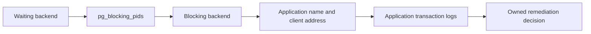

# How to Trace a Blocking PostgreSQL Transaction to Its Client

Author: [nawazdhandala](https://www.github.com/nawazdhandala)

Tags: PostgreSQL, Incident Management, Monitoring

Description: Follow pg_blocking_pids to the blocking session, inspect transaction age and client identity, and connect the backend to application ownership before acting.

A blocked query often points to a client that opened a transaction and then stopped issuing commands. The blocker may appear idle, so filtering only active queries misses it. Start with PostgreSQL's blocking relationship, then inspect the blocking backend's transaction age and application identity.

These read-only queries target PostgreSQL 17. Use a role with the required monitoring visibility and keep query samples restricted. Do not terminate a backend until the responsible operator understands the transaction and its user impact. The goal of this walkthrough is attribution and evidence, not automated cleanup.

## Find the actual blocking relationship

Use `pg_blocking_pids` instead of attempting a partial lock-table join that can miss lock modes or queue relationships. The query expands each waiting backend's blocker list and joins it to activity details.

```sql
SELECT waiting.pid AS waiting_pid,
       waiting.application_name AS waiting_app,
       blocker.pid AS blocking_pid,
       blocker.application_name AS blocking_app,
       blocker.state AS blocking_state,
       clock_timestamp() - blocker.xact_start AS blocking_transaction_age
FROM pg_stat_activity AS waiting
CROSS JOIN LATERAL unnest(pg_blocking_pids(waiting.pid)) AS blocked_by(pid)
JOIN pg_stat_activity AS blocker ON blocker.pid = blocked_by.pid
ORDER BY blocker.xact_start;
```

Sample at a sensible interval rather than running this in a tight loop. Lock state changes rapidly, so a blocker can disappear between observations. An empty result after the incident is not evidence that blocking never happened; retain timestamped samples during the event.

## Inspect the blocking client's identity

Once you have a backend PID, inspect application name, client address, backend start, transaction start, and last query. Replace the example PID with the observed blocker. Recheck it before any later action because PIDs can be reused after a session exits.

```sql
SELECT pid, backend_start, application_name, usename, datname,
       client_addr, client_port, state, xact_start, state_change,
       wait_event_type, wait_event, LEFT(query, 200) AS query_sample
FROM pg_stat_activity
WHERE pid = 12345;
```

For an idle-in-transaction blocker, the query is the last command, not necessarily the statement that acquired every held lock. Application request logs and transaction boundaries are needed to reconstruct the full scope. A client address may identify a proxy or pooler rather than the original application instance.



## Improve attribution before the next incident

Set a stable application name in the client connection configuration and include the backend PID in diagnostic context where the driver supports it. Use service and instance identity without embedding customer data. The following SQL demonstrates the session setting for a controlled diagnostic client.

```sql
SET application_name = 'checkout-worker-diagnostic';
SELECT pg_backend_pid() AS backend_pid;
```

In a pooled application, configure identity consistently and understand reset behavior. Avoid setting a per-request application name and forgetting to restore it, which can misattribute the next borrower of the connection. Trace IDs belong in application logs or carefully managed session context, not in an unbounded metrics label.

## Decide the response from impact and ownership

An application rollback may release locks safely if the owning request can still respond. Canceling the current query does not necessarily end an idle transaction, because there may be no active query to cancel. Terminating the session is a different action with rollback consequences and should follow your database runbook.

For prevention, inspect exception paths, transaction scopes spanning remote calls, unconsumed readers, and missing disposal. Consider a scoped idle-in-transaction timeout after testing the application's recovery behavior. Do not apply a broad timeout without considering maintenance and legitimate long-running work.

Capture the waiting query, blocker identity, transaction age, and owner response in the incident record. If a proxy obscures the original client, document that limitation and add correlation at the application boundary. A complete investigation connects the lock wait to the code path that left the transaction open, rather than merely identifying a database PID to remove.

Prepared transactions are a special limitation of this activity join. PostgreSQL can report a zero blocker PID for a prepared transaction, which has no ordinary live client row in `pg_stat_activity`; the inner join will omit that case. If blocking is reported but no client blocker appears, inspect the raw blocker PID array and the prepared-transaction inventory with your database owner. Do not assume the relationship vanished merely because the convenience join returned no row. Likewise, retain backend start time with a PID so later evidence does not accidentally refer to a reused process identifier.

## References

The [community question](https://stackoverflow.com/questions/18789586/postgres-how-to-debug-trace-idle-in-transaction-connection) motivated this walkthrough. Implementation references:

- [Official reference 1](https://www.postgresql.org/docs/17/monitoring-stats.html)
- [Official reference 2](https://www.postgresql.org/docs/17/functions-info.html)
- [Official reference 3](https://www.postgresql.org/docs/17/runtime-config-client.html)
