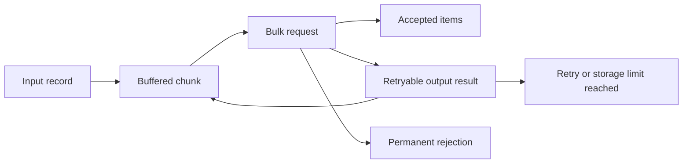

# How to Trace Dropped Logs Through Fluent Bit Bulk Rejections

Author: [nawazdhandala](https://www.github.com/nawazdhandala)

Tags: Fluent Bit, Observability

Description: Inspect Elasticsearch bulk item errors, Fluent Bit retry outcomes, and finite storage to distinguish delayed logs from discarded records.

An Elasticsearch bulk HTTP request can succeed at the transport level while individual items fail. Conversely, a transient HTTP rejection may be retried by Fluent Bit and eventually delivered. To diagnose missing logs, follow the record through input, chunk buffering, bulk response, retry scheduling, and final storage.

Use the exact Fluent Bit or AWS for Fluent Bit image deployed in your environment. Output-plugin behavior and available diagnostics vary by release. The classic configuration fragments below illustrate common Elasticsearch output and filesystem-buffering controls.

## Read the item-level error

A bulk response contains an overall error indicator and per-item statuses. This simplified fixture shows one successful document and one mapping failure:

```json
{
  "errors": true,
  "items": [
    {"index": {"status": 201, "_id": "event-1"}},
    {"index": {"status": 400, "error": {"type": "mapper_parsing_exception"}}}
  ]
}
```

A mapping error will not be repaired by retrying the identical document indefinitely. A 429 or temporary service failure points to capacity or availability instead. Preserve the error type, index, and a redacted example record so the source schema can be corrected.

Temporarily enable output error tracing in an isolated test:

```ini
[OUTPUT]
    Name                es
    Match               application.*
    Host                elasticsearch.example.net
    Port                443
    tls                 On
    Suppress_Type_Name  On
    Trace_Error         On
    Retry_Limit         8
```

Supply authentication through the supported mechanism for your deployment. Error tracing can expose payloads, so use a controlled fixture and disable it after diagnosis. `Suppress_Type_Name` is relevant to modern Elasticsearch versions that removed mapping types.



## Bound and observe the retry buffer

Filesystem buffering can retain chunks across Fluent Bit process restarts when the storage volume survives. It is not unlimited retention.

```ini
[SERVICE]
    Flush                       1
    storage.path                /var/lib/fluent-bit/buffer
    storage.max_chunks_up       32

[INPUT]
    Name                        tail
    Path                        /var/log/application/*.log
    Tag                         application.logs
    DB                          /var/lib/fluent-bit/tail.db
    storage.type                filesystem
```

The tail database records file position. The output chunk store records buffered delivery work. These solve different problems: a saved offset does not prove the destination accepted that record.

Set a per-output disk backlog limit in the output definition:

```ini
[OUTPUT]
    Name                        es
    Match                       application.*
    Host                        elasticsearch.example.net
    Port                        443
    tls                         On
    storage.total_limit_size    2G
    Retry_Limit                 8
```

This is an alternative output fragment to merge with the first, not a second duplicate output. At the configured limit, older queued data can be discarded according to buffering behavior. Monitor output errors, retries, retry failures, dropped records, and storage backlog using the metrics exposed by your version.

## Reconcile a numbered fixture

Send a finite sequence with a run ID, intentionally cause one mapping error in a staging index, and temporarily reject ingestion. After recovery, query all sequence numbers and identify missing or duplicate records. Distinguish permanent schema rejection from transient delivery delay.

If retries resend a partially accepted chunk, stable document IDs can help avoid duplicates, but their configuration and collision semantics must be understood. Do not assume the plugin provides exactly-once delivery automatically.

Check whether the source file rotated away while input was paused, whether the filesystem filled, and whether the task or Pod was replaced with an empty volume. Each is a separate loss boundary. The final runbook should state which failures are retried, which are discarded, and which require a schema or capacity fix before replay.

## References

The [community question](https://www.reddit.com/r/elasticsearch/comments/g1snjl/) motivated this investigation. The implementation references are [official reference 1](https://docs.fluentbit.io/manual/data-pipeline/outputs/elasticsearch), [official reference 2](https://docs.fluentbit.io/manual/administration/buffering-and-storage), [official reference 3](https://docs.fluentbit.io/manual/administration/scheduling-and-retries).
