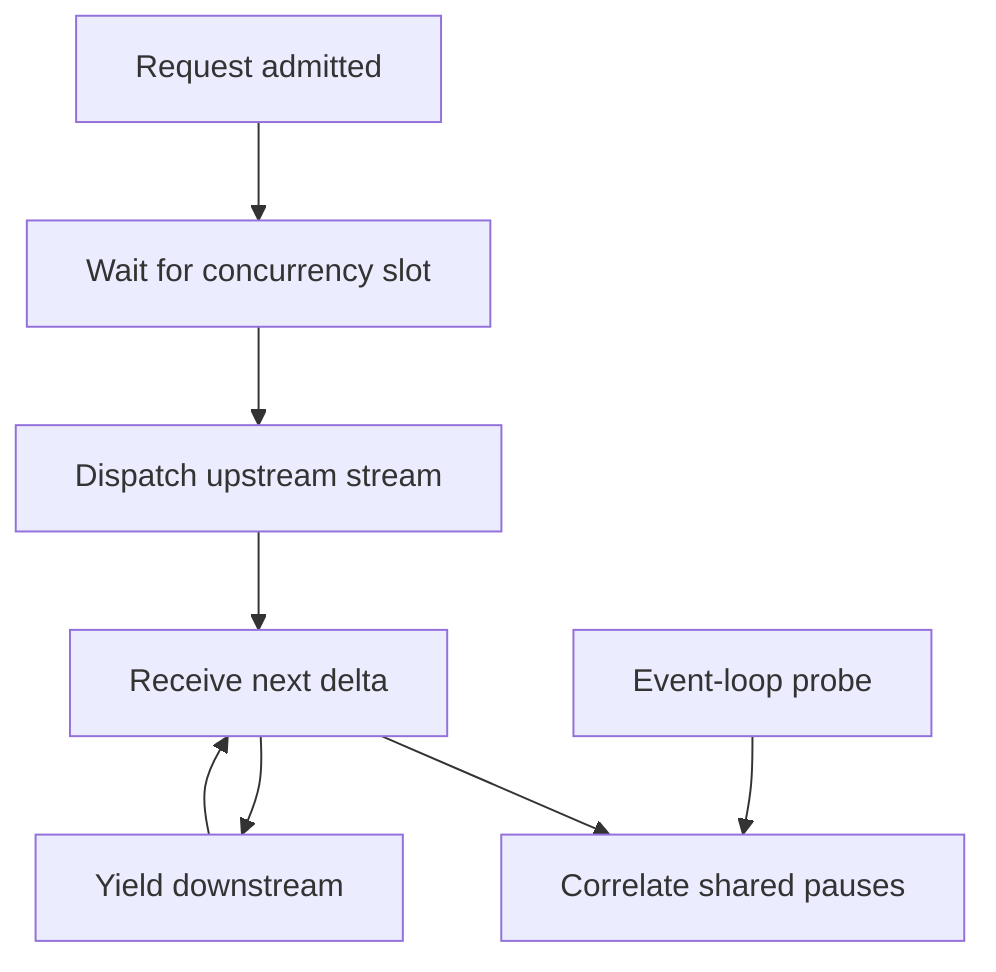

# How to Trace LLM Streaming Stalls During Concurrent FastAPI Requests

Author: [nawazdhandala](https://www.github.com/nawazdhandala)

Tags: AI, FastAPI, Python, Observability

Description: Use event-loop lag, queue wait, and per-stream gaps to distinguish blocking FastAPI code from model limits and slow consumers.

A stream that behaves well alone can stall when another FastAPI request arrives. The important question is whether all active streams pause together or just the new request waits. A shared event-loop pause points toward blocking code. A delay before upstream dispatch suggests queueing or a concurrency limit. A single slow stream can instead reflect its provider connection or client backpressure.

Instrument these boundaries before increasing worker count. Additional workers can hide a blocking function while leaving the underlying problem in place. The examples use Python 3.11 or later. The local fixtures run without a model account; integrate the same measurements into your FastAPI application after establishing a baseline.

## Measure the scheduler, not only the stream

This fixture introduces a deliberate blocking sleep alongside an event-loop probe. The probe compares the scheduled wakeup with the actual wakeup using the loop's monotonic clock. It is a diagnostic demonstration, not code to place in a production request handler.

```python
import asyncio
import time

async def probe(samples):
    loop = asyncio.get_running_loop()
    for _ in range(6):
        expected = loop.time() + 0.02
        await asyncio.sleep(0.02)
        samples.append(max(0.0, loop.time() - expected))

async def blocking_work():
    await asyncio.sleep(0.03)
    time.sleep(0.08)  # Deliberately blocks every task on this event loop.

async def main():
    samples = []
    await asyncio.gather(probe(samples), blocking_work())
    print({"maximum_loop_lag_ms": round(max(samples) * 1000, 1)})

asyncio.run(main())
```

The maximum lag should visibly exceed the probe's normal scheduling noise, but its exact value depends on the host. Do not turn a machine-dependent value into a brittle test assertion. In production, aggregate the lag distribution per worker and compare its time range with stream gaps.



## Separate admission wait from provider wait

The next complete offline fixture models two requests sharing one slot. Each receives its own timing record. Waiting for the semaphore is application queueing, and the delay after acquisition is simulated upstream work. This distinction prevents a capacity limit from being misreported as model prefill.

```python
import asyncio
import time

async def request(name, slots):
    admitted = time.perf_counter()
    async with slots:
        dispatched = time.perf_counter()
        await asyncio.sleep(0.03)
        first = time.perf_counter()
    return {"request": name,
            "queue_ms": round((dispatched - admitted) * 1000, 1),
            "upstream_first_ms": round((first - dispatched) * 1000, 1)}

async def main():
    slots = asyncio.Semaphore(1)
    rows = await asyncio.gather(request("a", slots), request("b", slots))
    assert len(rows) == 2
    print(rows)

asyncio.run(main())
```

Expect the second request to accumulate queue time while both upstream intervals remain near the simulated delay. A real connection pool can introduce another queue. Record connection acquisition separately if the client exposes it, and set limits intentionally rather than accepting unrelated defaults across every layer.

## Remove the blocking boundary

For an asynchronous HTTP client, keep iteration asynchronous and reuse a client with a controlled lifetime. If an unavoidable legacy operation performs blocking I/O, move that operation to a worker thread. The following fixture illustrates that boundary without involving an external service.

```python
import asyncio
import time

def legacy_lookup():
    time.sleep(0.05)
    return {"document_count": 3}

async def lookup():
    return await asyncio.to_thread(legacy_lookup)

async def main():
    result, _ = await asyncio.gather(lookup(), asyncio.sleep(0.01))
    assert result["document_count"] == 3
    print(result)

asyncio.run(main())
```

Thread offloading is appropriate for blocking I/O; it does not make unbounded concurrency safe. CPU-heavy work may need a separate process or service. Bound your thread and request queues, and define rejection behavior before a traffic burst exhausts memory.

## Read the evidence together

Shared pauses plus high loop lag support a blocking-code hypothesis. Stable loop lag plus growing admission wait suggests capacity pressure. Stable admission time plus gaps on one upstream connection suggests provider or network behavior. Timely upstream deltas with slow downstream yields suggest a slow consumer or response middleware.

Track cancellations in a `finally` block so abandoned streams release their resources. Keep each request's sequence number, elapsed gap, and outcome separate; a global last-token variable will manufacture false cross-request stalls. Finally, repeat the experiment at several controlled concurrency levels and with the same output length. That gives a useful capacity curve instead of one anecdote from a busy worker.

## References

This tutorial addresses the problem in the [community question](https://stackoverflow.com/questions/77026648/how-to-ensure-uninterrupted-streaming-with-openais-chat-completion-api-and-hand). Implementation details were checked against these primary sources:

- [Official documentation 1](https://www.starlette.io/responses/)
- [Official documentation 2](https://www.python-httpx.org/async/)
