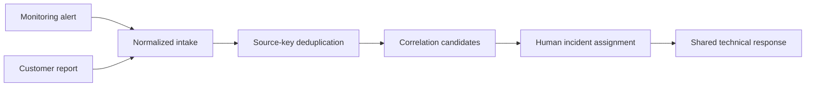

# How to Unify Incident Intake Across Reports and Monitoring Alerts

Author: [nawazdhandala](https://www.github.com/nawazdhandala)

Tags: Incident Management, Python, SRE

Description: Normalize reports into one intake ledger, deduplicate source deliveries, and correlate likely incidents without automatically merging ambiguous failures.

Customer reports and monitoring alerts often describe the same outage using different language and timestamps. A unified intake layer should preserve both sources, prevent duplicate delivery from creating duplicate records, and help a human correlate likely incidents. It should not erase distinct customer impact merely because two reports mention the same service.

This walkthrough uses Python 3 and SQLite to demonstrate ingestion idempotency. The schema is internal and vendor-neutral. It does not send messages or modify tickets. Map supported webhooks or exports into this record shape, keeping source permissions and original links intact.

## Normalize without discarding source meaning

Use fields for source, source event ID, received time, reported impact time, service, environment, symptom, and evidence link. Customer-reported time may be approximate, while a monitoring timestamp may represent an aggregation window. Preserve that distinction instead of treating both as exact instants.

```json
{"source":"support","source_event_id":"ticket-1042","received_at":"2026-11-15T10:10:00Z","reported_impact_start":"2026-11-15T10:00:00Z","service":"checkout","environment":"prod","symptom":"payment cannot complete","source_url":"support/ticket-1042","correlation_status":"unreviewed"}
```

Do not copy unnecessary customer text into a broad operational queue. Retain a concise redacted summary and a permission-preserving link. The source record remains authoritative for customer communication, while the incident ledger coordinates technical response.

## Make repeated delivery idempotent

Webhook retries are normal. Use a unique key combining source and source event ID so the same delivery cannot create multiple intake items. Do not deduplicate solely on message text, because two customers can legitimately report the same symptom.

```python
import sqlite3
con = sqlite3.connect(":memory:")
con.execute("CREATE TABLE intake(source TEXT,event_id TEXT,service TEXT,summary TEXT,UNIQUE(source,event_id))")
record = ("support","ticket-1042","checkout","payment cannot complete")
for _ in range(2):
    con.execute("INSERT OR IGNORE INTO intake VALUES(?,?,?,?)",record)
count = con.execute("SELECT COUNT(*) FROM intake").fetchone()[0]
print("Intake records:",count)
assert count == 1
```

In production, distinguish a retry from an update to an existing source event. Store event versions or update timestamps and preserve history. A later customer message can add important impact even though the ticket ID is unchanged. Idempotency should remove duplicate processing, not suppress new information.



## Suggest correlations with explicit reasons

Use service, environment, time overlap, region, and symptom class to propose an incident match. Keep the decision reversible and show why the match was suggested. The following is an internal correlation record, not an automatic merge command.

```yaml
intake_id: support-ticket-1042
candidate_incident: inc-42
matching_evidence:
  - same service and environment
  - reported impact overlaps incident window
  - payment failure symptom is consistent
uncertainty: customer region not yet known
required_action: responder reviews association
```

A global service incident may contain multiple regional failures with different causes. Conversely, several alerts from different services may belong to one shared dependency outage. Keep source records linked to the incident rather than destructively merging them into one summary that loses their distinctions.

## Define ownership and feedback

Assign an intake triage owner and an escalation deadline based on impact. An unreviewed customer report should not wait indefinitely because no monitoring alert exists. Likewise, a monitor-only incident should not be considered low impact simply because support has not received a ticket.

When a responder associates or separates records, store that decision and reason. Feed the outcome back into correlation rules and monitoring gaps during review. If customer reports repeatedly precede alerts, investigate detection coverage. If one source produces duplicates, repair its delivery semantics rather than teaching responders to ignore it.

Test duplicate deliveries, source updates, two unrelated failures in the same service, and one dependency outage affecting several services. The unified view succeeds when responders see all relevant evidence in one place while preserving source identity, uncertainty, and the ability to correct a mistaken association.

## References

The [community question](https://www.reddit.com/r/sre/comments/1qvimz3/how_are_you_handling_triage_across_multiple/) motivated this walkthrough. Implementation references:

- [Official reference 1](https://sre.google/workbook/incident-response/)
- [Official reference 2](https://docs.python.org/3/library/sqlite3.html)
