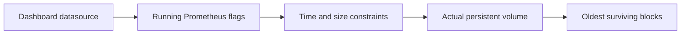

# How to Verify Prometheus Retention When History Stops at 15 Days

Author: [nawazdhandala](https://www.github.com/nawazdhandala)

Tags: Prometheus, Grafana, Storage

Description: Check effective Prometheus retention flags, competing size limits, datasource selection, and persistent volumes when older metrics disappear.

A dashboard ending at exactly fifteen days is a clue, not proof that Prometheus ignored your configuration. The dashboard may query a different server, the running process may still use defaults, or a size threshold may remove data before the configured time limit. Inspect the effective process and storage before increasing retention again.

The commands below assume Prometheus 3.x, `curl`, and `jq`. Use an authenticated administrative endpoint appropriate for your environment. Status responses can include deployment details, so keep them in the incident workspace rather than posting them publicly. None of the commands changes server configuration.

## Identify the actual datasource

Open the dashboard query inspector and record the datasource URL and executed query. Follow any proxy or load balancer to the real Prometheus instances. Two replicas with different volumes can return different oldest samples, especially if a load balancer distributes range requests without a consistent backend.

```bash
curl -fsS 'http://localhost:9090/api/v1/status/buildinfo' | jq '.data.version'
curl -fsS 'http://localhost:9090/api/v1/status/flags' \
  | jq '.data | with_entries(select(.key | startswith("storage.tsdb")))'
```

The flags response is more useful than a Helm values file sitting in a repository. Storage retention is configured through process arguments. A configuration reload does not necessarily replace those arguments; confirm the rollout created processes with the desired flags. If an operator owns the workload, change the operator's supported resource rather than patching a generated pod that will be reconciled away.

## Check both retention constraints

Prometheus uses whichever configured retention constraint removes data first. A year-long time setting cannot preserve a year if the size threshold is reached in two weeks. Inspect the physical volume size as well, because compaction needs working space above retained blocks.

```bash
# Illustrative process arguments, not a command to run beside an existing server.
prometheus \
  --config.file=/etc/prometheus/prometheus.yml \
  --storage.tsdb.path=/prometheus \
  --storage.tsdb.retention.time=365d \
  --storage.tsdb.retention.size=800GB
```

The values only make sense on a sufficiently sized volume. They are not a recommendation to retain a year locally. Confirm that the same persistent volume is mounted after deployments and restarts. An ephemeral filesystem can make a perfectly configured server lose all previous history each time its pod is replaced.



## Inspect block time ranges

Read the block metadata from a backup copy or a read-only volume snapshot. Each block records its covered timestamps. The following fixture demonstrates the conversion without accessing a live database. Real metadata should be enumerated from the configured storage directory, excluding WAL and head directories.

```python
from datetime import datetime, timezone
blocks = [
    {"ulid": "example-a", "minTime": 1792886400000, "maxTime": 1792972800000},
    {"ulid": "example-b", "minTime": 1792972800000, "maxTime": 1793059200000},
]
oldest = min(block["minTime"] for block in blocks)
print(datetime.fromtimestamp(oldest/1000, timezone.utc).isoformat())
assert oldest == 1792886400000
```

If blocks older than fifteen days exist but the dashboard shows nothing, investigate query lookback, label changes, and datasource routing. A renamed job can make historical data disappear from a selector while it remains physically stored. Try a stable metric and compare its old and new label sets. Do not use one recently introduced application metric as the sole retention probe.

## Estimate whether the target is feasible

A simple ratio can expose a contradictory size setting. If retained blocks grow by 10 GiB per day and the practical block budget is 150 GiB, a year-long flag cannot overcome that budget. Measure compressed block growth across representative days, then include WAL, head chunks, compaction overlap, backups, and expected growth in the volume plan.

Once the configuration is corrected, existing deleted history does not reappear. Recovery requires an available backup or a separate remote metrics store with a supported query path. The acceptance test is prospective: record the oldest available block today, verify the intended flags on every replica, and check that the oldest timestamp advances according to the selected policy over subsequent days. Keep a short written record of which datasource offers local versus long-term history so operators know where to look during the next incident.

## References

The [community question](https://stackoverflow.com/questions/59401508/prometheus-retention-time-set-to-1-year-but-not-keeping-data-beyond-default-15-d) motivated this walkthrough. Implementation references:

- [Official reference 1](https://prometheus.io/docs/prometheus/latest/storage/)
- [Official reference 2](https://prometheus.io/docs/prometheus/latest/querying/api/)
