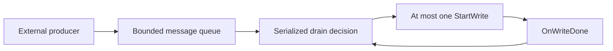

# How to Feed a C++ gRPC Streaming Reactor Without Blocking Its Callback Threads

Author: [nawazdhandala](https://www.github.com/nawazdhandala)

Tags: gRPC, C++, Streaming, Concurrency

Description: Feed a C++ gRPC server reactor through a bounded queue without waiting in callbacks, overlapping writes, or racing final cleanup.

A server-streaming reactor often has nothing to send until another thread produces an event. Waiting on a condition variable inside `OnWriteDone()` looks convenient, but it ties up a gRPC callback thread and can delay unrelated calls.

Keep callbacks short. Let the producer announce available data, and let one synchronized state machine decide when a write may start. The [C++ callback guidance](https://grpc.io/docs/languages/cpp/best_practices/) separates these external operations from operations started inside reactions.

## Separate waiting from writing

The producer can wait for its database, queue, or device using an application-owned worker. When data arrives, it offers a message to a bounded per-call queue and schedules a drain attempt. `OnWriteDone()` schedules the same drain path after releasing the completed message.



The drain path must also run when a producer inserts into an empty queue. If only `OnWriteDone()` starts the next write, an empty stream can remain idle forever because there is no outstanding write to complete.

## Write down the state before the code

A useful design tracks these properties under one synchronization strategy:

| State | Purpose |
| --- | --- |
| Queued messages | Own messages not yet submitted |
| In-flight message | Own the object referenced by the active write |
| Write pending | Prevent a second write until completion |
| Input closed | No more producer messages will be accepted |
| Terminal requested | Stop normal work after cancellation or failure |
| Finish started | Prevent further operations and repeated Finish calls |

The following is **design pseudocode**, not a drop-in reactor implementation. The dispatcher must serialize these transitions and keep the reactor alive while any scheduled callback can reach it.

```text
on producer offer(message):
    reject if input closed, terminal requested, finish started, or queue is full
    enqueue an owned message
    schedule drain

on producer completion:
    mark input closed
    schedule drain

on cancellation:
    request terminal state and stop producers asynchronously
    schedule drain

on write completion(ok):
    release the in-flight message
    clear write-pending
    if not ok: request terminal state and stop producers
    schedule drain

drain:
    if finish already started or write pending: return
    if terminal requested: quiesce producers, then finish once
    else if queue has data:
        move one message into stable in-flight storage
        mark write-pending before starting the write
        StartWrite(address of in-flight message)
    else if input closed: quiesce producers, then finish once
    else: return immediately
```

The [ServerWriteReactor API](https://grpc.github.io/grpc/cpp/classgrpc_1_1_server_write_reactor.html) supplies the transport operations. Your application supplies the queue, ownership, and producer shutdown protocol. Do not hide blocking cleanup inside the pseudocode's `quiesce` step; initiate asynchronous detachment and finish when it is complete.

## Make lifetime management explicit

Most reactor reactions may overlap. A mutex around the queue is not enough if cancellation leads to final cleanup while a producer still holds a raw pointer to the reactor.

On cancellation, stop new offers, cancel or detach the producer subscription, and ensure all callbacks that could reference the reactor have finished before final deletion. The server must still call `Finish()` after cancellation; `OnDone()` runs only after `Finish()` and all other gRPC reactions have completed. External application work must obey its own lifetime contract too.

Client-side reactor holds solve a specific client lifetime problem. They are not an API to copy into a server reactor. For server outside-reactor operations, coordinate shutdown and `Finish()` so no new operation starts after finishing begins.

## Choose a queue-full policy

A stalled client must not cause unbounded server memory. Pick a maximum queued byte count as well as a message count if payload sizes vary. Pause an upstream producer, reject the subscription with a documented status, or drop events only when the protocol explicitly permits loss.

Expose queued bytes and time since the last completed write. These help distinguish an idle producer from a stalled write path, but do not prove that the client stopped reading: gRPC buffers writes, and write completion does not acknowledge application-level consumption.

## Exercise the races

Test data arriving on an empty queue, cancellation during an active write, producer completion during cancellation, and an offer immediately before final cleanup. Run your implementation with C++ sanitizers where available. Assert one write in flight, one terminal transition, and no access after `OnDone()` cleanup.

## Conclusion

Return immediately when there is nothing to send. A bounded queue, one drain decision, stable message ownership, and coordinated producer shutdown let a reactor handle external events without blocking gRPC's callback threads.

## Official Documentation

- [C++ callback best practices and outside-reactor flow](https://grpc.io/docs/languages/cpp/best_practices/)
- [C++ callback tutorial](https://grpc.io/docs/languages/cpp/callback/)
- [ServerWriteReactor API](https://grpc.github.io/grpc/cpp/classgrpc_1_1_server_write_reactor.html)
