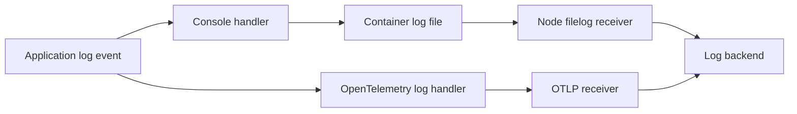

# Duplicate Kubernetes Logs from stdout and OTLP: Choose One Ingestion Path per Pod

Author: [nawazdhandala](https://www.github.com/nawazdhandala)

Tags: OpenTelemetry, Kubernetes, Logging

Description: Trace duplicate Kubernetes log records to simultaneous stdout collection and OTLP export, then assign a single ingestion path without losing sidecar or startup logs.

An application writes one log event, but the backend stores two copies. One copy contains a parsed JSON message and Kubernetes file metadata. The other contains structured OpenTelemetry attributes and an instrumentation scope. This often means the event traveled through two independent ingestion paths.

A node Collector reads the container's stdout file while the application's logging bridge also exports the event over OTLP. Both paths can be working correctly. The duplication comes from collecting the same event twice.



## Confirm the two paths

Emit a harmless test event with a unique marker from one pod. Search for that marker in both `kubectl logs` and the backend. Compare pod UID, container name, original timestamp, log body, instrumentation scope, and attributes such as `log.file.path`.

Temporarily inspect each Collector receiver with a small diagnostic pipeline if the backend has already normalized those fields away. Give the two paths distinct test attributes, then remove that instrumentation after the investigation. Two identical messages alone are not proof: retries, multiple application handlers, and two agents tailing the same node can also create duplicates.

The [Kubernetes Collector component guide](https://opentelemetry.io/docs/platforms/kubernetes/collector/components/) documents file-based collection from stdout and stderr. It also warns about duplicate collection when multiple filelog receivers read the same files.

## Choose who owns application logs

For stdout ownership, retain the console handler and remove the OTLP log handler or exporter from that application's logging configuration. Keep tracing and metrics enabled. Where your SDK's autoconfiguration supports it, the following setting disables automatically configured log export:

```yaml
# Application container environment fragment
env:
  - name: OTEL_LOGS_EXPORTER
    value: none
```

This is an [SDK autoconfiguration setting](https://opentelemetry.io/docs/specs/otel/configuration/sdk-environment-variables/), not a universal override of manually installed logging handlers. Verify the application's language distribution and startup code. A logger provider created explicitly in code can still export logs.

For OTLP ownership, keep the OTLP logging bridge and exclude only that application's container files from the node agent. The following fragment assumes the normal `/var/log/pods` layout, a `payments` namespace, pod names beginning with `checkout-`, and an application container named `app`:

```yaml
receivers:
  filelog:
    include:
      - /var/log/pods/*/*/*.log
    exclude:
      - /var/log/pods/payments_checkout-*_*/app/*.log
    include_file_path: true
    operators:
      - type: container
        id: container-parser
```

Current upstream names this component `file_log`; `filelog` remains a deprecated alias. Keep the receiver ID consistent with your existing pipeline and the names supported by your pinned distribution. The [filelog receiver reference](https://github.com/open-telemetry/opentelemetry-collector-contrib/tree/main/receiver/filelogreceiver) defines `include` and `exclude` as file globs. They are not Kubernetes label selectors. Confirm your node's actual path before applying the pattern, and retain the existing receiver's storage, parsing, and pipeline configuration. Preserve existing exclusions, particularly those preventing the Collector from collecting its own debug output.

## Keep the exceptions explicit

Excluding only the `app` container retains sidecar logs. Also decide where init-container output, runtime crashes, and application messages emitted before the SDK starts will go. If those only reach stdout, a blanket exclusion creates an observability gap. A practical alternative is to keep stdout as the canonical path until the application reliably exports all required events through OTLP.

During migration, overlap can produce duplicates and a gap can lose logs. Record the switch time and test one workload before rolling out broadly. Do not change filelog's `start_at` setting casually: replaying existing files can generate historical duplicates, while starting at the end can omit older unread records. Persist offsets when continuity across agent restarts matters.

## Verify the ownership rule

Repeat the unique-marker test after the change. Check that one event reaches the backend, sidecar and startup diagnostics remain available, and traces and metrics still arrive. Restart the application and the node Collector in a test environment to exercise initialization and offset recovery.

Keep the policy in the workload's deployment configuration and the agent's collection rules. Backend deduplication by message text is a poor substitute: two legitimate events can have identical text, and the two ingestion paths may encode the same event differently.
