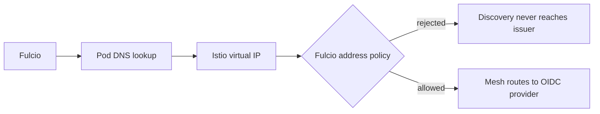

# Diagnose Fulcio OIDC Discovery Failures Behind Istio ServiceEntry Virtual IPs

Author: [nawazdhandala](https://www.github.com/nawazdhandala)

Tags: Fulcio, Sigstore, OIDC, Istio, Troubleshooting

Description: Find out whether Istio DNS capture makes an OIDC issuer resolve to a mesh virtual IP that Fulcio rejects, then choose a release-aware repair.

---

A Fulcio upgrade can break certificate issuance even though the OIDC provider still works from your laptop. One specific failure happens when Istio returns a virtual IP for the provider and Fulcio rejects that address before the connection reaches the mesh proxy.

The useful evidence is the resolved address and the server-side error. A message containing `connection to restricted IP` points to destination policy, while an unknown-authority error points to TLS trust. Changing the token audience will not repair either path.

## Recognize the virtual-IP collision

Istio can allocate addresses from `240.240.0.0/16` to eligible `ServiceEntry` resources. Its DNS proxy returns that address to the application, then the mesh routes the connection to the real external service. The address is meaningful inside the mesh even though it is unsuitable for ordinary Internet routing. [Istio documents this allocation and its compatibility limits](https://istio.io/latest/docs/ops/configuration/traffic-management/dns-proxy/).

The original Fulcio report described a safe dialer that rejected `240.0.0.0/4`, including Istio's allocation. A statically configured issuer did not exempt that reserved range. The report is useful historical evidence, not proof that every later Fulcio build has the same limitation. [Fulcio issue 2483](https://github.com/sigstore/fulcio/issues/2483) describes the interaction.



## Capture the failing pod's view

Record the affected pod's image and configured command and arguments before changing configuration. These fields do not expand environment references or show defaults inherited from the image:

```bash
POD='fulcio-REPLACE-WITH-AFFECTED-POD'
kubectl -n sigstore get pod "$POD" -o json |
  jq '.spec.containers[] | {name, image, command, args}'

kubectl -n sigstore get serviceentries.networking.istio.io -o yaml
kubectl -n sigstore logs "$POD" -c fulcio --since=15m
```

Set `POD` to the affected pod and adjust namespace and container names. Use that same pod for logs and DNS checks; targeting a Deployment can select a different replica. Restrict access to collected logs and remove any credentials before sharing them.

Resolve the issuer from the affected pod. If the image includes `getent`:

```bash
kubectl -n sigstore exec "$POD" -c fulcio -- \
  getent ahostsv4 id.example.com
kubectl -n sigstore exec "$POD" -c fulcio -- \
  getent ahostsv6 id.example.com
```

For minimal images, use an approved diagnostic container attached to that pod. A separate debug pod may have different DNS capture or mesh membership. Check every A and AAAA result rather than assuming the first address is the only one Fulcio can select.

Correlate the rejected address with the `ServiceEntry`, DNS-capture settings, and mesh listener configuration. Check the discovery hostname and the hostname in its `jwks_uri`; they can differ.

## Separate reachability from Fulcio acceptance

From the same network context, inspect discovery without following redirects automatically:

```bash
ISSUER='https://id.example.com'
curl --fail --silent --show-error \
  --connect-timeout 5 --max-time 15 \
  "${ISSUER%/}/.well-known/openid-configuration" |
  jq '{issuer, jwks_uri}'
```

A successful curl request demonstrates connectivity and curl's TLS validation. It does not exercise Fulcio's safe dialer. Conversely, a timeout also warrants checking mesh egress and NetworkPolicy before attributing everything to CIDR restrictions.

The returned issuer must still match the configured OIDC issuer. Keep hostname verification and the issuer identity intact. [Fulcio's OIDC integration guide](https://github.com/sigstore/fulcio/blob/main/docs/oidc.md) explains the issuer and claim contract.

## Pick a repair supported by the deployed release

Fulcio 1.10.0 added an operator override for the default IP restrictions through [the fix for this issue](https://github.com/sigstore/fulcio/pull/2509), as recorded in its [release notes](https://github.com/sigstore/fulcio/releases). Qualify a supported patched release containing that change, then inspect its `serve --help` and Helm values for the exposed setting. Current upstream configuration code includes an explicit allowed-CIDR mechanism, with blocked CIDRs taking precedence. Older builds described in the issue only exposed additional blocks. [The configuration implementation](https://github.com/sigstore/fulcio/blob/main/pkg/config/config.go) documents that precedence; do not assume a chart exposes every binary option.

If your release exposes a supported exception, scope it to the reviewed mesh allocation and retain explicit blocks and egress restrictions. An IP exception broadens where OIDC requests may connect; it does not validate which service controls an address.

Another option is to stop auto-allocation for the specific issuer entry, provided ordinary DNS and the chosen mesh routing mode still work:

```yaml
metadata:
  labels:
    networking.istio.io/enable-autoallocate-ip: "false"
```

This is a fragment to merge into the existing `ServiceEntry`, not a complete replacement manifest. Test it in a canary environment: removing the VIP can break TCP routing or a hostname that exists only in mesh configuration. Avoid disabling DNS capture across the cluster to solve one issuer's problem.

## Verify the complete signing path

After the change, confirm the pod resolves an expected destination, discovery succeeds, and JWKS retrieval succeeds. Request a fresh test token, issue a certificate, and verify a canary artifact against the intended issuer and identity. Also confirm an unapproved destination remains blocked.

Record the image digest, address-policy settings, mesh configuration, and canary result together. That makes the next upgrade test reproducible and prevents a temporary routing adjustment from becoming an undocumented trust exception.
