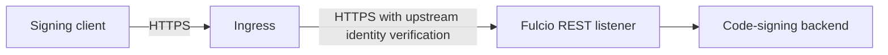

# How to Encrypt the Ingress-to-Fulcio Hop for REST Certificate Requests

Author: [nawazdhandala](https://www.github.com/nawazdhandala)

Tags: Fulcio, TLS, Kubernetes, Security, Troubleshooting

Description: Configure authenticated TLS between an ingress and Fulcio REST listener, checking the deployed release for native HTTP TLS support and verifying the upstream certificate.

HTTPS at the public ingress protects only the client-to-ingress connection. If the ingress forwards Fulcio certificate requests over plain HTTP, the OIDC token crosses the next network segment without transport encryption. Encrypting that segment requires the ingress to connect to a TLS-capable upstream and verify its identity.

Fulcio's historical [HTTP TLS issue](https://github.com/sigstore/fulcio/issues/2415) describes releases where only the gRPC listener supported server TLS. Current upstream code and documentation have evolved. Check the deployed binary before choosing a configuration based on that old limitation.

## Establish which listener receives REST traffic

Record the Fulcio image digest, command arguments, service target port, and ingress upstream protocol. Determine whether the deployment uses separate HTTP and gRPC listeners or a shared duplex listener. A gRPC TLS option does not automatically protect a separate HTTP port.

```bash
fulcio serve --help
kubectl -n sigstore get deployment fulcio -o yaml
kubectl -n sigstore get service fulcio -o yaml
```

Use the binary from the same image when checking help. Replace the example namespace and object names with your deployment's values. Read the ingress configuration too: the service's port name is not proof that the proxy uses HTTPS.

The [current setup guide](https://github.com/sigstore/fulcio/blob/main/docs/setup.md#serving-over-tls) documents `--http-tls-certificate` and `--http-tls-key` for the HTTP endpoint and shared duplex listener. Confirm those options in your release before applying them. Documentation on `main` can describe code newer than an installed package.

## Configure serving identity

Issue a serving certificate for the DNS name the ingress will verify, for example `fulcio.sigstore.svc.cluster.local`. Mount its certificate chain and private key into the Fulcio container. This is the network serving identity; do not substitute the code-signing CA certificate and key.

For a release supporting native HTTP TLS, add these arguments to its existing production command:

```text
--http-tls-certificate=/var/run/fulcio-serving/tls.crt
--http-tls-key=/var/run/fulcio-serving/tls.key
```

Keep the existing signing backend and transparency-log configuration. The two arguments are a focused addition, not a complete production invocation. The [serve command source](https://github.com/sigstore/fulcio/blob/main/cmd/app/serve.go) checks that certificate and key options are supplied together.

If your release lacks native HTTP TLS, either move to a reviewed release that provides it or terminate upstream TLS in a proxy alongside Fulcio. With a sidecar, document the remaining local cleartext hop and bind the application appropriately. A service mesh is another possible transport boundary, but only when its policy actually requires encryption for this connection.

## Make the ingress verify the upstream

Encryption without certificate verification does not establish that the ingress reached your Fulcio service. For a conventional NGINX reverse proxy, a contextual location block is:

```nginx
location / {
    proxy_pass https://fulcio.sigstore.svc.cluster.local:5555;
    proxy_ssl_server_name on;
    proxy_ssl_name fulcio.sigstore.svc.cluster.local;
    proxy_ssl_trusted_certificate /etc/nginx/fulcio-serving-ca.pem;
    proxy_ssl_verify on;
    proxy_ssl_verify_depth 2;
}
```

The port is illustrative; use the actual TLS listener. The trusted file contains the serving CA trust chain. NGINX documents these controls in its [proxy module reference](https://nginx.org/en/docs/http/ngx_http_proxy_module.html#proxy_ssl_verify). In Kubernetes, translate them through your controller's supported configuration rather than assuming every ingress controller accepts the same annotations.



## Verify both boundaries

From an authorized diagnostic environment on the ingress side, request the upstream with the expected name and serving CA:

```bash
curl --fail --cacert serving-ca.pem \
  https://fulcio.sigstore.svc.cluster.local:5555/api/v1/rootCert
```

A successful read-only request establishes connectivity to that route, not successful certificate issuance. Follow it with a staging signing request through the real public ingress and normal signature verification. Check proxy logs for the upstream scheme and certificate verification failures without logging bearer tokens.

Deliberately test a wrong upstream hostname or untrusted serving CA in staging. The connection should fail. If it succeeds, the proxy's verification setting is incomplete or the request used a different route.

Finally, inspect readiness probes and internal clients that still use HTTP. Update them for the selected listener design and test rollout behavior. Recovery is complete when REST traffic uses the intended TLS path, upstream identity is checked, and a normal signing client still completes the authenticated workflow.
