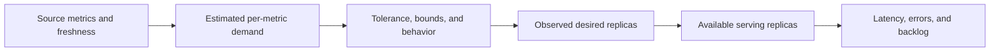

# How to Make HPA Decisions Observable with Controller Metrics, Events, and Recommendation Dashboards

Author: [nawazdhandala](https://www.github.com/nawazdhandala)

Tags: Kubernetes, HPA, Autoscaling, Troubleshooting

Description: Combine HPA status, controller metrics, retained events, and clearly labeled recommendation estimates to explain why requested capacity changed.

---

An HPA dashboard should answer three questions: what did the controller observe, what scale did it request, and how much capacity actually became ready? A replica-count chart alone cannot distinguish a metric failure from a policy limit or a slow-starting application.

Use separate data sources for controller health, individual HPA state, and application outcomes. Preserve their different meanings instead of presenting all of them as “the recommendation.”

## Start with the HPA object and events

```bash
kubectl get hpa checkout -n production -o json |
  jq '{spec, current: .status.currentReplicas,
       desired: .status.desiredReplicas,
       metrics: .status.currentMetrics,
       conditions: .status.conditions,
       lastScale: .status.lastScaleTime}'
kubectl get events -n production \
  --field-selector involvedObject.kind=HorizontalPodAutoscaler,involvedObject.name=checkout \
  --sort-by=.metadata.creationTimestamp
```

Use object UID when retaining events across deletion and recreation of the same HPA name. Store event reasons, messages, timestamps, and repeated-event counts in your observability backend. Events can expire or be aggregated; they are not a durable record of every evaluation.

A `SuccessfulRescale` event means the scale update succeeded. It does not guarantee that new Pods are scheduled, Ready, or receiving requests. Follow the target Deployment and application telemetry to verify that outcome.

## Add per-HPA state metrics

[kube-state-metrics](https://github.com/kubernetes/kube-state-metrics/blob/main/docs/metrics/workload/horizontalpodautoscaler-metrics.md) exposes current replicas, desired replicas, min/max bounds, and conditions. Build a first panel from those observed object fields:

```promql
kube_horizontalpodautoscaler_status_current_replicas{
  namespace="production",horizontalpodautoscaler="checkout"
}
```

```promql
kube_horizontalpodautoscaler_status_desired_replicas{
  namespace="production",horizontalpodautoscaler="checkout"
}
```

Add min/max series, the target workload's available replicas, and annotations from scaling events. Scope queries to the intended cluster and deduplicate replicated scrapes. Do not assume the HPA and Deployment have identical names; use the actual `scaleTargetRef` mapping.

## Monitor the controller separately

The [Kubernetes 1.35 HPA metrics source](https://github.com/kubernetes/kubernetes/blob/v1.35.0/pkg/controller/podautoscaler/monitor/metrics.go) includes reconciliation and metric-computation counters and duration histograms. They are alpha metrics in that release, so verify names and availability on the actual controller-manager endpoint.

For example, count reconciliation errors by category:

```promql
sum by (error) (
  rate(horizontal_pod_autoscaler_controller_reconciliations_total{
    error!="none"
  }[5m])
)
```

Metric-computation metrics also identify metric source type. These aggregate controller measurements can reveal widespread adapter failures or slow reconciliation, but their labels do not identify every affected HPA. Use object conditions, events, and logs for that attribution.

Managed clusters may restrict controller-manager scraping. In that case, preserve the status and event panels and document the missing controller-health view.

## Label the desired-replica gauge accurately

Kubernetes 1.35 also defines:

```promql
horizontal_pod_autoscaler_controller_desired_replicas{
  namespace="production",hpa_name="checkout"
}
```

This gauge uses `hpa_name`, whereas kube-state-metrics uses `horizontalpodautoscaler`. Normalize labels deliberately if joining them.

The [controller call site](https://github.com/kubernetes/kubernetes/blob/v1.35.0/pkg/controller/podautoscaler/horizontal.go) records the resulting desired count after the scaling decision. It is not a time series of every unconstrained per-metric recommendation, and it does not expose the complete stabilization-window history.

In high-availability control planes, stale samples from a previous leader can complicate gauge aggregation. Scope the scrape or query to current controller ownership where possible, and treat disagreement with fresh object status as a diagnostic signal rather than blindly taking the highest value.

## Build a recommendation view without inventing data

Arrange the dashboard as a causal chain:



If you calculate `ceil(replicas × current / target)` in a recording rule, label it as an estimate. Missing samples, CPU startup eligibility, utilization rounding, multiple metrics, and behavior rules can make it differ from the controller result.

Retain source timestamps and configuration revisions so an investigator can reconstruct the estimate. A target change and a traffic change can otherwise produce visually identical replica movements.

## Verify the dashboard during known events

Run a controlled scale-up, load removal, metric interruption, and delayed Pod startup. Confirm that each produces distinguishable evidence: a changed source value, an error event, a constrained desired count, or a gap between desired and available capacity.

Monitor telemetry freshness itself. A blank controller panel or missing HPA series should be visibly different from zero errors or zero demand. With those checks, the dashboard becomes a practical explanation of scaling decisions instead of a collection of graphs that only look complete when everything works.
