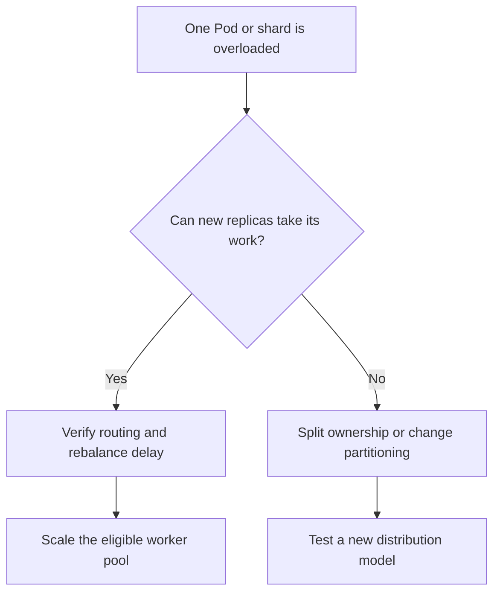

# How to Prevent Per-Pod Metric Averages from Hiding a Hot Shard

Author: [nawazdhandala](https://www.github.com/nawazdhandala)

Tags: Kubernetes, HPA, Autoscaling, Troubleshooting

Description: Detect uneven per-Pod demand, identify whether replicas can relieve a hot shard, and align autoscaling boundaries with the application partition model.

---

An average can look comfortable while one Pod is overloaded. This happens with hot tenants, sticky sessions, uneven partitions, and long-lived connections. HPA can calculate exactly the configured average and still make a poor decision for that workload.

The first question is whether adding replicas actually moves work away from the hot Pod. If it does not, a more aggressive HPA target can create idle replicas while the original bottleneck remains.

## Inspect the distribution behind the average

Suppose four Pods report concurrent requests `[100, 0, 0, 0]`. The average is 25. With a target of 40, the simplified recommendation is three replicas:

```python
from math import ceil

concurrency = [100, 0, 0, 0]
target = 40
average = sum(concurrency) / len(concurrency)
desired = ceil(len(concurrency) * average / target)
assert average == 25
assert desired == 3
print({"average": average, "maximum": max(concurrency), "desired": desired})
```

The hot Pod is above target even though the fleet average suggests fewer replicas. Tolerance, stabilization, and bounds may delay or prevent that reduction, but none of them changes the fact that the average hides the imbalance.

The [HPA algorithm](https://kubernetes.io/docs/concepts/workloads/autoscaling/horizontal-pod-autoscale/#algorithm-details) describes the proportional calculation. Its effectiveness depends on the workload and metric responding to added capacity.

Query the custom metrics API to see individual values:

```bash
kubectl get --raw \
  '/apis/custom.metrics.k8s.io/v1beta1/namespaces/production/pods/*/requests_in_flight?labelSelector=app%3Dcheckout' |
  jq '.items[] | {pod: .describedObject.name, value, timestamp}'
```

Use the API version served by your adapter. Compare every value with Pod readiness, request routing, shard ownership, and metric freshness. Missing samples are not idle Pods; do not manufacture zeros for unobserved instances.

## Find the source of the imbalance

Break down workload by the smallest identity that explains ownership without creating unnecessary telemetry cardinality. Useful dimensions can include shard, bounded tenant tier, queue partition, or routing pool.

Check whether a small number of sessions keep returning to the same Pod, a partition cannot be consumed concurrently, or a new replica has not joined the application's membership system. Compare arrival rate, queue age, and service time per partition. High CPU on one Pod may be caused by expensive requests rather than a larger request count.



A Kubernetes StatefulSet gives Pods stable identities; it does not automatically redistribute application shards when replicas change. Verify the application's own membership and rebalancing behavior before attaching scaling expectations to those identities.

## Choose a boundary that matches movable work

If workers for shard A can share its queue, a separate Deployment and HPA can give that shard its own capacity control. For example, this metric fragment could belong to an HPA targeting `workers-shard-a`:

```yaml
- type: External
  external:
    metric:
      name: queue_pending_jobs
      selector:
        matchLabels:
          shard: a
    target:
      type: AverageValue
      averageValue: "20"
```

This requires an adapter exposing the total backlog for shard A and application workers that can concurrently consume it. The selector does not create partition-aware consumption by itself. Keep the target Deployment's Pods separate from other HPA targets to avoid overlapping control.

For large shard counts, managing a Deployment per shard may be impractical. Alternatives include a shared work queue, virtual shards that can move between workers, or application-level partition splitting. Measure rebalancing cost and ordering requirements when choosing among them.

## Avoid replacing one misleading signal with another

A maximum-per-Pod metric is useful for alerting, but feeding it directly into a proportional autoscaler needs care. If the busiest shard stays pinned to one Pod, its maximum remains high after every scale-up. The HPA can keep requesting replicas without relieving the bottleneck.

Likewise, publishing the same maximum value as though it were each Pod's local metric changes the meaning of `AverageValue`. Keep local measurements local, and document any global aggregation explicitly. The [HPA API contract](https://github.com/kubernetes/kubernetes/blob/v1.35.0/staging/src/k8s.io/api/autoscaling/v2/types.go) describes the expected inverse relationship between a scaling metric and capacity.

## Verify with skewed traffic

Run a balanced-load baseline, then concentrate the same total arrival rate on one shard. Add replicas and measure whether the hot shard's queue age, concurrency, and latency improve. Repeat during rebalancing and with one worker unavailable.

Alert on both fleet capacity and partition pressure. A useful dashboard shows average, maximum, and per-shard backlog together. Keep a minimum capacity reserve or conservative scale-down policy while correcting distribution, but treat those as temporary protection: sustainable scaling requires new replicas to receive useful work.
