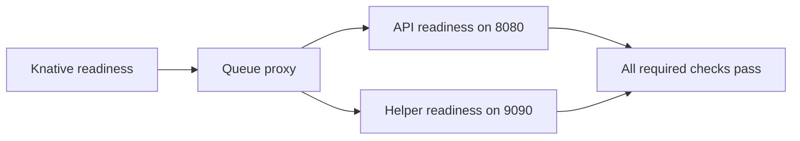

# How to Probe Every User Container in a Knative Service with Sidecars

Author: [nawazdhandala](https://www.github.com/nawazdhandala)

Tags: Knative, Kubernetes, Monitoring

Description: Enable multi-container probing in Knative and give the traffic container and each required sidecar distinct readiness checks without exposing multiple traffic ports.

Your HTTP container becomes ready, but a sidecar that supplies configuration or credentials is still warming up. Requests reach the pod and fail even though the main process is healthy. In a multi-container Knative Service, readiness needs to represent the dependencies required to serve a request.

Enable multi-container probing and define a meaningful check for each required user container. Keep the traffic port and sidecar health ports distinct.

## Enable the supported feature combination

The [Knative feature reference](https://knative.dev/docs/serving/configuration/feature-flags/#multiple-container-probing) documents `multi-container` and `multi-container-probing`. For an Operator-managed installation, merge the relevant settings into the existing resource:

```yaml
spec:
  config:
    features:
      multi-container: "enabled"
      multi-container-probing: "enabled"
```

For YAML-managed installations, maintain those values in `config-features`. Check the installed release's defaults and supported fields; do not infer probe support merely from admission of multiple containers. The [Operator guide](https://knative.dev/docs/install/operator/configuring-with-operator/) explains the durable configuration path.

## Give every required container a useful readiness check

This example has a request-serving API and a configuration sidecar. Replace the illustrative images with your own. The API serves traffic on 8080; the helper exposes only an internal health endpoint on 9090:

```yaml
apiVersion: serving.knative.dev/v1
kind: Service
metadata:
  name: configured-api
  namespace: applications
spec:
  template:
    spec:
      containers:
        - name: app
          image: registry.example.com/apps/configured-api:build-42
          ports:
            - containerPort: 8080
          readinessProbe:
            httpGet:
              path: /ready
              port: 8080
        - name: config-helper
          image: registry.example.com/platform/config-helper:build-42
          readinessProbe:
            httpGet:
              path: /ready
              port: 9090
```

Only the request-serving container declares a traffic port. The sidecar can listen on 9090 without declaring a second `ports` entry. Containers share the pod's network namespace, so their listeners must not collide. A probe's port is where its health handler listens, not a request to expose another Knative route.

The helper's `/ready` endpoint should return success only when it can provide usable configuration. A process-alive response is insufficient if the API cannot operate until the first configuration fetch finishes.

## Understand the aggregated readiness path

[Knative's probing guide](https://knative.dev/docs/serving/services/configure-probing/) explains that queue-proxy performs the configured user-container readiness checks and exposes the combined result. Knative also checks that its networking configuration is ready.



Liveness has a different purpose. Kubernetes can restart a container after a liveness failure, while queue-proxy does not turn that liveness definition into a readiness test automatically. If the condition makes requests unsafe, include it in readiness too. See the [Kubernetes probe guide](https://kubernetes.io/docs/tasks/configure-pod-container/configure-liveness-readiness-startup-probes/) for the distinction between readiness, liveness, and startup checks.

Avoid making readiness depend on every optional service in your architecture. A nonessential analytics sidecar should not necessarily remove an otherwise useful API pod from service. Decide which failures actually prevent this pod from fulfilling its contract.

## Test each failure independently

After admission and deployment, inspect the generated pod and its container statuses. Do not edit the generated pod to make the permanent fix; change the Service template and create a new Revision.

```bash
kubectl -n applications get pods -l serving.knative.dev/service=configured-api
kubectl -n applications logs configured-api-example-pod -c queue-proxy
kubectl -n applications logs configured-api-example-pod -c config-helper
kubectl -n applications describe ksvc configured-api
```

Use the actual pod name. In a test environment, delay helper initialization and verify that traffic is withheld. Then make the API unhealthy while the helper remains healthy. Inspect Revision and Service conditions as well as pod status, because those layers can reach readiness at different times. Finally verify that recovery restores request handling without requiring manual edits to generated resources.
