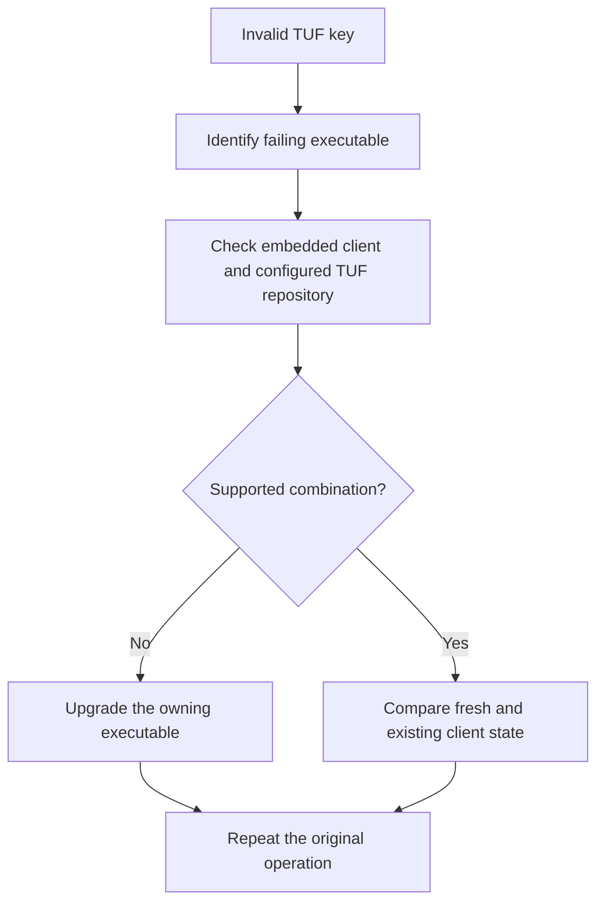

# How to Restore Fulcio Signing When Cosign Reports an Invalid TUF Key

Author: [nawazdhandala](https://www.github.com/nawazdhandala)

Tags: Fulcio, Sigstore, Cosign, Troubleshooting

Description: Trace invalid TUF key errors to the actual signing client, distinguish embedded dependency problems from trust-root compatibility, and recover without bypassing verification.

An error mentioning Fulcio does not necessarily mean that Fulcio rejected your identity. Certificate issuance, certificate transparency verification, and trusted-key retrieval are separate steps. An invalid TUF key can prevent a client from trusting a response even when the certificate authority is working.

Start by identifying the exact executable that failed. The historical [cosign-installer issue 100](https://github.com/sigstore/cosign-installer/issues/100) is a useful example: image signing succeeded, but the following Syft attestation command failed. The maintainer traced that failure to an older Cosign dependency embedded in Syft. Reinstalling the standalone Cosign executable could not replace that embedded library.

## Locate the failing process

Keep the command immediately before the error together with its exit status. In a workflow that creates an image signature and an SBOM, give each operation its own step. That makes a partial success visible and prevents an error from being attributed to whichever installer appeared earlier in the log.

Collect versions from the same container or runner that executes the command:

```bash
command -v cosign
cosign version
command -v syft
syft version
```

Run the Syft checks only if that tool participates in your workflow. A developer laptop's version does not establish what an action, container image, or composite action uses. Record the image digest and action revision as well. If two copies appear on `PATH`, compare the resolved paths before changing dependencies.

The 2022 issue reports that Syft 0.53.4 embedded the problematic dependency, while the maintainer's test with 0.59.0 succeeded. Those numbers explain that incident; they are not present-day installation recommendations. Upgrade the executable that owns the failing code to a supported release, and review its compatibility notes.

## Separate two different compatibility problems

A later event affected clients reading Sigstore's public TUF repository. The [March 2024 trust-root announcement](https://blog.sigstore.dev/tuf-root-update/) documented a TUF specification update and identified Cosign 2.2.0 and later as compatible at that time. Older clients could fail even with an otherwise healthy network and unmodified cache.

Use that history to form a diagnostic hypothesis, not to declare a universal minimum for every future repository. Compare your installed client with the current release and trust-root guidance for the Sigstore instance you use. A private mirror may have its own root history and bootstrap configuration.



The [Cosign installation guide](https://docs.sigstore.dev/cosign/system_config/installation/) provides supported distribution methods. Pin the reviewed version or digest in automation so that recovery does not depend on an unexplained change to the runner image.

## Inspect cache and network evidence without discarding it

The error text may suggest local corruption, but that is not proof. Preserve the failed job log and the relevant cache directory before replacing anything. Record whether the error follows a restored CI cache, a particular runner, or every new runner.

Repeat the operation in a clean disposable environment using the same approved client and repository configuration. If it succeeds there, compare cached metadata and configuration with the failing environment. If it fails in both places, investigate the client/repository combination and network response instead of repeatedly deleting state.

Check whether a proxy returns an authentication page or an HTML error where JSON metadata is expected. Compare the requested hostname with the intended TUF service. Avoid printing complete environments: they can contain signing tokens and registry credentials. Capture only endpoint names and nonsecret version information.

Do not copy a root file from an arbitrary successful machine as a shortcut. Bootstrap trust material needs an authenticated distribution path. Likewise, disabling certificate transparency or signature checks changes the security decision instead of repairing it.

## Confirm the complete workflow

Rerun every previously failing signing or attestation operation against a disposable test artifact. Then verify the resulting signature with the expected identity and issuer, using the same trust distribution that production consumers use. Preserve the artifact digest so a changed tag does not make two attempts look equivalent.

A useful incident record contains the failing executable, its old and replacement versions, the TUF repository, the cache comparison result, and the verification outcome. Success means both production and verification paths work under the intended trust policy. A single successful certificate request does not establish that the rest of the workflow recovered.
