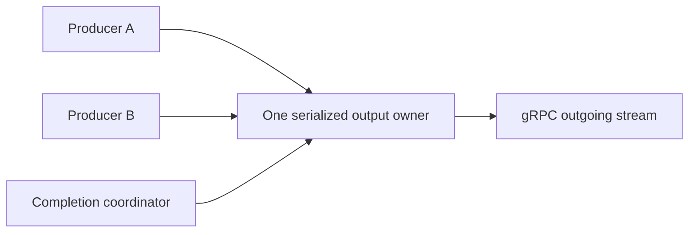

# How to Serialize Writes from Multiple Producers to a Java gRPC StreamObserver

Author: [nawazdhandala](https://www.github.com/nawazdhandala)

Tags: gRPC, Java, Concurrency, Streaming

Description: Serialize Java gRPC stream writes and terminal events through one owner, then add explicit bounds for slow consumers.

Two producers can safely compute messages in parallel, but they cannot independently call `onNext()` on the same gRPC `StreamObserver`. The observer is the serialization boundary for one outgoing stream.

The [Java StreamObserver contract](https://grpc.github.io/grpc-java/javadoc/io/grpc/stub/StreamObserver.html) requires application synchronization when several threads write to one observer. Synchronizing only the message list does not serialize calls to the observer, and synchronizing only `onNext()` leaves races with completion and errors.

## Protect the complete lifecycle

For a modest-volume stream, a small adapter makes the rule explicit:

```java
import io.grpc.stub.StreamObserver;

final class SerializedOutput<T> {
    private final StreamObserver<T> delegate;
    private boolean terminal;

    SerializedOutput(StreamObserver<T> delegate) {
        this.delegate = delegate;
    }

    synchronized boolean send(T value) {
        if (terminal) return false;
        try {
            delegate.onNext(value);
            return true;
        } catch (RuntimeException failure) {
            terminal = true;
            delegate.onError(failure);
            throw failure;
        }
    }

    synchronized void complete() {
        if (terminal) return;
        terminal = true;
        delegate.onCompleted();
    }

    synchronized void fail(Throwable failure) {
        if (terminal) return;
        terminal = true;
        delegate.onError(failure);
    }
}
```

All producer paths must use the same adapter. Do not retain a second reference that writes directly to the original observer. The terminal flag is set before invoking a terminal callback so that an exception from that callback cannot reopen the stream.

The adapter orders messages by lock acquisition, not by event timestamp or producer creation order. If the application requires sequence order, assign sequence numbers upstream and define how gaps or late producers are handled.

## Let one coordinator complete the stream

Completion means that the entire outgoing stream is finished. It does not mean that one producer has finished its portion. A coordinator should wait for every successful producer and only then call `complete()`. On the first fatal producer error it should call `fail()` and stop accepting further work.



An error can race with an already accepted message. The coordinator's terminal state determines which event wins locally; it cannot retract a message already sent. If the business protocol needs atomic batches, express that in the message contract rather than relying on `onCompleted()` to roll back earlier messages.

## Add backpressure as a separate requirement

This adapter solves concurrent access, but it does not bound gRPC's outgoing buffering. For sustained streams, use `ServerCallStreamObserver` or `ClientCallStreamObserver` readiness with a bounded application queue.

Have producers enqueue messages and notify one drain owner. The drain owner checks `isReady()` before sending, stops when readiness becomes false, and resumes on the readiness callback. It must also wake when a producer adds data while the stream is already ready; waiting only for a future readiness transition can strand queued messages. With a queue, successful completion must wait until all producers have finished and the queue has drained.

Register `setOnReadyHandler()` during the initial service invocation on the server, or in `ClientResponseObserver.beforeStart()` on the client. Never spin or sleep inside the registered readiness callback. Recheck readiness when the callback runs, and serialize draining with completion and cancellation. Choose a queue-full policy that fits the protocol: pause upstream production, reject work, or deliberately drop documented lossy events.

## Test more than the happy path

Run two producers with distinct message IDs and verify that every accepted message arrives once on a successfully completed RPC. A successful `send()` means local submission, not confirmed delivery to the peer. Add completion racing with a producer, producer failure, client cancellation, and a client that deliberately stops reading. Check that no output is submitted after the terminal event and that queued memory stays bounded.

Use an in-process gRPC server and channel for integration tests instead of assuming a mock observer reproduces transport readiness. Thread serialization and slow-reader behavior are different checks.

## Conclusion

Give each outgoing stream one lifecycle owner. Serialize messages, completion, and failure together, then add readiness and bounded buffering when production rates can exceed consumption.

## Official Documentation

- [Java StreamObserver contract](https://grpc.github.io/grpc-java/javadoc/io/grpc/stub/StreamObserver.html)
- [Java server stream readiness and cancellation](https://grpc.github.io/grpc-java/javadoc/io/grpc/stub/ServerCallStreamObserver.html)
- [gRPC flow control](https://grpc.io/docs/guides/flow-control/)
