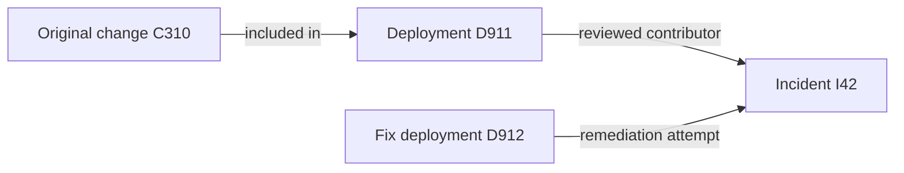

# How to Link an Unplanned Fix Deployment to the Production Incident—and the Original Change

Author: [nawazdhandala](https://www.github.com/nawazdhandala)

Tags: DORA, Deployment, Incident Management, Change Management, GitHub

Description: Connect fix deployments to incidents and original changes using stable identifiers, reviewed attribution, preserved evidence, and queryable relationships.

Checkout breaks after a release. An engineer deploys a hotfix, errors fall, and the incident closes. A month later, the hotfix pull request says only “production fix.” Nobody can reliably answer which incident prompted it or which earlier change it corrected.

Capture those answers as separate relationships. DORA defines deployment rework rate around unplanned deployments resulting from production incidents; identifying the original faulty change answers a different question. A repair can qualify as rework even while its incident's cause remains unknown. [DORA metric definitions](https://dora.dev/guides/dora-metrics/).

## Give Each Record Its Own Identity

Keep deployment, incident, and source-change records distinct:

| Record | Suggested key | Additional evidence |
| --- | --- | --- |
| Deployment | Source system, repository identity, deployment ID | Service, environment, rollout times, artifact digest, deployed revision |
| Incident | Incident system, project ID, incident ID | Affected resources, impact interval, incident URL |
| Change | Source system, repository identity, pull request or commit identity | Landed revision, review URL, release membership |

These are your integration keys, not prescribed DORA fields. Include the provider instance or host in the source-system identity. Preserve provider IDs and URLs alongside them. Repository names, release labels, and incident titles are useful display values, but insufficient join keys. For configuration changes, use the configuration revision or audit-event identity instead of inventing a pull request.

A commit is not a deployment ID: the same revision can reach staging, production, and production again during rollback. Give the later rollout its own identity. Deduplicate repeated notifications about that rollout without merging distinct deployments.

GitHub's deployment API returns an `id`, `sha`, `environment`, and `statuses_url`. Creating a deployment represents a request to deploy; obtain evidence of actual production rollout from its statuses and your deployment controller. [GitHub deployments API](https://docs.github.com/en/rest/deployments/deployments).

## Record the Repair Before Investigating Its Ancestry

Add incident identification and deployment purpose to your team's emergency-deployment workflow. Before execution, record who requested the repair, the incident key, target service and environment, and why the work was unplanned. Treat these as local workflow inputs, not assumed GitHub API parameters.

After execution, attach the actual deployment ID and artifact. A pull request that never reaches production is not a fix deployment. Record partial rollouts and unsuccessful repair attempts too: “attempted remediation” and “restored service” are separate facts.

Use this example chain:



The remediation edge records why D912 happened. Its outcome records whether it helped. Neither establishes that D911 caused I42. A repair deployed to an upstream service may address a downstream incident; record that dependency explicitly when the services differ.

In OneUptime, copy the incident ID from Incident Details and retain its project context. Keep the deployment and evidence URLs in a private note; a project-defined custom field can point to the relationship record. These are supported places for your integration's metadata, not a claim that OneUptime automatically constructs this entire graph. [Incident overview](https://oneuptime.com/docs/en/incidents/index), [incident custom fields](https://oneuptime.com/docs/en/incidents/settings#custom-fields).

## Review the Original Deployment and Change Separately

Find candidate deployments for affected services and dependencies around the impact window. Then inspect revision-specific failures, configuration differences, reproductions, and the effect of mitigation. A nearby timestamp makes a deployment worth investigating; it does not establish responsibility.

GitHub's deployment history exposes associated commits, workflow logs, environments, and source pull requests where available. Use these to reconstruct what shipped. [Viewing deployment history](https://docs.github.com/en/actions/how-tos/deploy/configure-and-manage-deployments/view-deployment-history).

Distinguish two conclusions:

- **Deployment attribution:** evidence supports D911 contributing to I42.
- **Change attribution:** evidence identifies C310 within D911 as contributing to I42.

If D911 contained twelve pull requests, confirming the first conclusion does not implicate all twelve. Keep the exact change unknown until evidence supports it. A hotfix touching the same file is also insufficient by itself.

Allow several contributing deployments and several repair deployments. Retain rejected candidates with their reasons. An incident caused by an external dependency may have a confirmed repair and no originating deployment in your systems.

## Store Links as Reviewable Data

The following is a small local reporting model, not a product API schema. Each entity ID below is a globally unique local key mapped to its complete source key above; never join raw provider IDs across projects or systems. The SQL example stores `unplanned` as an integer, `0` or `1`:

```text
deployment_changes(deployment_id, change_id)

remediation_links(
  link_id, incident_id, fix_deployment_id, unplanned, outcome,
  review_state, evidence_uri, reviewed_by, reviewed_at
)

attribution_links(
  link_id, incident_id, original_deployment_id, original_change_id,
  review_state, evidence_uri, reviewed_by, reviewed_at
)
```

Use `proposed`, `confirmed`, and `rejected` review states. A confirmed attribution may have a null `original_change_id`: the deployment is established, but its specific contributing change is not. Populate that field only after reviewing the exact change, and validate that it belongs to the deployment through `deployment_changes`.

Keep a stable `link_id` for each logical relationship. Store immutable revisions with a per-link revision sequence, their recording time, and a reference to the revision they supersede. Expose the latest revision of each link through `current_remediation_links` and `current_attribution_links` views, selecting that revision before filtering by review state. A later rejection must replace an earlier confirmation in these views. This preserves the initial hypothesis when an incident review changes it, while allowing ordinary queries to use current conclusions.

For those views, retrieve the chain with a left join:

```sql
SELECT
  r.fix_deployment_id,
  r.incident_id,
  a.original_deployment_id,
  a.original_change_id
FROM current_remediation_links AS r
LEFT JOIN current_attribution_links AS a
  ON a.incident_id = r.incident_id
 AND a.review_state = 'confirmed'
WHERE r.review_state = 'confirmed'
  AND r.unplanned = 1;
```

D912 returns I42, D911, and C310 after review. If attribution is pending, D912 and I42 still appear with null original fields. Multiple confirmed contributors produce multiple rows; this is a relationship report, so count distinct deployment IDs when deriving deployment totals. Do not filter out failed repair outcomes merely because they failed to restore service.

## Preserve Enough Evidence to Revisit the Decision

Save the deployed manifest or artifact digest, rollout status history, incident decision note, and relevant telemetry query with its time window and version filters. Record observation time separately from event time when collection was delayed. Keep evidence access consistent with the incident's audience.

Archive evidence before its source retention expires. For example, GitHub documents 90-day retention for previous deployment statuses, while retaining the current status. A URL alone may therefore stop proving the sequence you reviewed. [Deployment status retention](https://docs.github.com/en/rest/deployments/statuses#data-retention).

During incident review, check that every repair points to its real deployment, every confirmed original change has supporting evidence, and unresolved attribution remains visible. The result should let another engineer follow the repair to the incident and inspect exactly how the original-change conclusion was reached.
