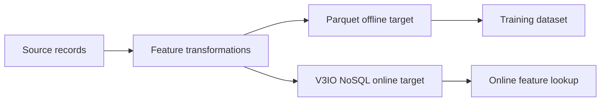

# Fix MLRun 'No Offline Targets' with Parquet and NoSQL Feature Set Targets

Author: [nawazdhandala](https://www.github.com/nawazdhandala)

Tags: MLOps, Feature Store, Python, Troubleshooting

Description: Fix missing offline feature-set targets by declaring Parquet and V3IO NoSQL destinations, ingesting data, and checking materialized target status.

A feature set can serve online values while failing when you request a training DataFrame. If MLRun reports that there are no offline targets, check where the data was written before investigating Parquet schemas or changing the training code.

For ordinary, non-passthrough feature sets, `to_dataframe()` looks for an offline target and raises this error when it cannot find one. The target lookup uses the feature set's recorded target status, which makes declared configuration and completed ingestion separate things to inspect. [MLRun feature-set implementation](https://docs.mlrun.org/en/stable/_modules/mlrun/feature_store/feature_set.html), [target lookup implementation](https://docs.mlrun.org/en/stable/_modules/mlrun/datastore/targets.html)

## Choose storage for each access pattern

Parquet is an offline target suited to reading datasets for training. Iguazio's `NoSqlTarget` stores key-based online values in V3IO. It requires an Iguazio/V3IO backend; it is not a generic NoSQL adapter that creates an online store in any MLRun installation. [MLRun sources and targets](https://docs.mlrun.org/en/stable/feature-store/sources-targets.html)



For an application needing both training history and online retrieval, configure both paths deliberately. Successful online retrieval does not establish that a corresponding offline dataset exists.

## Inspect the feature set you actually loaded

Check its project, name, and version or tag. A notebook variable can refer to an older definition after another process updates the feature set. Reload the intended stored object before comparing its configuration and status:

```python
# feature_set is the existing object loaded from the intended project.
feature_set.reload()
snapshot = feature_set.to_dict()
print("Declared targets:", snapshot.get("spec", {}).get("targets", []))
print("Recorded targets:", snapshot.get("status", {}).get("targets", []))
```

Review the output locally because storage paths may contain internal names. Do not interpret a declared Parquet target as proof that files were written. Compare ingestion logs and the actual destination with the recorded status.

Also check any explicit target name passed to `to_dataframe()`. Asking for an absent name can fail even when another offline target exists. The lookup compares that name with recorded offline targets. [MLRun target selection](https://docs.mlrun.org/en/stable/_modules/mlrun/datastore/targets.html)

## Configure explicit destinations

The following contextual example uses a disposable feature set with the default Storey engine (`engine="storey"`) in an Iguazio project. Its entities, timestamp column where needed, and transformation graph are already configured. Replace the project and path names with writable destinations reserved for this example:

```python
from mlrun.datastore import NoSqlTarget, ParquetTarget

feature_set.set_targets(
    targets=[
        ParquetTarget(
            name="offline",
            path="v3io:///projects/your-project/fs/customer-demo/offline/",
            partitioned=False,
        ),
        NoSqlTarget(
            name="online",
            path="v3io:///projects/your-project/fs/customer-demo/online/",
        ),
    ],
    with_defaults=False,
)
feature_set.save()
```

`set_targets` accepts target objects, and `with_defaults=False` makes the selected target list explicit. It replaces the declared list, so preserve any additional destinations required by a real production feature set. [MLRun feature-set API](https://docs.mlrun.org/en/stable/api/mlrun.feature_store/index.html)

The target constructors support names and paths; the example disables Parquet partitioning to keep this small diagnostic focused on target creation. Choose a partition strategy separately for production data volume and query patterns. [MLRun target constructors](https://docs.mlrun.org/en/stable/_modules/mlrun/datastore/targets.html)

## Ingest before reading the offline dataset

Use a small input DataFrame matching the feature set's entities and feature schema:

```python
# input_dataframe is the prepared sample for this feature set.
feature_set.ingest(input_dataframe)
feature_set.reload()
offline_sample = feature_set.to_dataframe(target_name="offline")
print("Rows read:", len(offline_sample))
```

Wait for ingestion to finish, and inspect its errors if the read fails. For asynchronous or remote ingestion, use the completion mechanism appropriate to that run before reloading. These examples illustrate the documented API; they have not been executed against your storage service.

Adding an offline target does not backfill previously ingested records. Replay the required source data through the updated configuration to build training coverage. Compare timestamps, entity counts, and expected feature columns rather than treating a nonempty directory as sufficient evidence.

Finally, distinguish this error from the similar feature-vector error. A feature vector may require offline retrieval or materialization before its own stored target can be read; the documented retrieval pattern is `vector.get_offline_features().to_dataframe()`. [MLRun feature-vector API](https://docs.mlrun.org/en/stable/api/mlrun.feature_store/index.html)

Confirm each underlying feature set has the required offline data first, then verify the vector's joins and time range. That sequence keeps a missing storage destination separate from a later dataset-selection problem.
