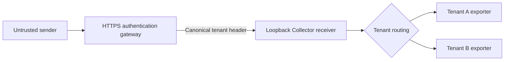

# Multi-Tenant OTLP Routing: Preserve Trusted Tenant Headers Without Accepting Spoofed Identity

Author: [nawazdhandala](https://www.github.com/nawazdhandala)

Tags: OpenTelemetry, OTLP, Multi-Tenant, Security, Routing

Description: Route OTLP using tenant identity established by a trusted gateway, overwrite client-supplied tenant headers, and keep tenant separation intact through batching and queues.

A tenant header is a routing instruction, not proof of identity. If a public OTLP endpoint accepts `X-Tenant-ID: tenant-b` from any authenticated tenant, a sender can put telemetry in another tenant's backend.

Establish tenant identity from a verified credential, then let a trusted gateway attach the routing header. The Collector should only receive that header through the trusted path.

## Define the trust boundary

This design uses an HTTPS gateway and Collector on the same host or in the same Kubernetes Pod network namespace:



The gateway validates the credential, checks its tenant authorization, and replaces any caller-supplied tenant header. The Collector's loopback listener prevents another Pod from bypassing that gateway. If the components run separately, use a private listener with network restrictions and authenticated transport instead.

Tenant identity must come from a verified token claim, credential lookup, or certificate mapping. A payload resource attribute such as `tenant.id` is also caller-controlled unless your trusted infrastructure derives and overwrites it.

## Replace the header after authentication

An NGINX gateway can use an authorization service through `auth_request`. This location fragment belongs in a server that already has HTTPS configured:

```nginx
location /v1/ {
    auth_request /_authorize_otlp;
    auth_request_set $verified_tenant $upstream_http_x_verified_tenant;
    proxy_set_header X-Tenant-ID $verified_tenant;
    proxy_set_header Authorization "";
    proxy_pass http://127.0.0.1:4318;
}

location = /_authorize_otlp {
    internal;
    proxy_pass http://auth.internal/check-otlp;
    proxy_pass_request_body off;
    proxy_set_header Content-Length "";
    proxy_set_header Authorization $http_authorization;
    proxy_set_header X-Tenant-ID "";
}
```

The authorization service is an application you supply. Its contract is important: return 2xx only for an authorized credential mapped to a known tenant, and include exactly one canonical `X-Verified-Tenant` response header. Return 401 or 403 otherwise. Do not derive that response from the request's tenant header.

The [NGINX authorization module](https://nginx.org/en/docs/http/ngx_http_auth_request_module.html) supports capturing authorization response headers with `auth_request_set`. Ensure your NGINX build includes that module. Protect the gateway-to-authorization-service connection according to your deployment's trust requirements.

## Route before batching

Here is a trace-only Collector configuration for the two permitted tenants:

```yaml
receivers:
  otlp/trusted:
    protocols:
      http:
        endpoint: 127.0.0.1:4318
        include_metadata: true

connectors:
  routing/tenant:
    error_mode: propagate
    default_pipelines: [traces/unmatched]
    table:
      - context: resource
        condition: otelcol.client.metadata["X-Tenant-ID"][0] == "tenant-a"
        pipelines: [traces/a]
      - context: resource
        condition: otelcol.client.metadata["X-Tenant-ID"][0] == "tenant-b"
        pipelines: [traces/b]

processors:
  batch/a: {}
  batch/b: {}

exporters:
  otlp_http/a:
    endpoint: https://backend.example.com
    headers:
      X-Scope-OrgID: tenant-a
      Authorization: "Bearer ${env:TENANT_A_BACKEND_TOKEN}"
  otlp_http/b:
    endpoint: https://backend.example.com
    headers:
      X-Scope-OrgID: tenant-b
      Authorization: "Bearer ${env:TENANT_B_BACKEND_TOKEN}"
  debug/unmatched:
    verbosity: basic

service:
  pipelines:
    traces/in:
      receivers: [otlp/trusted]
      exporters: [routing/tenant]
    traces/a:
      receivers: [routing/tenant]
      processors: [batch/a]
      exporters: [otlp_http/a]
    traces/b:
      receivers: [routing/tenant]
      processors: [batch/b]
      exporters: [otlp_http/b]
    traces/unmatched:
      receivers: [routing/tenant]
      exporters: [debug/unmatched]
```

Use a Contrib distribution supporting the current [routing connector metadata paths](https://github.com/open-telemetry/opentelemetry-collector-contrib/blob/main/connector/routingconnector/README.md). Current upstream uses `otlp_http`; older releases use `otlphttp`. Check the syntax against your installed release.

Routing happens before the asynchronous batch processors. Each tenant then has a separate processor and exporter with a fixed backend identity. The incoming credential is not persisted as an outbound authorization header.

The unmatched pipeline is a diagnostic fallback, not another customer's backend. It emits a basic summary and does not retain or forward the data. Alert on its use and repair the gateway mapping. A valid unknown tenant must already have been denied by the authorization service.

## Test attempted cross-tenant writes

Send tenant A's credential with a forged tenant B header and a uniquely identifiable test span. It must land only in A's backend. Repeat with no tenant header, repeated headers, an invalid credential, and an unknown account. Confirm direct access to the Collector listener is unavailable from an untrusted workload.

If you later consolidate exporters and copy headers dynamically, preserve the required metadata through every asynchronous component. The [headers setter extension](https://github.com/open-telemetry/opentelemetry-collector-contrib/blob/main/extension/headerssetterextension/README.md) documents metadata forwarding, but forwarding itself does not authenticate the value. Re-run the isolation tests after adding batching, persistent queues, or a new proxy hop.
