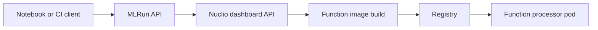

# `project.deploy_function()` Cannot Submit a Deployment: How to Trace MLRun-to-Nuclio API Routing

Author: [nawazdhandala](https://www.github.com/nawazdhandala)

Tags: MLOps, Nuclio, Kubernetes, Troubleshooting

Description: Trace a failed MLRun deploy_function request through the client, MLRun API, Nuclio dashboard, image build, and function readiness before changing endpoints.

A failure from `project.deploy_function()` can happen before Nuclio receives anything. It can also happen after Nuclio accepted the function but could not build its image. Those situations need different fixes, even when both appear as a deployment error in the notebook.

MLRun's [project implementation](https://docs.mlrun.org/en/stable/_modules/mlrun/projects/project.html) describes `deploy_function()` as the operation for real-time Nuclio-based functions. Confirm that the selected function uses that runtime; a Kubernetes training job belongs to the job execution path instead.

## Locate the last successful boundary

Start with the exception's request URL, HTTP status, project, function name, and timestamp. Keep bearer tokens and serialized secrets out of copied logs. Record the SDK, MLRun server, and Nuclio versions because request routing and authentication behavior can change across releases.



This depicts the usual remote deployment path. Local or explicitly configured development flows can differ. Follow the actual traceback and server logs instead of forcing every installation into the diagram.

Ask whether the MLRun API logged the request and whether a matching Nuclio function appeared. No function object suggests a submission or authorization problem. A function in an error state with build logs suggests the request reached Nuclio and failed later.

## Confirm the client reaches MLRun

Verify the effective `MLRUN_DBPATH` against the platform's API address. It should not be replaced with the Nuclio dashboard URL. A successful read-only project lookup establishes more than a browser opening the MLRun UI.

A 404 for `/api/v1/client-spec` belongs to client-to-MLRun routing and should be resolved before function deployment. A 401 or 403 needs an authentication or project permission check. Preserve the responding service's error body so an ingress rejection is not mistaken for Nuclio rejecting a function specification.

MLRun's [client setup documentation](https://docs.mlrun.org/en/stable/setup-guide.html) explains the API endpoint and remote credentials. Check the notebook kernel's loaded settings, including any environment file, rather than only the terminal environment.

## Check the server-to-Nuclio hop

The address reachable from your laptop is not necessarily the address the MLRun API should use inside Kubernetes. `localhost` in the MLRun pod refers to that pod, and an external dashboard route can introduce authentication or routing requirements absent from the internal service route.

Inspect the deployed MLRun configuration and the release's Nuclio integration. The [Nuclio runtime source](https://docs.mlrun.org/en/stable/_modules/mlrun/runtimes/nuclio/function.html) includes dashboard-address resolution for deployment status. Change the setting at the component that makes the failing request; changing a notebook variable cannot repair an unrelated server-side endpoint.

Use your actual namespace and discovered object names for these read-only checks:

```bash
kubectl -n default-tenant get services
kubectl -n default-tenant get endpointslices
kubectl -n default-tenant get pods
kubectl -n default-tenant get nucliofunctions
```

Match the dashboard service selector with ready pods and endpoints. Inspect network policy and DNS from the MLRun side when logs show connection refusal, resolution failure, or timeout. Do not assume a successful browser session proves pod-to-service connectivity.

## Move to build diagnosis only after submission works

Nuclio performs the image build as part of deployment, as the [MLRun image-build guide](https://docs.mlrun.org/en/stable/runtimes/image-build.html#deploying-nuclio-functions) explains. Once a function exists, inspect its state and build logs for package installation, base-image access, and registry push errors.

```bash
kubectl -n default-tenant describe nucliofunction FUNCTION_NAME
kubectl -n default-tenant logs POD_NAME --all-containers --since=15m
```

Discover the relevant dashboard, controller, builder, or processor pod before using the log command. An image build succeeds under push credentials, while the resulting processor still needs pull access. A healthy dashboard does not establish either permission.

Avoid resubmitting rapidly under new names. That creates multiple partial functions and makes it harder to correlate logs with one attempt. Keep one controlled test deployment and record its identity across components.

## Confirm readiness and invocation

After the route is repaired, redeploy a minimal function in an authorized test project. Verify that the request is accepted, the image is produced, the processor becomes ready, and a normal invocation succeeds through its intended route.

Deployment and invocation URLs are separate. A successful deployment does not prove that an external caller can reach the function, and an old working invocation URL does not prove that a new deployment reached Nuclio. Keeping those outcomes separate makes the remaining failure specific enough to fix.
