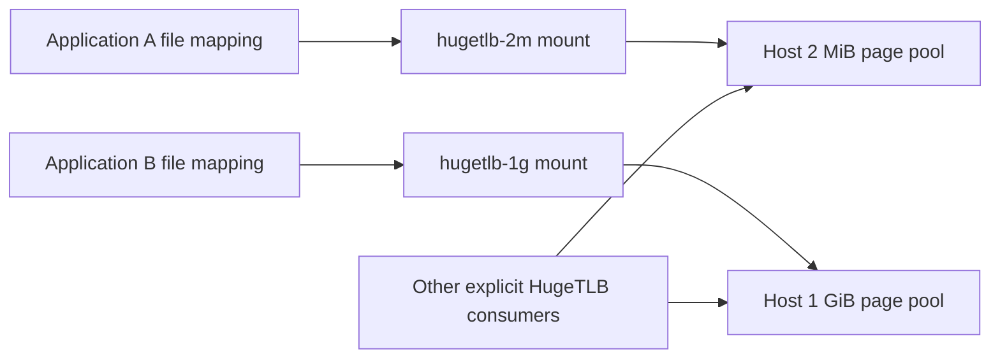

# Run 2 MiB and 1 GiB Huge Page Pools with Separate hugetlbfs Mounts

Author: [nawazdhandala](https://www.github.com/nawazdhandala)

Tags: Linux, HugePages, Memory Management

Description: Configure separate hugetlbfs mounts for 2 MiB and 1 GiB pages, distinguish filesystem limits from pool capacity, and test file-backed mappings safely.

Two applications can need different huge-page sizes on the same Linux host. One may use many moderately sized buffers; another may expect large, long-lived mappings. Giving each application an explicitly sized hugetlbfs mount makes that choice visible in configuration.

There are three separate settings to get right: physical page pools, filesystem mounts, and application paths. Creating a mount does not create its backing pool. Creating a second mount of the same page size does not create a second independent pool either.

This example follows **Linux 6.12** interfaces on a staging host that supports both 2 MiB and 1 GiB HugeTLB pages. It uses standard Linux mount tools and Python 3 for a small mapping probe. Administrative commands change only two new, dedicated mount paths; do not reuse directories already holding application data.

## Plan the two pools before mounting anything

Use this example budget only after confirming that the host has sufficient ordinary memory left for its other work:

| Page size | Planned page count | Physical capacity | Mount path |
|---|---:|---:|---|
| 2 MiB | 512 | 1 GiB | `/mnt/hugetlb-2m` |
| 1 GiB | 4 | 4 GiB | `/mnt/hugetlb-1g` |

A reviewed boot configuration can request these pools with:

```text
hugepagesz=2M hugepages=512 hugepagesz=1G hugepages=4
```

This is a kernel-argument fragment, not a command to execute. Preserve existing arguments and use your distribution's boot-management procedure. After the planned restart, verify the actual counts. Supported sizes and allocation success depend on the system. The [HugeTLB administration guide](https://www.kernel.org/doc/html/v6.12/admin-guide/mm/hugetlbpage.html) documents these size/count pairs and the per-size sysfs interface.

```bash
for size in 2048 1048576; do
    pool="/sys/kernel/mm/hugepages/hugepages-${size}kB"
    printf '\n%s\n' "$pool"
    for field in nr_hugepages free_hugepages resv_hugepages; do
        printf '%s=' "$field"
        cat "$pool/$field"
    done
done
```

The planned totals are 512 and four. Free counts may be lower once consumers start, and outstanding reservations may already commit some free pages. Resolve missing directories or inadequate capacity before moving on.



The last two arrows matter: separate paths provide a clear page-size choice, but other consumers can still compete for the corresponding host pool.

## Create mounts with explicit ownership and sizes

The following lab uses the current user's UID and primary GID so that the probe can run without elevated privileges. For a service deployment, substitute the intended service account's numeric IDs.

Before creating directories, inspect `/mnt` and confirm that both chosen paths are new, empty locations. Then run:

```bash
lab_uid=$(id -u)
lab_gid=$(id -g)
sudo mkdir /mnt/hugetlb-2m /mnt/hugetlb-1g
sudo mount -t hugetlbfs \
    -o "pagesize=2M,size=1G,uid=$lab_uid,gid=$lab_gid,mode=0700" \
    none /mnt/hugetlb-2m
sudo mount -t hugetlbfs \
    -o "pagesize=1G,size=4G,uid=$lab_uid,gid=$lab_gid,mode=0700" \
    none /mnt/hugetlb-1g
```

Stop if a command fails; do not repeatedly mount over an existing mount. The ordinary `mount -t ... -o ...` form is documented by [mount](https://man7.org/linux/man-pages/man8/mount.8.html).

`pagesize` selects the pool. `size` sets a maximum amount this filesystem can use. Here, each mount's ceiling matches its planned pool capacity, but that ceiling is not an exclusive entitlement. The kernel also supports `min_size`, which reserves capacity for a filesystem at mount time; this example deliberately omits that additional reservation policy. The [Linux 6.12 hugetlbfs implementation](https://raw.githubusercontent.com/torvalds/linux/v6.12/fs/hugetlbfs/inode.c) contains the option parsing and reservation handling.

The UID, GID, and mode apply to the mounted filesystem's root. Permissions on the underlying directory alone do not describe access after mounting. Avoid world-writable access simply to make a test pass.

## Confirm the exact mountpoints and application view

Inspect both mountpoints explicitly:

```bash
findmnt --mountpoint /mnt/hugetlb-2m --output TARGET,FSTYPE,OPTIONS
findmnt --mountpoint /mnt/hugetlb-1g --output TARGET,FSTYPE,OPTIONS
```

Expect `hugetlbfs` at each target and the corresponding page-size option. Numeric values may be displayed in normalized units. `--mountpoint` checks the named mountpoint; `--target` can instead identify the filesystem containing a path, which might be the ordinary parent filesystem if the intended mount is absent. This distinction and explicit output columns are documented by [findmnt](https://man7.org/linux/man-pages/man8/findmnt.8.html).

Perform the check in the same mount namespace as the application. A container may see a different path or no mount at all, even when the host configuration is correct. Confirm access using the application's account before testing memory allocation.

## Exercise a file-backed mapping

Save this as `hugetlb-probe.py`. It creates a temporary backing file in the selected directory, sets its length, maps it, and writes distinct bytes at its endpoints:

```python
import argparse
import mmap
import os
import tempfile

parser = argparse.ArgumentParser()
parser.add_argument("directory")
parser.add_argument("page_size", choices=("2M", "1G"))
args = parser.parse_args()
length = {"2M": 2 * 1024**2, "1G": 1024**3}[args.page_size]
with tempfile.TemporaryFile(dir=args.directory) as backing:
    os.ftruncate(backing.fileno(), length)
    with mmap.mmap(backing.fileno(), length, flags=mmap.MAP_SHARED,
                   prot=mmap.PROT_READ | mmap.PROT_WRITE) as region:
        region[0] = 17
        region[-1] = 29
        assert region[0] == 17 and region[-1] == 29
        print(f"Mapped and touched endpoints of {length} bytes")
```

Python documents the Unix [mmap constructor](https://docs.python.org/3.12/library/mmap.html), [file-length operation](https://docs.python.org/3.12/library/os.html#os.ftruncate), and [temporary-file lifecycle](https://docs.python.org/3.12/library/tempfile.html). On Unix, `TemporaryFile` uses an unnamed file or immediately removes its directory entry. The contexts close the mapping and file when the probe finishes normally.

Run these separately, after verifying each mount and confirming at least one page is available for the test:

```bash
python3 hugetlb-probe.py /mnt/hugetlb-2m 2M
python3 hugetlb-probe.py /mnt/hugetlb-1g 1G
```

Expected successful messages report 2,097,152 and 1,073,741,824 bytes. The second test consumes a full 1 GiB huge page while it runs; it is not a two-byte physical-memory test. Run it only where that temporary capacity is available.

The script's size argument does not force the filesystem to use that size. The verified mount supplies that behavior. Running it in `/tmp` can succeed with ordinary pages and proves nothing about HugeTLB. Likewise, passing `2M` to the 1 GiB mount is not the intended test.

The file-backed mapping does not need the anonymous `MAP_HUGETLB` flag: its hugetlbfs file determines the backing. Applications using anonymous HugeTLB mappings or System V huge shared memory may not use these mount paths at all. Confirm the application's actual allocation interface before expecting a path change to affect it.

## Make only the verified configuration persistent

After the staging tests, you can represent the mounts in `/etc/fstab`. The numeric ID `1001` below is an example; replace both UID and GID with the actual service values:

```fstab
none /mnt/hugetlb-2m hugetlbfs pagesize=2M,size=1G,uid=1001,gid=1001,mode=0700 0 0
none /mnt/hugetlb-1g hugetlbfs pagesize=1G,size=4G,uid=1001,gid=1001,mode=0700 0 0
```

Review existing entries before adding these. The final fields disable dump and filesystem checking for these pseudo filesystems. On systemd hosts, reload generated unit configuration after editing fstab, and make the consuming service depend on its mount. See the [fstab format and reload guidance](https://man7.org/linux/man-pages/man5/fstab.5.html). Mount persistence and pool reservation remain separate configurations.

A final acceptance test should start the real application with the appropriate mount path, observe the matching pool, and test its full working-set demand. If creation fails, investigate ownership and namespace visibility. If mapping fails, inspect that size's reservations, mount ceiling, and eligible NUMA capacity. Successful setup of the other size does not resolve those constraints.

The published probe was executed against ordinary temporary files on macOS to check its file lifecycle, endpoint assertions, and argument handling. No Linux mount or HugeTLB allocation was executed for this article; those tests must be completed on the target staging host.
