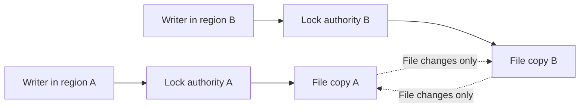

# Cross-Region File Storage: Why Replication Is Not Shared Locking

Author: [nawazdhandala](https://www.github.com/nawazdhandala)

Tags: File Storage, Disaster Recovery, High Availability

Description: Separate replicated bytes from locks, caches, and write ownership before designing cross-region file access or promoting a disaster recovery replica.

Two regions have the same directory tree. Applications can mount a share in either region. It is tempting to call that active-active storage and send users to whichever endpoint responds fastest.

The difficult question is what happens when both users edit the same file, or when the regions stop communicating. Having two copies does not establish one shared decision about who may write. A safe design must explain data replication, locking, cached reads, and ownership during failure separately.

## Define exactly what is active in both regions

“Active-active” can describe several different arrangements. Write down which one you mean before choosing a replication product:

| Arrangement | What must be proved |
| --- | --- |
| Both regions read published, immutable files | Readers identify the intended version and tolerate publication delay |
| Both regions write different owned directories | Ownership is enforced and files do not cross owners without coordination |
| One region writes; another is a recovery replica | Promotion fences the old writer and accepts a defined recovery point |
| Both regions modify the same files | The service coordinates conflicting operations across the actual failure boundary |

The last row needs more than a synchronization schedule. Ask the vendor what happens to a lock acquired in region A when region B requests a conflicting lock. Then ask the same question while communication between the regions is unavailable. Require an answer for the exact protocol and product configuration you will deploy.

## A local lock cannot coordinate an independent replica

Imagine a counter file containing `100`. Region A locks its local copy, reads it, and writes `101`. At the same time, region B locks its own copy and also writes `101`. Both local lock operations can be correct while the combined result loses an increment.

This is an illustrative failure model, not a claim about every distributed filesystem. It describes independent lock authorities connected only by file replication:



Microsoft explicitly documents that DFS Replication does not provide distributed locking. Conflicting edits can be resolved by selecting one file version; the conflict directory is not guaranteed permanent retention. That resolves replication convergence, not the application's lost update. [DFS Replication FAQ](https://learn.microsoft.com/en-us/windows-server/storage/dfs-replication/dfsr-faq).

Likewise, CephFS snapshot mirroring in the **Reef documentation** asynchronously copies snapshots to a remote filesystem. Its documented unit of replication is snapshot data, not a promise of shared live locks between independent clusters. Evaluate that feature as a recovery mechanism rather than assuming the word “mirroring” establishes concurrent write safety. [CephFS snapshot mirroring](https://docs.ceph.com/en/reef/cephfs/cephfs-mirroring/).

## Cache behavior remains part of correctness

A cache keeps previously fetched data or metadata near the application. Cache coherence describes how participants keep those views compatible with changes elsewhere. A copied file on a remote server does not necessarily invalidate an application's cached content, an open handle, or a protocol client's cached attributes.

NFSv4.1 has specific rules for caching, locks, delegations, and reclaiming state after server failure. A delegation lets a client perform some operations locally until the server recalls that permission. The protocol does not promise unrestricted distributed cache coherence. Read its actual guarantees before assuming an endpoint change makes existing clients see a new filesystem consistently. [RFC 8881, sections 9.11 and 10](https://www.rfc-editor.org/rfc/rfc8881.html#section-10).

For your application, identify the consistency boundary. Does it reopen the file for each request? Hold a handle for hours? Cache parsed configuration in memory? Update several files as one logical transaction? Even perfect copying of individual files does not establish the application's transaction boundary.

## Inspect a replica without promoting it

Amazon EFS provides a concrete example of regional disaster recovery rather than two independently writable copies. Its replication destination is read-only while replication is configured. The service exposes the last successful synchronization time. [EFS replication details](https://docs.aws.amazon.com/efs/latest/ug/monitoring-replication-status.html).

The following read-only command is checked against **AWS CLI 2.38.1**. You need configured AWS credentials with permission to describe EFS replication, the source filesystem identifier, and its region. Replace both example values:

```bash
aws efs describe-replication-configurations   --file-system-id fs-0123456789abcdef0   --region eu-west-1   --query 'Replications[].{Source:SourceFileSystemId,Destinations:Destinations[].{Region:Region,FileSystemId:FileSystemId,Status:Status,LastReplicatedTimestamp:LastReplicatedTimestamp}}'   --output json --no-cli-pager
```

The output should identify the source, destination, replication status, and timestamp. The projection deliberately keeps every returned destination rather than silently selecting the first response item. An empty result or missing timestamp is evidence to investigate, not a zero-lag result. [CLI command and response fields](https://docs.aws.amazon.com/cli/latest/reference/efs/describe-replication-configurations.html).

Compare the reported timestamp with the incident time and your required recovery point objective, or RPO: the maximum acceptable period of lost changes. AWS states that changes before the reported synchronization point have replicated, while later changes may not have. EFS replication does not transfer changes as a point-in-time consistent application snapshot. A healthy status therefore does not establish application recovery correctness by itself. [EFS replication behavior](https://docs.aws.amazon.com/efs/latest/ug/efs-replication.html).

## Promotion needs an enforceable ownership decision

A failed health check cannot prove that the old region stopped writing. Its application might still reach local storage while being unreachable from your control plane. Fencing means preventing the former owner from continuing conflicting access before a replacement takes ownership. ClusterLabs explains why an unresponsive node must not simply be assumed stopped. [Pacemaker fencing principles](https://clusterlabs.org/projects/pacemaker/doc/2.1/Clusters_from_Scratch/html/fencing.html).

For regional recovery, document the supported fencing mechanism and its evidence. This might involve controlled application shutdown plus enforced removal of write access, or the platform's supported failover orchestration. Merely changing DNS does not establish that existing writers have lost access. If fencing cannot be confirmed, the runbook needs a deliberate stop condition rather than automatic promotion.

Use a staged procedure:

1. Stop admitting new writes and establish the old owner's inability to continue conflicting writes.
2. Record the available recovery point and preserve evidence of any uncertainty or divergence.
3. Perform the product's supported promotion procedure.
4. Reconnect controlled test clients and verify identity, permissions, locking, reads, and application recovery.
5. Enable a small amount of controlled test traffic before restoring ordinary writers.

For EFS specifically, AWS documents making the replica writable by deleting its replication configuration. That is an operational state change with consequences, so it belongs in a reviewed product-specific runbook, not a generic one-line repair. [Using an EFS replica](https://docs.aws.amazon.com/efs/latest/ug/replication-fail-over.html).

## Rehearse disagreement, not just disconnection

In isolated staging, test a long-lived reader, competing writers, and a client that loses its connection during an update. Use uniquely numbered application operations so the team can identify missing or duplicate work. Capture lock results, application acknowledgments, content digests, and the chosen authoritative site.

The acceptance criteria should include more than “the mount works.” A single-owner design should demonstrate that the old owner cannot keep writing, the replacement serves the accepted recovery state, and clients recover without silently replaying an operation twice. A design advertising concurrent same-file writes must demonstrate its documented conflict behavior under a partition.

Finally, rehearse failback. After the recovery region accepts writes, it contains newer authoritative data. Reconnecting the original replica direction can overwrite those changes if the wrong source is selected. EFS explicitly distinguishes preserving replica changes by copying them back from discarding them when restoring the original direction. Choose that outcome deliberately and preserve divergent data for review. [EFS failback choices](https://docs.aws.amazon.com/efs/latest/ug/replication-fail-over.html).

The command projection above was checked locally with generated and synthetic responses, not against a live regional deployment. Treat the proposed failure exercise as your acceptance plan. The design is ready when the team can explain who owns each write before, during, and after a partition, and can demonstrate that answer with the actual storage service and application.
