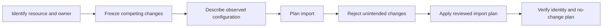

# Adopt Existing Cloud Resources Without Recreating Them

Author: [nawazdhandala](https://www.github.com/nawazdhandala)

Tags: Terraform, Cloud Automation, Infrastructure as Code

Description: Import existing infrastructure into Terraform with explicit ownership, matching configuration, and an import-only review gate that prevents accidental replacement.

An existing network already serves production traffic. You want Terraform to manage it, but the first plan proposes changing tags, DNS settings, or even replacing a resource. That is not a harmless bookkeeping step.

Adoption should begin by describing the resource as it exists and associating its physical identity with one automation owner. Configuration improvements can follow in separate reviewed changes. This tutorial uses a narrowly scoped AWS VPC example with Terraform 1.11.4 and AWS provider 6.25.0.

## Establish who owns the resource today

Before importing, inspect the current deployment systems, state stores, service catalogs, and operational procedures. A resource created manually is different from one already managed by another Terraform root or CloudFormation stack.

Do not import the same object into two active states. If another system owns it, plan an ownership transfer with that system paused and its configuration updated through the appropriate retention or state-transfer procedure. Otherwise its next reconciliation may fight your new configuration.

Record the physical resource ID, account, Region, dependent workloads, and existing owner. Back up relevant state and freeze competing changes during the adoption window. The [Terraform import documentation](https://developer.hashicorp.com/terraform/language/import/single-resource) explains the relationship between an existing object, its destination address, and state.



## Separate Terraform names from cloud names

A Terraform address such as `aws_vpc.adopted` is the configuration's identity for an object. It does not mean the cloud resource must be renamed to “adopted.” Physical naming attributes and tags are separate provider arguments.

Changing a local block label later also needs state-aware handling. For an address change within the applicable configuration, a `moved` block can describe the transition without treating the old address as a deletion and the new one as creation. That is different from importing an unmanaged object. See [Terraform module refactoring](https://developer.hashicorp.com/terraform/language/modules/develop/refactoring).

Choose a durable address before import. Avoid combining adoption, module restructuring, naming cleanup, and policy changes in the same plan; each makes it harder to identify an unintended mutation.

## Describe one simple VPC exactly

This example is limited to an existing, non-default, IPv4 VPC with default tenancy, no IPAM allocation, no IPv6 configuration, and network-address-usage metrics disabled. A VPC is an isolated virtual network. IPAM is AWS's IP address management service.

For resources outside that scope, extend the configuration from observed properties and the pinned provider schema before planning. Do not force the resource to match this example's assumptions.

Save this as `main.tf` in a dedicated reviewed root. Configure your organization's protected backend before a real adoption; the snippet omits backend configuration because storage and access settings are organization-specific.

```hcl
terraform {
  required_version = "= 1.11.4"
  required_providers {
    aws = {
      source  = "hashicorp/aws"
      version = "= 6.25.0"
    }
  }
}

variable "observed" {
  type = object({
    account_id           = string
    region               = string
    vpc_id               = string
    cidr_block           = string
    enable_dns_support   = bool
    enable_dns_hostnames = bool
    tags                 = map(string)
  })
  nullable = false
}

provider "aws" {
  region              = var.observed.region
  allowed_account_ids = [var.observed.account_id]
}

resource "aws_vpc" "adopted" {
  cidr_block           = var.observed.cidr_block
  instance_tenancy     = "default"
  enable_dns_support   = var.observed.enable_dns_support
  enable_dns_hostnames = var.observed.enable_dns_hostnames
  tags                 = var.observed.tags

  lifecycle {
    prevent_destroy = true
  }
}

import {
  to = aws_vpc.adopted
  id = var.observed.vpc_id
}
```

Create an `observed.auto.tfvars` file containing an `observed` object with those fields. Populate it from verified inventory: the real account and Region, VPC ID, current CIDR address range, both DNS flags, and the existing managed tags. Do not copy another environment's values or guess defaults.

The import target uses the VPC ID, as documented in the [AWS provider 6.25.0 VPC reference](https://raw.githubusercontent.com/hashicorp/terraform-provider-aws/v6.25.0/website/docs/r/vpc.html.markdown). `allowed_account_ids` checks the provider's account against the approved account; its behavior is documented in the [same version's provider reference](https://raw.githubusercontent.com/hashicorp/terraform-provider-aws/v6.25.0/website/docs/index.html.markdown).

Pay attention to provider-level default and ignored tags in an existing root. They affect which tags Terraform intends to manage. An empty tags map is not a general instruction to preserve everything already present.

## Plan adoption before applying it

Use authorized credentials for the intended account, then initialize and validate:

```bash
terraform init
terraform validate
terraform plan -out=adopt.tfplan
terraform show adopt.tfplan
```

`init` installs the pinned provider and initializes the configured backend. Keep the resulting dependency lock file with the configuration. `validate` checks configuration consistency; it does not establish that the target exists or that its settings match.

The plan reads the actual resource and previews the import plus any changes required by configuration. Inspect every action. The acceptance target is one intended import with no resource additions, updates, deletions, or replacements. If any mutation appears, stop and resolve the mismatch before applying.

A plan that changes DNS flags or removes a Name tag still changes infrastructure even if it does not replace the VPC. Do not approve it merely because the destroy count is zero. Terraform documents saved plans in its [plan command reference](https://developer.hashicorp.com/terraform/cli/commands/plan) and inspection in [terraform show](https://developer.hashicorp.com/terraform/cli/commands/show).

After reviewing the exact saved plan and confirming the maintenance window still holds, apply that artifact:

```bash
terraform apply adopt.tfplan
```

This command changes Terraform state and performs any actions present in the plan. Passing a saved plan does not ask for another interactive approval; see the [apply command reference](https://developer.hashicorp.com/terraform/cli/commands/apply). Protect the plan artifact because it can contain sensitive values. If the environment or configuration changed during review, generate and review a fresh plan instead.

## Use generated configuration as a draft

Terraform can generate configuration from import declarations with `terraform plan -generate-config-out=generated.tf` when corresponding resource configuration is absent. Use a new output filename and inspect the result before treating it as maintained code. Do not run that as an extra generation step against the already-declared resource above.

Generated fields still need review for defaults, sensitive values, unsupported combinations, and module conventions. The generator cannot decide your ownership boundary or tell you which externally managed fields should remain outside this root. See [configuration generation for imports](https://developer.hashicorp.com/terraform/language/import/generating-configuration).

Likewise, `prevent_destroy` is an additional guard, not a complete adoption review. It can block destruction while configured, but does not prevent in-place changes and is not a substitute for preserving state ownership.

## Verify the post-adoption state

After applying the reviewed import, confirm the Terraform address maps to the same physical VPC ID and that dependent workloads remain healthy. Run a fresh ordinary plan and expect no changes. Keep the import block as historical context if useful; it should not require recreating the resource.

Importing a VPC does not automatically bring its subnets, route tables, gateways, or security groups under management. Inventory and adopt related resources separately, using each resource type's documented import identity. Do not assume that an entire network became managed because one VPC address appears in state.

If adoption exposes unexpected changes, preserve the state and plan evidence. Do not restore an old state snapshot blindly or remove state entries just to silence a diff; either can reintroduce conflicting ownership or hide real changes.

For this tutorial, the pinned configuration was initialized and validated locally. No AWS resource was read, planned for import, or adopted. A real acceptance run must establish the import-only plan, unchanged physical identity, healthy dependents, and a clean subsequent plan before the new automation owner takes over routine changes.
