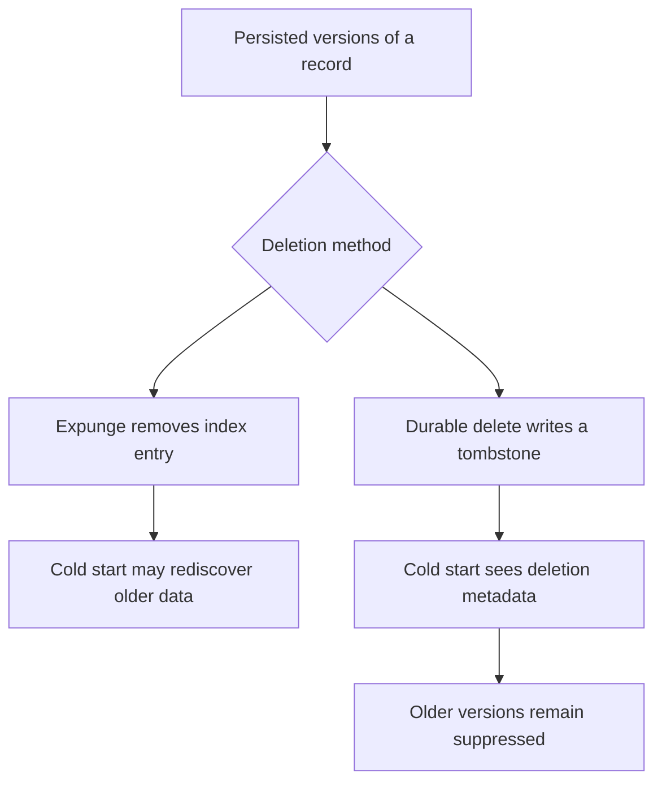

# Prevent Deleted Aerospike Records from Returning After a Cold Start

Author: [nawazdhandala](https://www.github.com/nawazdhandala)

Tags: Aerospike, Database, Java, Troubleshooting

Description: Understand Aerospike record resurrection, use durable delete policies, and choose safe recovery checks for tombstones, truncation, and cold starts.

A successful delete followed by a not-found read seems conclusive. Then a node cold-starts, and an old record returns. The delete may have removed the record's index entry without recording a persistent deletion marker. Rebuilding the index can rediscover an older stored copy.

Aerospike calls these resurrected records “zombie records.” The response should address how deletion is represented and how nodes return to service. Repeatedly deleting the visible record, or restarting other nodes to make them agree, can obscure the evidence without establishing a durable deletion policy.

This guide targets **Aerospike Database Enterprise Edition 8.2** and uses **Java client 10.5.0** for the example. Community Edition does not provide the same durable-delete behavior; the edition distinction is essential to the design.

## Understand what a cold start rebuilds

The primary index maps keys to stored records. A cold start reconstructs that index by scanning namespace storage. Multiple persisted versions may exist until background storage reclamation overwrites obsolete data. An expunge, Aerospike's term for a non-durable delete, removes the index entry without leaving the durable marker needed to suppress earlier copies during reconstruction. [Cold restart documentation](https://aerospike.com/docs/database/manage/database/cold-start/)



A tombstone is a record of deletion. It participates in version comparison even though normal reads do not return it as application data. It is not merely an audit message in a log. [Durable delete architecture](https://aerospike.com/docs/database/learn/architecture/durable-deletes/)

A warm restart retains the existing index and follows a different path. Avoiding a cold start can reduce exposure during planned maintenance, but it does not repair missing deletion history. A future failure may still require index reconstruction.

## First rule out a new write or a restore

Before attributing the incident to storage reconstruction, collect a small, precise evidence set:

- The namespace, set, key or digest, and affected node identities.
- The deletion result, time, and actual policy used by the application.
- Restart logs showing whether the node performed a cold start.
- The returned record's generation, last-update metadata where available, and business timestamps.
- Any application retries, scheduled imports, backup restores, or replication flows that could recreate it.

A legitimate new write after a deletion is different from an old stored version returning. Likewise, restoring a backup taken before deletion can intentionally reintroduce that data. Preserve application deletion history long enough to reconcile recovery operations with the business system of record.

Use read-only information requests for the server-side context. With Aerospike tools installed, replace this node address and namespace, and supply your normal authentication and TLS options:

```bash
asinfo -h 10.20.0.11 -p 3000 -v build
asinfo -h 10.20.0.11 -p 3000 \
  -v 'get-config:context=namespace;namespace=test' -l
asinfo -h 10.20.0.11 -p 3000 -v 'namespace/test' -l
```

Keep complete output from every relevant node. Configuration helps establish consistency and conflict-resolution settings; namespace statistics include tombstone information. These commands do not establish whether one particular historical deletion was durable. [Info command reference](https://aerospike.com/docs/database/reference/info/)

## Make the delete policy explicit

The default Java write policy does not request durable deletion. Set `durableDelete` on the policy passed to the operation that actually deletes the record, including paths that remove its last bin. A bin is an Aerospike record field. Setting a policy on an unrelated earlier write is not sufficient. [Java delete documentation](https://aerospike.com/docs/develop/client/java/usage/atomic/delete/)

This helper compiles with Maven dependency `com.aerospike:aerospike-client-jdk8:10.5.0`. It assumes an authenticated client connected to a supported Enterprise server. Run it only for a disposable staging key until your application's deletion authorization and error handling are in place.

```java
import com.aerospike.client.AerospikeClient;
import com.aerospike.client.Key;
import com.aerospike.client.policy.WritePolicy;

public final class DurableRecordDelete {
    public static WritePolicy policy(WritePolicy base) {
        WritePolicy copy = new WritePolicy(base);
        copy.durableDelete = true;
        copy.maxRetries = 0;
        return copy;
    }

    public static boolean deleteTestKey(AerospikeClient client,
                                        Key testKey, WritePolicy base) {
        return client.delete(policy(base), testKey);
    }
}
```

The copied policy preserves your supplied settings and leaves the shared policy unchanged. Automatic retries are disabled so this example does not silently establish a retry policy for deletion. A timeout requires explicit reconciliation: the server might have applied the delete before the response was lost. Do not blindly repeat an old deletion after another writer may have created a new record under the same key.

The client's boolean return reports whether the record existed for the delete operation. It does not certify that every historical version across every disconnected node has been erased. The field and defaults are documented in the [pinned WritePolicy source](https://github.com/aerospike/aerospike-client-java/blob/10.5.0/client/src/com/aerospike/client/policy/WritePolicy.java).

## Choose per-record deletion or truncation deliberately

| Requirement | Appropriate mechanism | Boundary to check |
|---|---|---|
| Delete selected business records | Explicit durable-delete policy | Supported edition and every deletion code path |
| Remove a whole set or namespace, possibly before a cutoff | Truncation | Exact target, cutoff, edition, and concurrent writers |
| Expire cache records naturally | TTL and namespace cleanup | Expiry is not a durable-delete substitute |

Enterprise truncation persists a cutoff in shared cluster metadata rather than requiring a client to delete every key individually. It applies to records older than the chosen last-update-time cutoff. Community truncation does not provide the same protection across cold starts. The [truncate reference](https://aerospike.com/docs/database/reference/info/#truncate) documents scope, permissions, and edition behavior.

Truncation is therefore not a general repair for a handful of resurrected records. Review the precise set or namespace, confirm backups and retention requirements, control concurrent writers, and use the documented administrative workflow only when that broad removal is intended. Do not issue truncate-undo as a troubleshooting experiment: removing the cutoff can allow older data to return.

## Protect the surrounding lifecycle

Durable deletes depend on accurate clocks and appropriate conflict resolution. Aerospike recommends last-update-time conflict resolution for correct durable-delete propagation across cluster changes, with strong consistency for workloads sensitive to network partitions. Tombstones consume resources and remain until the tomb-raider process can safely remove them. [Durable delete requirements](https://aerospike.com/docs/database/learn/architecture/durable-deletes/)

A long-offline node deserves special handling. If its deletion markers have already been reclaimed elsewhere, its old data can be unsafe to reintroduce. Use the documented node-replacement procedure after verifying healthy replicas and backups; do not reconnect an old disk simply because the process starts. The [retention guide's old-node discussion](https://aerospike.com/docs/database/manage/namespace/retention/) explains this boundary.

Also investigate TTL reductions. Shortening a newer version's lifetime can leave an older version with a later expiry on storage. Enterprise Database 8.1 introduced `apply-ttl-reductions`; setting it to false prevents such reductions. Assess the business impact before changing it, since it can retain data longer than an application requested. [Configuration reference](https://aerospike.com/docs/database/reference/config/)

## Rehearse the recovery path in isolation

For a disposable Enterprise staging dataset, create uniquely identifiable records, delete selected keys durably, and confirm ordinary reads no longer return them. Observe tombstone statistics and retain the exact policy and deletion results. Then exercise the documented cold-start procedure on an isolated test node, with backups and recovery capacity prepared, and confirm deleted keys stay absent while retained keys survive.

Repeat the scenario for the actual maintenance or restore path your team uses. An application policy change protects future operations; it does not retroactively prove that previously expunged records are safe. Reconcile those records against an authoritative deletion ledger and develop a reviewed remediation plan.

The Java helper was compiled and its policy construction tested locally. No deletion, restart, or restore was executed against an Aerospike server. Treat the rehearsal above as an acceptance test to perform before relying on the recovery design.
