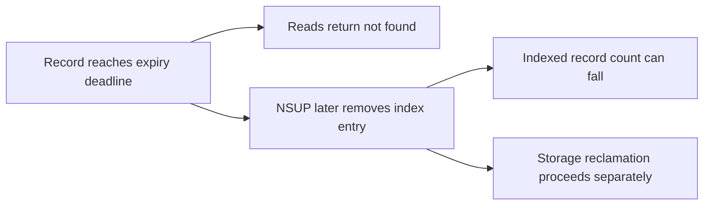

# Why Expired Aerospike Records Still Appear in Counts

Author: [nawazdhandala](https://www.github.com/nawazdhandala)

Tags: Aerospike, Database, Monitoring, Troubleshooting

Description: Diagnose Aerospike expiry discrepancies by separating read visibility, NSUP cleanup, replica counts, and delayed storage reclamation.

Your application writes temporary records with a ten-minute lifetime. Fifteen minutes later, reads return “not found,” but the dashboard still shows more records than expected. Restarting the cluster or lowering retention again would be a poor first response. You need to establish what the dashboard actually counts.

Aerospike separates the decision to return a record from the background work that removes it from indexes and reclaims storage. Those stages finish at different times. This guide develops a read-only investigation using the current documented metrics, with **Database 8.2** as the reference version. Check metric availability against your installed release before copying a dashboard query.

## Follow one expired record through the system

A record's time to live (TTL) establishes its expiry deadline. Reads check that deadline. Aerospike documents that a record already past expiry returns “not found” even between namespace supervisor runs; batches and scans also enforce expiry. A dashboard count is therefore not evidence that an expired record remains readable. [Aerospike support: TTL checks on reads](https://support.aerospike.com/hc/en-us/articles/49939338965915-Is-TTL-checked-on-a-read)

The namespace supervisor, abbreviated NSUP, removes expired records from the primary index. The primary index is the lookup structure used to locate records. Device defragmentation subsequently deals with obsolete stored versions and reusable storage blocks. [Namespace retention guide](https://aerospike.com/docs/database/manage/namespace/retention/)



There is no single “expiry completed” timestamp that answers all three operational questions. Your application cares about visibility. Capacity planning cares about index and storage pressure. Your monitoring must expose both without suggesting they are interchangeable.

## Identify the count before explaining it

Inspect the actual dashboard query, including labels and aggregation. A panel named “records” might sum several nodes, include replica copies, or display a historical maximum. It may also be showing an exporter sample collected before the latest cleanup cycle.

The current [metrics reference](https://aerospike.com/docs/database/reference/metrics/) distinguishes:

| Metric | What it measures | Frequent mistake |
|---|---|---|
| `master_objects` | Records for which this node owns the master copy | Treating an indexed count as an exact live-record query |
| `prole_objects` | Replica records on the node | Adding these to master copies and calling the result unique records |
| `objects` | Namespace records on this node, excluding tombstones | Using this deprecated-since-8.1 metric without checking its scope |
| `expired_objects` | Cumulative records expired since this server started | Calling it the current cleanup backlog |
| `nsup_cycle_duration` | Duration of the last NSUP cycle, in seconds | Interpreting it as current progress or milliseconds |

A counter measures accumulated events; a gauge measures a current or most recently observed value. Subtracting `expired_objects` from `master_objects` is meaningless: the former includes historical removals, while the latter describes records currently represented on the node.

When comparing nodes, retain node identity. During migrations, ownership and physical copies change. Record the cluster membership and migration state alongside the samples instead of forcing a cluster-wide count to match a simplistic replication-factor formula.

## Capture evidence from every affected node

Use an account authorized for information requests and the normal TLS options required by your installation. The following Bash example assumes `asinfo` is installed. Replace the addresses and namespace; the commands only read server state.

```bash
for node in 10.20.0.11 10.20.0.12 10.20.0.13; do
  printf '\nNode %s\n' "$node"
  asinfo -h "$node" -p 3000 -v build
  asinfo -h "$node" -p 3000 \
    -v 'get-config:context=namespace;namespace=test' -l
  asinfo -h "$node" -p 3000 -v 'namespace/test' -l
done
```

The configuration response tells you whether cleanup is enabled. The namespace response supplies the statistics needed to compare cleanup activity with counts. Preserve the full output with a collection timestamp rather than filtering away unfamiliar fields immediately. The request formats are defined by the [info command reference](https://aerospike.com/docs/database/reference/info/).

Collect another sample after a meaningful observation interval. Check for process restarts before calculating counter deltas: a reset is not negative expiry activity. Also record application insert and update traffic. A steady object count can hide substantial cleanup when new records arrive at the same rate.

## Determine whether NSUP is disabled, slow, or simply between cycles

`nsup-period` is the interval between starts of primary-index expiry scans. Its default is zero, which disables NSUP. If a cycle lasts longer than the configured period, scans effectively run continuously. Reducing the period further does not make that already-running traversal faster. `nsup-threads` controls traversal concurrency. [Retention configuration](https://aerospike.com/docs/database/manage/namespace/retention/)

A positive TTL with `allow-ttl-without-nsup` enabled can leave you with expired records that are not being cleaned up by NSUP. That override is intended for testing. Correct the deployment configuration through your normal change process rather than making the dashboard hide the accumulation. The [configuration reference](https://aerospike.com/docs/database/reference/config/) describes startup safeguards and the effect of changing NSUP settings dynamically.

Use logs to tell a long active cycle from a completed one. The `nsup-done` entry reports cumulative and per-cycle expiry counts, and `total-ms` reports that completed cycle in milliseconds. This log field has different units from the seconds-based `nsup_cycle_duration` metric. The official [log reference](https://aerospike.com/docs/database/reference/logs/) explains both the expiration and eviction processing context.

Do not derive a strict cleanup deadline from `nsup-period` alone. A record can expire after the traversal has passed its index location. Traversal duration, scheduling, and workload all matter. Establish a normal range from completed cycles in your environment, then investigate departures from that range.

## Verify visibility using a controlled key

Choose a disposable test key with a known positive TTL and no writers renewing it. Record the successful creation time and returned expiry metadata. Disable read-touch behavior in your observing client so the test itself does not extend the record's lifetime; Java client 10.5.0 exposes this as `Policy.readTouchTtlPercent = -1`. [Pinned client policy source](https://github.com/aerospike/aerospike-client-java/blob/10.5.0/client/src/com/aerospike/client/policy/Policy.java)

Read the key before and after its deadline. Distinguish a genuine not-found result from a timeout, authentication failure, or wrong namespace. If it remains readable, investigate its actual expiry, renewal writes, client read-touch settings, and server clocks. NSUP lag alone does not explain a successful read of an already-expired record.

Then observe a completed cleanup cycle and the relevant counters. Run this experiment in a quiet staging namespace if you need precise count comparisons; a busy production namespace cannot isolate one key's contribution reliably. Do not scan the entire production dataset merely to validate a dashboard label.

## Keep storage reclamation as a separate investigation

If index counts decrease while operating-system memory stays high, cleanup may still be working. Aerospike retains primary-index arena allocations for reuse rather than returning them to the operating system during normal operation. A warm restart does not necessarily change that. [Aerospike support: memory after expiry](https://support.aerospike.com/hc/en-us/articles/56255268033051-Why-doesn-t-system-memory-usage-go-down-after-records-expire-or-are-deleted)

Likewise, device free space depends on storage reclamation, not just the disappearance of a key from reads. Investigate storage metrics and defragmentation separately before changing TTLs or restarting nodes.

A useful incident conclusion names the stage and evidence: “The test key is unreadable after its deadline; NSUP cycles are completing; expiry counters increase; remaining pressure is storage reclamation.” If cycles stop completing or counts rise without expected cleanup, preserve node-specific logs and configuration for investigation. That is a much stronger diagnosis than “TTL is broken.”

The commands and diagram here were checked locally for syntax and structure. No Aerospike cluster was exercised, so the observation steps are a staging procedure rather than reported production measurements.
